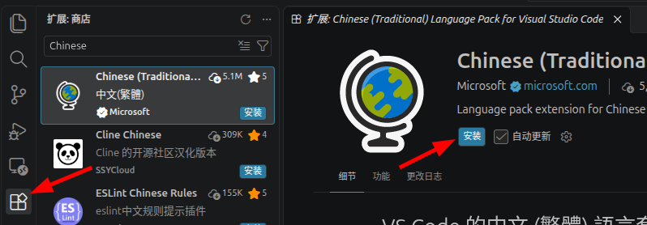
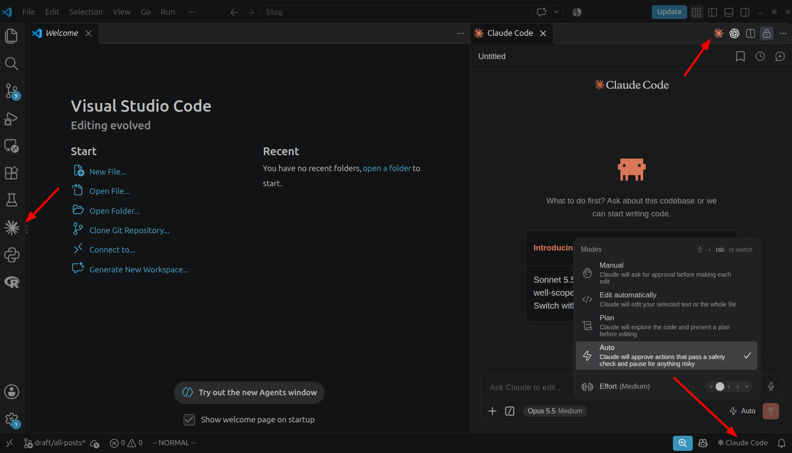
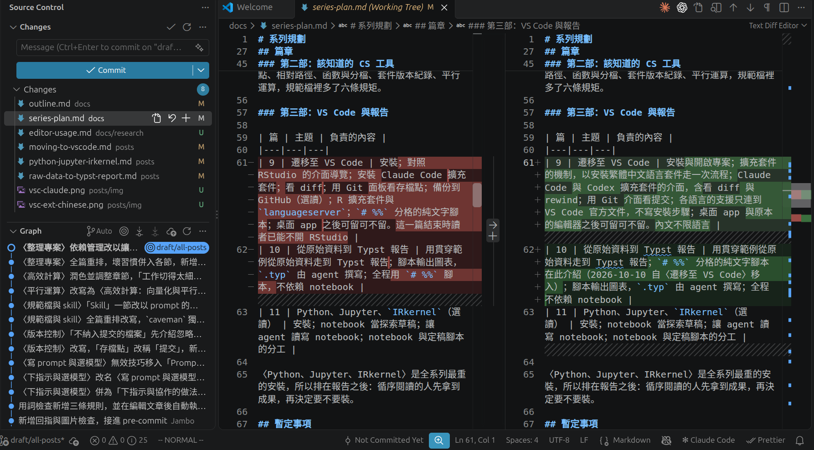

## 遷移的理由

至「該知道的 CS 工具」一部結束，工作是在兩個視窗之間進行的，agent 於桌面 app 內改檔，改完之後要看檔案、執行 R，則須切到 RStudio；而桌面 app 沒有 Git 面板，[[版本控制]]一篇以來的提交有哪些、各自改了什麼，都靠 agent 轉述。這套環境已經完整可用，如果覺得足夠，本系列讀到此處即可停下。

VS Code 是 Microsoft 的免費編輯器，也是目前使用最廣的一個，Stack Overflow 2026 年的[開發者調查](https://survey.stackoverflow.co/2026/technology/data)裡，約七成受訪者經常使用它；用的人多，擴充套件與教學也就多。它本身只負責開檔與編輯，其餘功能靠擴充套件補上。裝上 Claude Code 的擴充套件之後，編輯器、agent 與 Git 面板便在同一個視窗之內，agent 改了哪一行，旁邊的編輯器當場可見，提交也可自己翻看，不必再問。代價是多裝一個軟體、重新適應一套介面，因此本篇只寫給願意繼續的人。

遷移並不必捨棄原本的編輯器與桌面 app。RStudio 與 VS Code 開啟的是同一個資料夾，讀的是同一份 code 與同一組提交，哪一件事在哪邊順手便在哪邊做。桌面 app 也一樣，規範檔、skill 的做法與提交都跟著專案資料夾，並不綁定介面，留著它處理不需要看 code 的工作，或就此不再開啟，都無妨。

## 安裝 VS Code 與開啟專案

自[官方網站](https://code.visualstudio.com/)下載 Windows 版安裝程式，選項大致維持預設，只在 Select Additional Tasks 一頁多勾一項 Add "Open with Code" action to Windows Explorer directory context menu。勾選之後，於檔案總管對資料夾按右鍵即可用 VS Code 開啟它。

VS Code 沒有專案檔，開啟一個資料夾即是開啟專案，由 File 選單的 Open Folder 選取先前交給 agent 的那個資料夾，或於檔案總管對該資料夾按右鍵選 Open with Code。開啟的須是專案資料夾本身，不是其上一層裝著數個專案的資料夾，原因見[[整理專案]]一篇。初次開啟某個資料夾時會詢問是否信任其中的檔案，自己的專案選擇信任即可；如果選擇不信任，VS Code 會進入 Restricted Mode，Claude Code 擴充套件在此模式下無法運作。

視窗分為幾區，各區的名稱於[官方說明](https://code.visualstudio.com/docs/editing/getting-started/userinterface)有圖示。中央是 Editor，即編輯區，可左右並排數個檔案。最左側一排圖示稱為 Activity Bar，點選後於旁邊的 Primary Side Bar 展開對應的檢視，第一個圖示是 Explorer，列出專案資料夾內的檔案。編輯區下方是 Panel，其中的 Terminal 用來執行指令；最下方一列為 Status Bar。

另有一個入口是 Command Palette，按 `Ctrl+Shift+P` 開啟，輸入功能名稱的片段即可搜尋並執行，VS Code 的所有功能都可由此找到，記不得按鈕位置時由此處找。

## 擴充套件與語言套件

VS Code 本體的功能不多，開檔、編輯、搜尋、終端機與 Git 之外，其餘都由擴充套件（extension）提供，Claude Code、各種語言的支援都是擴充套件。擴充套件集中於 Marketplace，任何人都可以上架，多數免費，用到哪一項功能才裝哪一個，因此每個人的 VS Code 裝的東西都不相同。

安裝是在 Extensions 檢視裡進行，位於 Activity Bar，快捷鍵為 `Ctrl+Shift+X`。上方的搜尋框輸入名稱，結果逐列顯示名稱、發行者與安裝次數，點選其中一列，編輯區開啟它的說明頁，按 Install 即安裝，多數裝完立即生效。已安裝的列於同一個檢視的 Installed 之下，每一列的齒輪圖示內有 Disable 與 Uninstall，前者暫時停用，後者移除。詳見[官方說明](https://code.visualstudio.com/docs/configure/extensions/extension-marketplace)。

另一個入口是 Marketplace 的網頁。每個擴充套件在網頁上各有一頁，按頁面上的 Install，瀏覽器會詢問是否開啟 VS Code，同意之後 VS Code 開啟同一個擴充套件的說明頁，再按一次 Install 即可。本系列提到的擴充套件都附上這個網頁的連結，由連結進入，便不必擔心搜尋時選錯。

擴充套件裝上之後能讀寫專案裡的檔案、執行指令，而 Marketplace 上不乏名稱相近的仿冒品，安裝之前須看發行者。Claude Code 的發行者是 Anthropic，語言套件的是 Microsoft；發行者名稱旁的藍色勾號表示其網域經過驗證。本系列提到擴充套件時都會寫明發行者。

第一個可以裝的是語言套件，它把介面換成中文，不涉及其他設定，適合用來走一次流程。於 Extensions 檢視搜尋 Chinese (Traditional)，找到 Microsoft 發行的 [Chinese (Traditional) Language Pack](https://marketplace.visualstudio.com/items?itemName=MS-CEINTL.vscode-language-pack-zh-hant)，按 Install，裝完後右下角出現通知，詢問是否切換語言並重新啟動，同意之後介面即為繁體中文。要換回英文，於 Command Palette 執行 Configure Display Language 再選 English，見[官方說明](https://code.visualstudio.com/docs/configure/locales)。



介面換成中文之後，本篇與後面各篇仍一律寫英文原名。譯名會隨版本變動，官方文件與網路上的教學也都用英文；Command Palette 在中文介面下仍可用英文名稱搜尋，因此照著英文原名找得到對應的功能。

## Claude Code 與 Codex 的介面

於 Extensions 檢視搜尋 Claude Code 並安裝，或由 [Marketplace 的頁面](https://marketplace.visualstudio.com/items?itemName=anthropic.claude-code)安裝，發行者為 Anthropic，細節見[官方文件](https://code.claude.com/docs/en/vs-code)。擴充套件需要 VS Code 1.94.0 以上的版本，以及與桌面 app 相同的付費訂閱；它自帶所需的元件，不必另裝命令列工具，也不依賴桌面 app。

裝好之後，Claude 的入口都以一個星芒狀的 Spark 圖示標示。編輯區右上角的工具列有一個，但須有分頁開著才會出現；Activity Bar 上也有一個，點選後列出歷次對話；右下角的 Status Bar 另有 Claude Code 字樣，沒有分頁開著時也能點。初次開啟會要求登入，按下 Sign in 後於瀏覽器完成授權。



依官方文件，新版擴充套件的權限模式預設以 Auto 開始，此模式下 agent 改檔之前不會先顯示對照，如果要逐一核准，須自行切回 Manual。

對話框的用法與桌面 app 相仿。權限模式的切換位於對話框下緣的模式指示上，選項為 Manual、Plan、Edit automatically 與 Auto。Manual、Plan、Auto 與[[離開網頁對話]]一篇所述相同；Edit automatically 即修改檔案不再詢問，相當於桌面 app 的 Accept edits。Plan 模式在此處多了一項方便，計畫會以一份 Markdown 文件開在編輯區，可以直接在上面加註意見，再交還 agent。

[[規範檔與 skill]]一篇寫的 `CLAUDE.md` 在此同樣生效，因為它放在專案資料夾內，跟著資料夾走，與使用哪一個介面無關。Skill 的管理則是在對話框輸入 `/plugins`，開啟名為 Manage plugins 的圖形介面，其中 Plugins 分頁列出已安裝的項目並可搜尋安裝新的，Marketplaces 分頁用來新增來源。

與編輯器同在一個視窗還有一項好處，agent 會自動看到編輯區內選取的文字。於某支腳本內選取數行，再到對話框提問，不必說明是哪個檔案的哪幾行；按 `Alt+K` 則會把檔名與行號以 `@` 的形式插入對話框，可確認它指向何處。

改檔前的對照也開在編輯區。桌面 app 的權限提示已會顯示改動前後的對照，VS Code 內用的是編輯器本身的差異檢視，原內容與 agent 提議的內容並列，增刪的行以顏色標出，檔案再長也能上下捲動、對照前後文。

Manual 模式下，agent 每次要改檔都先開啟這份對照並等待決定，可以接受、拒絕，或在對話框告訴它應該怎麼改。除了整份接受或拒絕之外，另有較細的做法。對照之中每一處改動底下都有 Accept this change 與 Reject this change 兩個按鈕，可以只留下其中幾處；單一檔案的改動超過 100 處時，這組按鈕不會出現，只能整份決定。也可直接在對照裡修改 agent 提議的內容再接受，agent 會被告知內容經過修改，不至於誤以為檔案與它原先提議的相同。

看對照的原則與[[離開網頁對話]]一篇相同，先看改的是哪個檔案、範圍是否與所交代的相稱。差別在於此處看得見上下文，例如交代「把圖的配色改掉」，對照裡卻出現讀取資料或篩選樣本的那幾行，一眼即可發現，此時拒絕該處並詢問原因。

擴充套件也支援 checkpoint。滑鼠移到對話中任何一則訊息上，會出現 rewind 按鈕，按下後有三個選項：

| 選項 | 作用 |
|---|---|
| Fork conversation from here | 自這則訊息另起一段對話，檔案的改動全部保留 |
| Rewind code to here | 把檔案退回這則訊息當時的狀態，對話紀錄保留 |
| Fork conversation and rewind code | 另起一段對話，同時把檔案退回當時的狀態 |

Rewind 能退回什麼、救不回什麼，[[版本控制]]一篇已經說明，此處不再重複；它適合用於剛發生的幾步改動，跨越數日的退回仍靠提交。

Codex 也有 [VS Code 擴充套件](https://marketplace.visualstudio.com/items?itemName=openai.chatgpt)，於 Extensions 檢視搜尋 Codex 也可找到，發行者為 OpenAI，以 ChatGPT 帳號登入，同樣讀取專案內的 `AGENTS.md`，見 [OpenAI 的說明](https://learn.chatgpt.com/docs/codex/ide)。

## Git 介面

[[版本控制]]一篇以來，提交都由 agent 代為進行，使用者所知的只有它的回報。VS Code 內建的 Source Control 檢視可以直接看到這些提交，位於 Activity Bar，快捷鍵為 `Ctrl+Shift+G`。它使用的是[[版本控制]]一篇安裝的 Git for Windows，不需另外設定。介面上寫的 commit 即是提交。

自上一次提交以來改了什麼，看上方的 Changes 清單。其中列出所有已改動而尚未提交的檔案，點選任一個即開啟差異檢視，左為上一次提交當時的內容，右為目前的內容。Agent 以 Edit automatically 或 Auto 模式連續改了數個檔案之後，在此處可以一次看完它動過哪些地方，再決定要不要提交。

過去有哪些提交、各自改了什麼，看下方的 Graph。每次提交一列，附有 agent 當時寫下的說明；點選其中一列，展開該次改動的檔案清單，再點選檔案即可看到逐行的差異；於該列上按右鍵選 Open Changes，則把該次所有檔案的差異合在一頁顯示。



某一個檔案的來歷，看 Explorer 檢視下方的 Timeline。它只列出目前開啟的檔案所經歷的提交與本機儲存紀錄，適合用來追查「這個函數是什麼時候被改成這樣的」。

此外，編輯區的行號旁會以顏色標記自上一次提交以來的變動，綠色為新增的行，藍色為修改過的行，紅色三角形表示該處有行被刪除。

Source Control 檢視也可用來提交，但本系列只用它來看；提交與退回仍可交給 agent，說明文字由它撰寫，規範檔裡關於提交的規矩也由它遵守。看過 Changes 之後的指示可以這樣寫：

```text
我看過目前的改動了，把這些改動提交一次，說明裡寫清楚改了什麼、為什麼改。
```

官方文件見 [Source Control 概觀](https://code.visualstudio.com/docs/sourcecontrol/overview)與[檢視歷史](https://code.visualstudio.com/docs/sourcecontrol/history)。

## 程式語言

VS Code 對各種語言的支援同樣來自擴充套件，語法標色、自動補全、把 code 送進終端機執行、查看圖與資料，都由該語言的擴充套件提供。安裝步驟與所需的配套元件隨版本變動，以 VS Code 的官方文件為準，[R](https://code.visualstudio.com/docs/languages/r) 與 [Python](https://code.visualstudio.com/docs/languages/python) 各有一頁，其他語言見[總覽](https://code.visualstudio.com/docs/languages/overview)。原有的 R 或 Python 不必重裝，擴充套件用的是電腦上已有的那一份。

這些擴充套件是給使用者自己用的，agent 並不依賴它們。Agent 執行 code 靠的是指令，沒有裝任何語言的擴充套件，它照樣能執行腳本並回報結果；裝了之後，使用者才能在編輯區裡自己執行、自己看圖與資料。

反過來說，擴充套件找得到語言的執行檔，也不代表 agent 找得到，Windows 上的 R 即是一例，原因見[[整理專案]]一篇「相對路徑」。遇到時請 agent 找出安裝位置，並把完整路徑記進規範檔：

```text
剛才找不到 Rscript。請找出這台電腦上 R 的安裝位置，之後一律用完整路徑執行 Rscript，並把這個路徑寫進規範檔。
```
