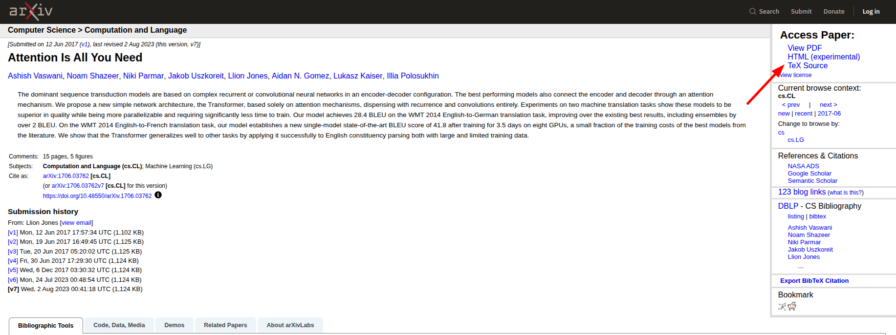

[[LLM 與 agent 的運作原理]]一篇說明 LLM 只讀進文字，[[寫 prompt 與選模型]]一篇又提到圖片既耗 token 又讀不準。然而手邊的資料與文件多半是 Excel、PDF 與 Word，直接上傳雖然能讀，內容卻常走樣，用量也消耗得快；如果不知道原因，便只會覺得 agent 不可靠。

本篇先說明這些格式為何讀不準，並介紹 Markdown 的語法，再說明如何將資料與文件換成 LLM 讀得準的純文字，即 CSV、TeX 原始碼與 Markdown，最後是 Markdown 在本系列裡的用途。

## 上傳文件解析不準的原因

PDF、Word、Excel 都不是文字檔，上傳之後之所以能讀，並非 LLM 本身有此能力，而是平臺先做了轉換，抽出其中的文字，或逐頁轉成圖片，LLM 讀到的是轉換後的結果，而非原檔。這道轉換發生在 LLM 之前，使用者看不見，出錯之處多半在此。

PDF 記錄的是每個字在頁面上的位置，原本是為列印而設計，並不記錄哪些字屬於同一段、哪些數字屬於同一欄，電腦無法得知文件的結構。抽出文字時，雙欄的版面可能左右兩欄交錯，表格失去格線後只剩一串數字，公式的上下標、分數與求和符號則被壓平成一行，頁首、頁尾與註腳也混入正文之中。掃描出來的 PDF 連文字都沒有，只能當圖片處理。

Word 的情況稍好，段落與標題還在，但公式、表格、註解與追蹤修訂各有各的內部表示法，轉換時同樣可能遺失。

Excel 的問題則在於一張工作表並不等於一張資料表。合併儲存格、佔了兩三列的表頭、同一張表上並排的幾個區塊、以顏色標示的類別、公式與其計算結果之別，人一眼就看得出來，轉成文字後卻未必保留；一個活頁簿如果有多張工作表，哪一張被讀進去、是否全部被讀進去，也不易確認。

轉成圖片則是另一種代價，所佔的 token 遠多於文字，辨識的準確度又不如直接讀文字。

## 純文字優先的理由

純文字檔指以記事本開啟即可閱讀的檔案，內容只有文字，沒有版面資訊，`.R` 腳本即屬於此。本系列的立場是，凡交給 agent 讀的資料與文件，優先使用這一類格式，表格資料用 CSV 而非 Excel，文件用 Markdown 而非 Word，論文儘可能用 TeX 原始碼而非 PDF。

純文字讀得準。它不需轉換，檔案裡寫的是什麼，LLM 讀到的便是什麼；即使 LLM 仍有理解錯誤，至少可以排除檔案本身讀錯這一層。

純文字也省用量。同樣的內容，文字所佔的 token 遠少於圖片，context window 也因此撐得更久；且 agent 可以先搜尋檔案內的關鍵字，只讀取相關的段落，不必每次將整份文件讀入。

純文字的改動還可以逐行比對。[[離開網頁對話]]一篇提過，agent 修改檔案前會顯示改動前後的對照，此對照以行為單位，只有純文字檔才看得出改了哪幾行；如果改的是 Excel 或 Word，能看到的只有檔案被修改了。[[版本控制]]一篇的提交也是同理，純文字檔的每一次改動都可查看、可退回。

本篇轉檔的做法並不限於 coding agent，轉好的 CSV 與 Markdown 上傳至網頁對話，同樣比原檔讀得準、耗得少。

## Markdown 語法簡介

以 Word 撰寫時，內容與樣式須同時顧及，字體、字級、顏色、行距都要選定，自他處貼上一段文字，格式往往隨之走樣，標題的編號與縮排也時常錯亂，心力多花在調整版面，而非內容本身。

Markdown 是以幾個符號標示格式的純文字寫法，副檔名為 `.md`，以記事本即可開啟與編輯。它只標示相對的關係，哪些是標題、屬於哪一層、哪裡是重點、哪幾項並列，至於顯示成何種字體與顏色，交由開啟它的軟體決定，寫的人不必過問。因此凡以內容為主、只求看得出文章結構與重點的文字，如筆記、摘記、說明文件與草稿，都建議以 Markdown 撰寫；版面須精確控制的文件，如須依規定格式繳交的報告，則不適合。

Markdown 在 CS 領域是最通行的文件寫法，軟體的說明文件、專案的說明檔與技術筆記多以它寫成，因此 LLM 的訓練資料裡有大量的 Markdown，讀寫這種格式都很熟練。

網頁對話的回覆複製貼至 Word 時，偶爾可見一些井字號與星號，那便是 Markdown 的符號，網頁只是將其顯示為標題與粗體。常用的寫法不過數種，一個例子即可涵蓋：

````markdown
# 一級標題

## 二級標題

一般的段落直接寫，段落之間空一行。
這是 *斜體*，這是 **粗體**，這是[連結的文字](https://example.com)。

- 清單的一項
- 清單的另一項

1. 有編號的清單
2. 第二項

句子中的 code 以反引號包住，例如 `mean(x)`。成段的 code 則以三個反引號圍起，
並於開頭註明語言：

```r
x <- c(1, 2, 3)
mean(x)
```

句子中的公式夾在一對 $ 之間，例如 $\bar{x} = \frac{1}{n} \sum_{i=1}^{n} x_i$。
獨立成行的公式則夾在兩對 $$ 之間：

$$
\hat{\beta} = (X^\top X)^{-1} X^\top y
$$

| 欄位 | 說明 |
|---|---|
| id | 編號 |
| income | 月收入 |
````

井字號的數目即標題的層級；表格以直線分隔欄位，第二列的橫線將表頭與內容分開。公式並非 Markdown 原有的語法，但 VS Code、Obsidian、GitHub 與網頁對話等大部分軟體都支援，寫法即 LaTeX 的公式語法，顯示時排成數學式；不支援的軟體則原樣顯示 `$` 與其間的文字。這些語法不必記誦，文件多由 agent 撰寫，使用者只須讀得懂、能改幾個字。如果要看到排版後的樣子，VS Code 與 Obsidian 都可預覽，前者見[[遷移至 VS Code]]一篇，後者見本篇[[#以 Obsidian vault 作為專案（選讀）|「以 Obsidian vault 作為專案」]]一節。

## CSV 與 Excel 之別

CSV 是以逗號分隔欄位、一列資料佔一行的純文字檔，以記事本開啟，看到的就是資料本身：

```text
id,gender,income
1,F,32000
2,M,28500
```

Excel 的 `.xlsx` 除了資料，還存有格式、公式、圖表與多張工作表，須以 Excel 或專門的套件才能讀取，例如 R 須另裝 readxl。CSV 則是幾乎所有主流語言都能方便讀寫的格式，R 與 Python 都內建讀寫 CSV 的函數，不需另裝套件，因此交給 agent 的表格資料應存成 CSV。

Excel 可以直接開啟 CSV，也可以直接存出，選擇「檔案」、「另存新檔」，在存檔類型的選單中選取「CSV UTF-8（逗號分隔）」即可，而非一般的「CSV（逗號分隔）」；後者在繁體中文的 Windows 上以 Big5 存檔，中文在別處讀入時可能變成亂碼。

CSV 只能容納一張規矩的表，即第一列是欄位名，其下每一列是一筆資料。Excel 檔如果不合此形，轉存之前有幾件事須先處理：

- 一個活頁簿有多張工作表。另存 CSV 只會存下目前開啟的那一張，其餘須逐一另存，每張一個檔案。
- 合併儲存格。轉存後只有左上角一格有值，其餘都是空的，須先取消合併並填滿。
- 表頭佔多列。例如第一列是大類、第二列是細項，須合併為單一列的欄位名。
- 表格上方的標題與說明文字、下方的合計列與備註，以及僅以顏色或粗體表示的資訊，CSV 都不保留或不該保留。

這些也可交由 agent 處理，由它寫一段 R code 讀取 `.xlsx` 並輸出整理後的 CSV，如此一來整理的步驟留有紀錄，原始檔更新時可以重做；但合併儲存格與多列表頭正是 agent 容易猜錯之處，輸出的 CSV 須與原檔對照幾列。

## 論文：直接取用 TeX 原始碼

論文的 PDF 是上述問題的集大成，雙欄、公式、表格、註腳俱全。但理工領域的論文多以 TeX 撰寫，PDF 是編譯出來的成品，作者手上原有一份純文字的原始碼，其中的公式是以文字寫成的，例如 `\bar{x} = \frac{1}{n} \sum_{i=1}^{n} x_i`，LLM 讀這一行不需任何辨識。

arXiv 上的論文多附有這份原始碼。於論文的摘要頁（網址為 `arxiv.org/abs/` 加編號），右側 Access Paper 之下列有 View PDF 與 TeX Source，點選 TeX Source 即可下載。下載到的通常是一個壓縮檔，內含一至數個 `.tex` 檔、圖檔與參考文獻檔，詳見 [arXiv 的官方說明](https://info.arxiv.org/help/view.html)。



解壓不必自己動手，將下載的檔案放入專案後交代 agent 即可：

```text
papers 資料夾裡有一個從 arXiv 下載的 TeX 原始碼壓縮檔。請解壓到 papers 底下以論文編號命名的資料夾，找出主要的 .tex 檔，然後依原文說明第 3 節的估計式是怎麼推導出來的。
```

下載也可交給 agent。請 agent 代尋論文時，如果未交代，取回的多半是 PDF，因此須寫明 arXiv 上的論文優先下載 TeX 原始碼，沒有原始碼時才取 PDF：

```text
請在 arXiv 上找 double machine learning 的原始論文。優先下載 TeX 原始碼（網址為 arxiv.org/src/ 加編號），解壓到 papers 底下以論文編號命名的資料夾；如果該篇沒有原始碼，才下載 PDF。
```

這條交代每次都相同，可寫入規範檔，見[[規範檔與 skill]]一篇。

並非每篇都有 TeX Source。作者如果只上傳 PDF，或以 Word 撰寫，摘要頁便沒有這個連結，下載到的也可能就是 PDF 本身。期刊網站上的論文則一律只有 PDF，此時可先以論文標題搜尋 arXiv，許多期刊論文另有預印本，內容與正式版大致相同；如果仍找不到，則依[[#其餘文件：轉寫為 Markdown]]一節的做法處理。

## 其餘文件：轉寫為 Markdown

沒有原始碼的論文、講義、Word 寫成的規格文件、問卷與資料的欄位說明，都可交由 agent 轉寫為 Markdown，即[[#Markdown 語法簡介]]一節介紹的純文字格式。轉寫本身仍須經過[[#上傳文件解析不準的原因]]一節所述的解析，走樣的風險並未消失，差別在於只解析一次，其結果是一個可以開啟檢查、可以修正的檔案，此後所有的對話都讀這一份，不再反覆解析原檔，也不再反覆耗用 token。

指示可以這樣寫：

```text
把 docs/原始文件 裡的「欄位說明.pdf」轉寫成 Markdown，存到 docs/欄位說明.md。表格用 Markdown 表格，公式用 LaTeX 語法，頁首頁尾與頁碼不要。看不清楚或沒把握的地方不要猜，標上「待確認」並註明頁碼。原檔不要改動。
```

轉完須抽查。表格須挑幾列與原檔逐格對照，尤其是數字、小數點與正負號，以及欄位是否錯位。公式須看上下標、分數的分子分母與求和的範圍，Markdown 裡的公式以 LaTeX 語法寫成，見[[#Markdown 語法簡介]]一節，初看不易讀，可請 agent 逐一說明每個公式對應原文的哪一式。此外須看有無整段遺漏，對照原檔的章節標題數一遍即可。[[LLM 與 agent 的運作原理]]一篇提過 LLM 會編造，轉寫時也一樣，原檔模糊之處它可能補上一個看似合理的數字，因此指示中須要求標出沒把握之處。

篇幅長的文件應分章轉寫，每章一個檔案，日後只需讀取用得到的那一章。原檔仍須保留，以便日後核對。

## Markdown 的用途：筆記、規範檔、skill、回覆

Markdown 在本系列會以下列身分出現：

| 用途 | 寫的人 | 讀的人 |
|---|---|---|
| 筆記 | 使用者，或由 agent 代筆 | 使用者與 agent |
| 規範檔 | 使用者與 agent | agent |
| skill | 多為他人寫好，直接安裝 | agent |
| 回覆 | agent | 使用者 |

筆記是最直接的一種。依[[#其餘文件：轉寫為 Markdown]]一節轉寫出來的文件、讀論文時的摘記、每次分析做了什麼決定，都可以 `.md` 檔存於專案內，agent 讀得到，下一次對話可以直接引用，不必重新交代。

規範檔與 skill 都是寫給 agent 讀的檔案，內容與用法留待[[規範檔與 skill]]一篇，此處只須知道兩者同樣是 Markdown，以記事本開啟，看到的就是標題、清單與段落，沒有特殊格式。

回覆則是 agent 輸出的文字。LLM 的回覆也是以 Markdown 寫成，桌面 app 與網頁將其排版後顯示，因此可以要求 agent 將某一段回覆原樣存成 `.md` 檔，例如一份計畫或一段分析的說明，存下後即成為筆記，日後可再交回給 agent。

## 以 Obsidian vault 作為專案（選讀）

[Obsidian](https://obsidian.md/) 是一款免費的筆記軟體，所有筆記都以 Markdown 檔存於使用者電腦上的一個資料夾，Obsidian 稱此資料夾為 vault。已在使用 Obsidian 的人，vault 本身就是一個裝滿 Markdown 的資料夾，符合[[離開網頁對話]]一篇對專案的定義，可以直接交給 agent，於 Code 分頁點選 Select folder 並選取 vault 所在的資料夾即可，不需匯出，也不需在 Obsidian 內安裝任何東西。

可以交代的事例如：

```text
這個資料夾是我的 Obsidian vault。找出所有提到 bootstrap 的筆記，整理成一份摘要，存成新的筆記「bootstrap 整理.md」，每一點註明出自哪一篇筆記。不要修改既有的筆記。
```

Agent 寫入的檔案會立即出現在 Obsidian 內，反過來也一樣，兩邊開的是同一批檔案。vault 內名為 `.obsidian` 的資料夾存放 Obsidian 自身的設定，不應讓 agent 改動；筆記如果多，也可只選取 vault 之下的某個子資料夾，以縮小 agent 看得到的範圍。

尚未使用 Obsidian 者不必為此安裝，以一般資料夾存放 `.md` 檔，效果相同。Obsidian 另有讓 agent 透過 MCP 連接的做法，屬[[規範檔與 skill]]一篇的選讀內容。
