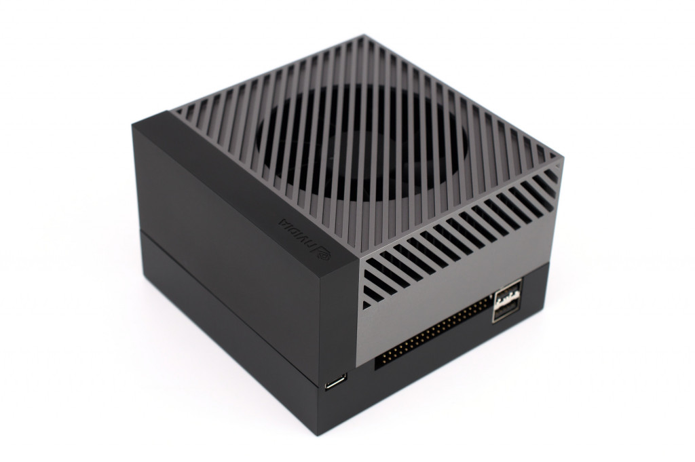
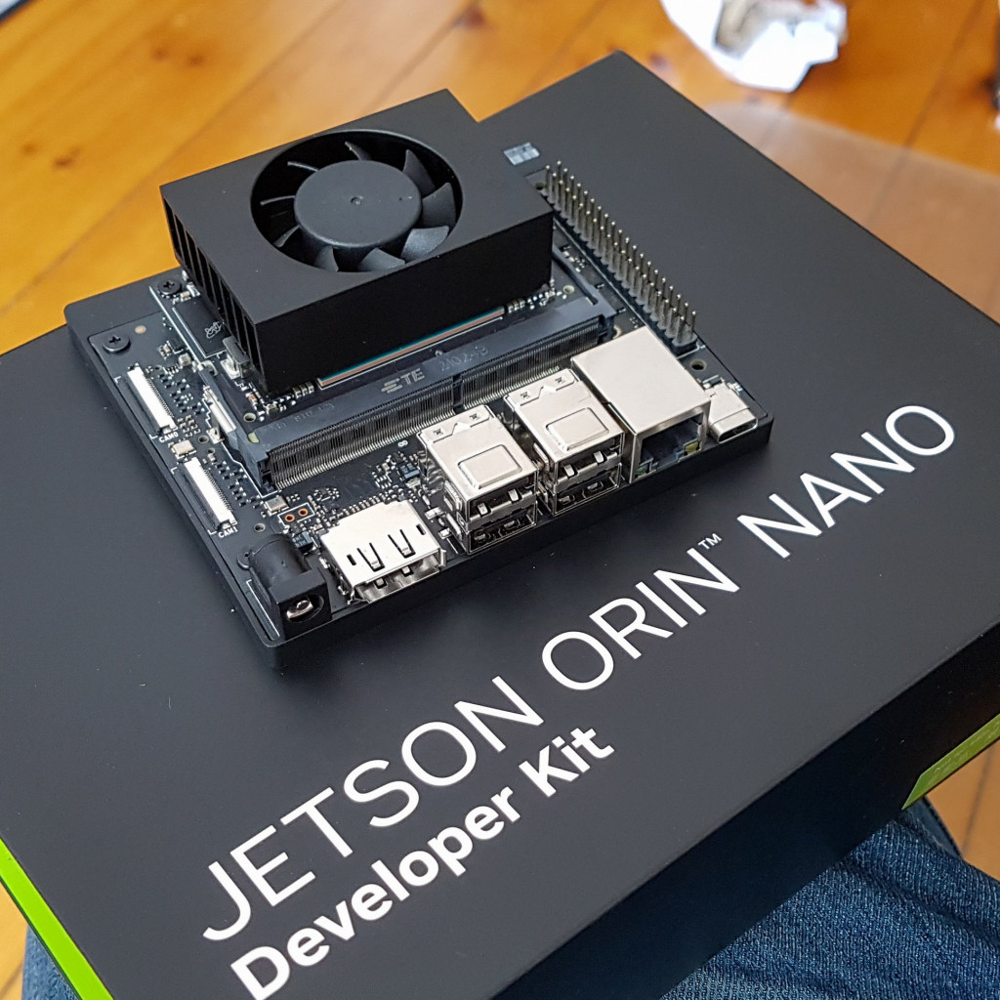
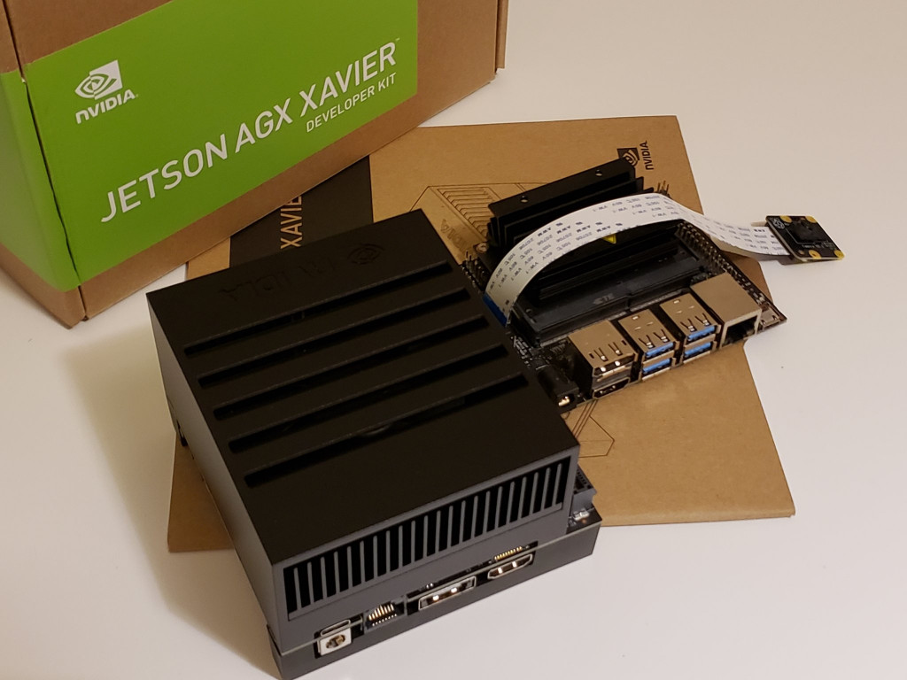
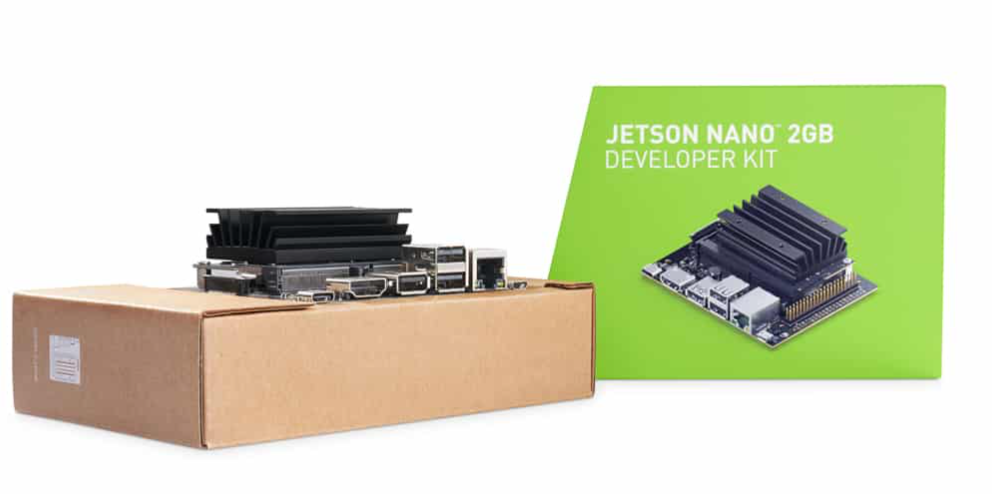
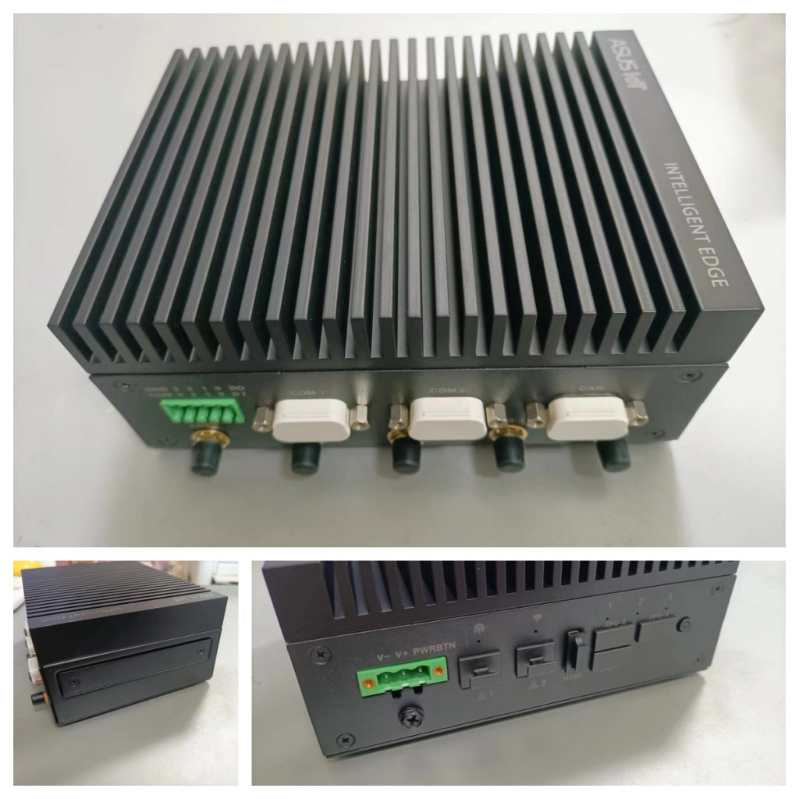

上文介紹了我是如何在NVIDIA Jetson Nano開發套件上開始我的邊緣人工智慧開發之旅。事實上，因為我爸爸工作的關係，NVIDIA每出一款Jetson開發套件，我都使用過。在本篇文章裡，我將對於「如何選擇一款適合的NVIDIA Jetson開發套件」談談我自己的一些經驗和想法。

在選擇一款適合的NVIDIA Jetson開發套件時，需要考慮多個因素，包括預算、性能需求、應用場景以及未來的可擴展性等。以下是一些關鍵的步驟和建議，幫助您做出明智的選擇。

## 明確需求和預算

首先，您需要明確專案的具體需求和預算範圍。NVIDIA Jetson系列提供了多種型號的開發套件，從入門級的Nano到高性能的AGX Xavier和Orin系列，價格和功能各不相同。根據您的專案需求，設定一個合理的預算範圍。

目前正在銷售的NVIDIA官方開發套件只剩下：

Jetson AGX Orin開發套件，1999美金

Jetson Orin Nano開發套件，499美金

另外，NVIDIA曾經推出，但已經退市的兩款開發套件，一個是Jetson AGX Xavier開發套件，一個是Jetson Xavier NX開發套件（外形跟Jetson Orin Nano幾乎一致）

最入門級的產品就是Jetson Nano開發套件，雖然官方套件已經退市，但有很多第三方公司仿造官方開發套件做的產品。

目前包括華碩在內，很多公司都利用NVIDIA Jetson模組晶片，製作自己品牌的Jetson加固式系統，應用在很多工業場景。

## 了解不同型號的性能特點

| 型號 | GPU計算能力 | CUDA核心數 | 內存大小 | 適用場景 |
| --- | --- | --- | --- | --- |
| Jetson Nano | 0.5 TFLOPS (FP16) | 128 | 4GB | 入門學習、小型專案、覆蓋樹莓派的使用場景 |
| Jetson Xavier NX | 6 TFLOPS (FP16) / 21 TOPS (Int8) | 384 | 8GB | 邊緣計算、機器視覺、機器人 |
| Jetson AGX Xavier | 高達32 TOPS | 512 | 64GB | 高級自動駕駛、複雜機器人 |
| Jetson Orin NANO | 高達40TOPS | 1024 | 8GB | 小型邊緣計算、生成式AI入門、學習用途 |
| Jetson AGX Orin | 高達275 TOPS | 2048 | 64GB | 生成式AI、高級計算機視覺、高級自動駕駛、複雜邊緣計算 |

## 考慮應用場景和介面需求

根據您的應用場景，選擇具有適當介面和擴展性的開發套件。例如，如果您的專案需要連接多個攝影機或感測器，那麼選擇具有多個USB或CSI介面的型號將更為合適。此外，還需要考慮是否需要支持特定的通訊協定（如Wi-Fi、藍牙、乙太網等）。

目前我感受到在Jetson Orin系列上，NVIDIA投入很多在大模型應用上，所以如果您是要在邊緣計算設備上部署大模型，建議從Jetson Orin系列開始起步。我以目前的使用經歷來說，Jetson AGX Orin開發套件的64G大顯存，在執行大模型應用方面確實比較游刃有餘，但是成本確實也很高，這就需要您在預算和性能之間進行權衡。

如果您只是在視頻應用方面做開發，那麼Jetson Xavier NX是比較好的選擇。很多第三方公司都有出基於Jetson Xavier NX的系統。

## 評估生態系統支持和社群資源

NVIDIA Jetson系列擁有龐大的生態系統和活躍的開發者社群。在選擇開發套件時，可以考慮該型號的生態系統支持情況，包括可用的軟體庫、開發工具、參考設計以及社群提供的資源和幫助。這將有助於加速您的開發進程並降低技術風險。

## 比較不同通路的購買選項

NVIDIA官方通路和第三方通路都提供NVIDIA Jetson開發套件的銷售。在選擇購買通路時，需要考慮價格、售後服務、技術支持以及物流速度等因素。官方通路通常提供更高的品質保證和更完善的技術支持，但價格可能相對較高；而第三方通路則可能提供更靈活的價格和購買選項。

<strong>綜上所述，選擇一款適合的NVIDIA Jetson開發套件需要綜合考慮多個因素。通過明確需求和預算、了解不同型號的性能特點、考慮應用場景和介面需求、評估生態系統支持和社群資源以及比較不同通路的購買選項等步驟，您可以找到最適合您專案的開發套件。</strong>
