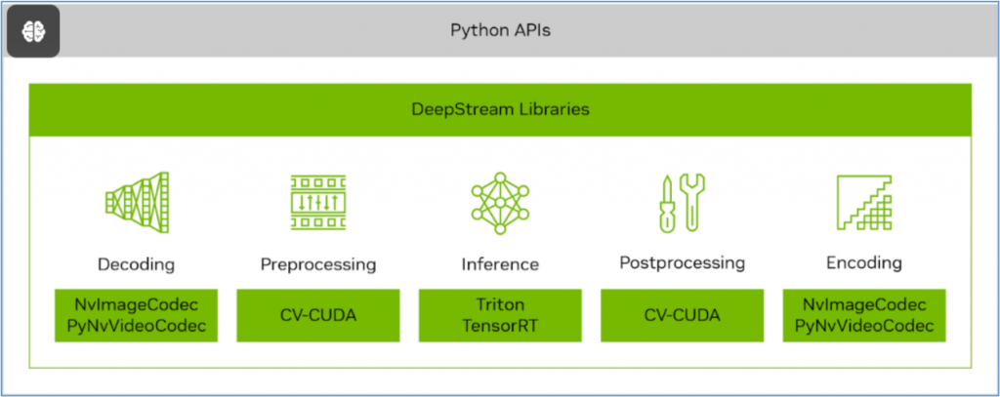
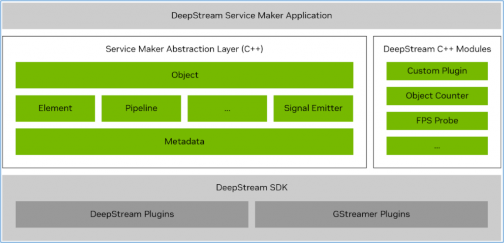
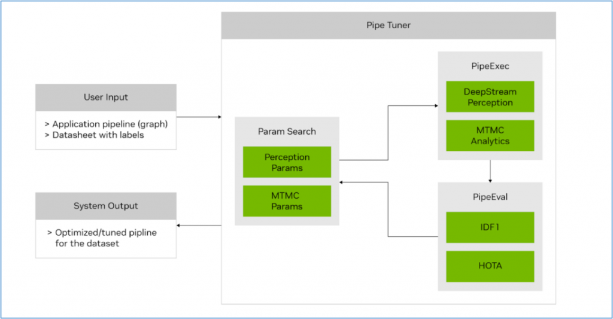

這套影片分析IVA工具包，從一開始協作美國國家級交通影片分析的任務，一直到後來不斷進化成在嵌入式AI設備上的執行，在3.0版時已經有過一次架構上的成熟跨越，而今年新推出的7.0版，則在開發容易度與AI整合度上取得相當程度的提升，對於原本就熟悉DeepStream的開發者來說，可以在7.0版上重新架構一次更有效率的應用，對於初學者來說，能在更短時間內開發出令人賞心悅目的影片分析應用。

這個7.0版本主要在加速下一代應用程式開發的創新功能，改進的亮點包括以下內容：

- 透過DeepStream Library提供三大新的Python API：



```
- **CVCUDA**：這是一個開源專案，可以構建高效的雲級人工智慧（AI）影像和計算機視覺（CV）應用程式，使用GPU加速來構建高效的預處理和後處理流程。
- **NvImageCodec**：個具有統一介面的加速編解碼器的開源庫，為提供編解碼器插件的擴展模組的框架而設計。不僅為圖像的編/解碼提供統一的介面，還支援CV-CUDA、PyTorch和CuPy的零拷貝介面，大大降低編程難度並提高性能。
- **PyNvVideoCodec**：是NVIDIA基於Python的影片編解碼庫，用於在NVIDIA GPU上進行硬體加速的影片編碼和解碼。PyNvVideoCodec是VPF（影片處理框架）的繼承者，庫內部使用Video Codec SDK的核心C/C++影片編碼和解碼API，並在其上提供易於使用的Python API。這個庫提供的編碼和解碼性能接近影片編解碼器SDK。
```

- 使用新的Service Maker簡化應用程式開發：

提供高級C++API，大大簡化了使用DeepStream SDK的應用程式開發，將應用程式構建週期從幾天縮短到幾個小時。這些面向對象的API具有簡化的介面，使沒有多媒體或Gstreamer知識的應用程式開發人員能夠輕鬆創建加速的AI流應用程式。以下是DeepStream Service Maker API的一些關鍵特性：



```
    - 基於引用的對象管理使開發人員無需擔心運行時對象的生命周期。
    - 透過方法鏈實現的流暢介面使應用程式代碼更具可讀性和表現力。
    - 透過異常進行統一的錯誤處理簡化了應用程式代碼錯誤管理。
    - 可變（variadic）方法減少API數量，同時增強了靈活性。
    - Runtime模組機制支援自定義插件，並與標準DeepStream插件保持相容。
```

借助DeepStream Service Maker，您可以在幾分鐘內快速構建管道、整合所需的插件、無縫鏈接它們並啟動應用程式。然後，這些應用程式可以輕鬆地打包到容器中，並透過REST API進行管理，提供了一個簡化的工作流程，大大減少了傳統的編碼工作。例如在Python版的deepstream\_test1.py範例中，在創建pipeline部分的代碼，扣除註釋之後至少還有60行以上，而使用Service Make功能之後，這部分代碼就簡化成下面的16行內容，十分簡明扼要：

```cpp
Pipeline pipeline("deepstream-test1");
pipeline.add("filesrc", "src", "location", argv[1])
    .add("h264parse", "parser")
    .add("nvv4l2decoder", "decoder")
    .add("nvstreammux", "mux", "batch-size", 1, "width", 1280, "height", 720)
    .add("nvinfer", "infer", "config-file-path", CONFIG_FILE_PATH)
    .add("nvvideoconvert", "converter")
    .add("nvdsosd", "osd")
    .add(sink, "sink")
    .link("src", "parser", "decoder")
    .link({"decoder", "mux"}, {"", "sink_%u"})
    .link("mux", "infer", "converter", "osd", "sink")
    .attach("infer", new BufferProbe("counter", new ObjectCounter))
    .attach("infer", "sample_video_probe", "my probe", "src", "font-size", 20)
    .start()
    .wait();
```

- SV3DT單視圖3D追蹤器（Single-View 3D Tracking）的增強功能：

最新版本對SV3DT追蹤器進行重大增強，此高級功能旨在使用單個單鏡頭相機在3D空間內精確追蹤對象，從而在3D世界地平面上提供對象的精確定位。第一個SV3DT版本將行人建模為地面上的圓柱體，此法將腳定位在圓柱體底部來確保更準確的定位，提供更清晰、更明確的運動和定位表示，而不管遮擋程度如何。

- DeepStream 3D框架支援BEVFusion傳感器融合模型：

BEVFusion是目前傳感器融合領域最激動人心的AI模型之一，DeepStream 7.0增強了DeepStream 3D（DS3D）框架，並添加可以與相機輸入融合的激光雷達和雷達輸入。透過一個低級庫（作為源代碼提供）簡化了與各種傳感器的整合，簡化了對不同傳感器供應商的支援。

- 使用PipeTuner優化AI流水線

PipeTuner 1.0是一個新的開發工具，有望徹底改變人工智慧管道的調優。人工智慧服務通常包含一系列用於推理和追蹤的參數。找到最佳設置以最大限度地提高特定用例的準確性是一個複雜而關鍵的過程。

傳統上，手動調優需要對每個管道模組有深入的了解，並且在廣泛的高維參數空間中變得不切實際，即使有數據集和用於精度分析的地面真值標籤的支援。



PipeTuner有效地探索參數空間，並自動化識別最佳參數的過程，根據用戶提供的數據集實現盡可能高的關鍵績效指標（KPI）。至關重要的是，PipeTuner簡化了這一過程，這樣用戶就不需要了解管道及其參數的技術知識。

透過整合PipeTuner，您可以加快上市時間，並為每個部署位置量身定制DeepStream管道參數，確保在每種情況下都能達到最佳性能。這標誌著在所有用例和場景中，使複雜的AI管道優化對每個人都是可訪問和有效的方面邁出了重要的一步。

總的來說，新版DeepStream 7.0的確增加了非常多實用的功能，下一回我們直接使用這個新工具來做點示範，大家感受一下強大的功能。
