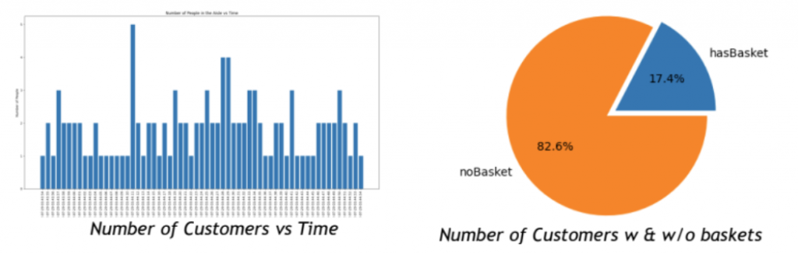
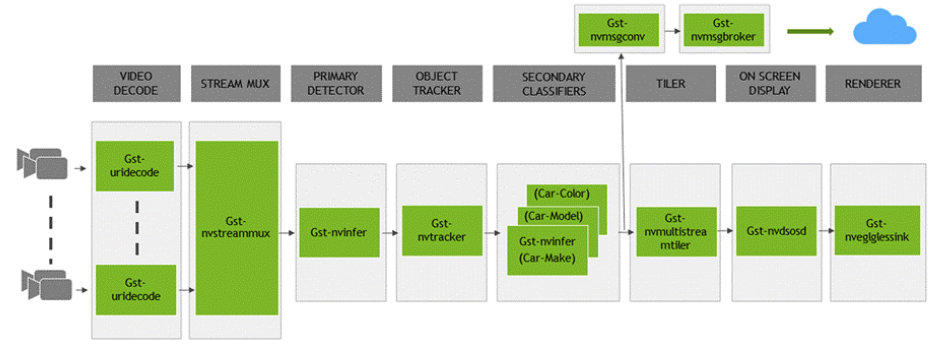
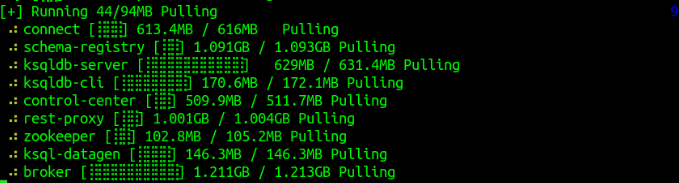
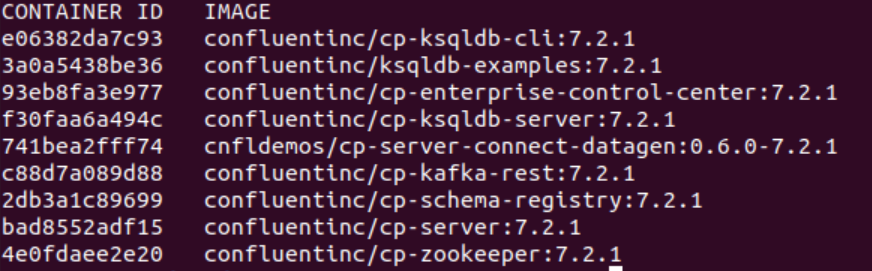
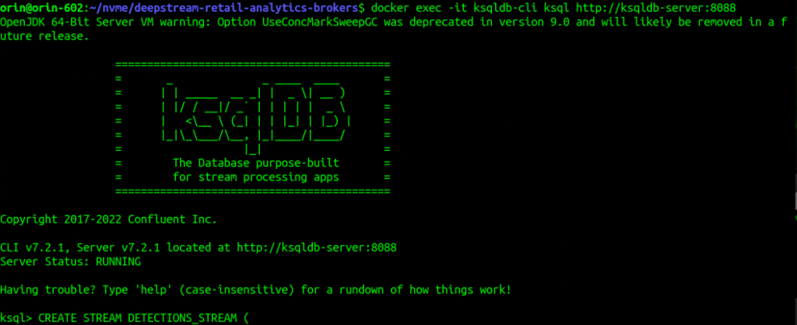
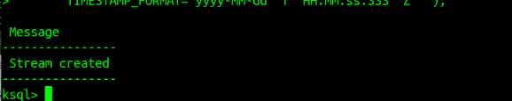
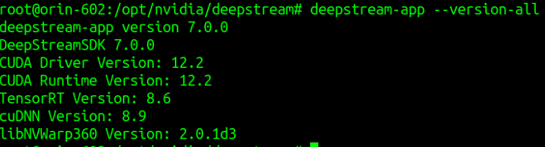
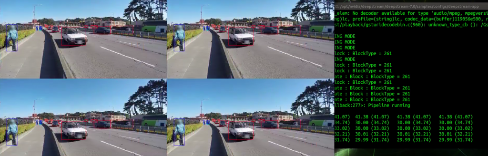
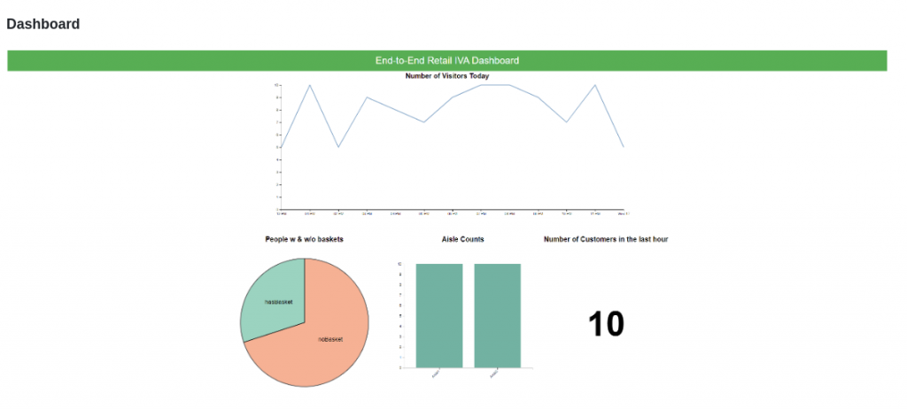

這是一個在零售行業的應用程式，使用NVIDIA DeepStream、TAO 和預訓練模型，在實體零售環境中執行即時智慧視訊分析（IVA）的案例。DeepStream用於在商店內的視訊源上運行DL推理，以檢測和追蹤顧客，並確定檢測到的人「是否攜帶購物籃」。


然後使用Kafka將這個pipeline的推理結果，以資料流形式傳輸到TSDB（時間序列資料庫）進行處理與存檔。Django應用程式提供REST-ful API，根據推理資料查詢見解，這裡還添加一個前端儀表板的範例，可以快速地提供各種關鍵KPI的顯示。



此應用程式結合了DeepStream附帶的deepstream-test4和deepstream-test5開源範例，其完整的pipeline工作流程如下圖，與標準的DeepStream工作流程差不多：



這裡面最重要的幾個智慧運算與資訊分配的元件如下：

- Primary Detector：從NGC下載的PTM（PeopleNet Pre-trained Model）。
- ObjectTracker：NVIDIA的NvDCF追蹤器。
- Secondary Detector：使用TAO工具包訓練的自定義分類模型，用於對有購物籃和沒有購物籃的人進行分類。
- Message Converter：自定義的轉換器，從推理資料生成自定義有效負載。
- Message Broker：將推理資料中繼到Kafka伺服器。

不過Secondary Detector需要自行收集資料後，再使用TAO工具或其他工具（例如CVAT）進行模型訓練，會耗費更多的時間與篇幅，因此這部分在本文中會省略掉。現在我們就開始按部就班地進行這個專案。

## Step 1、創建並啟動Kafka與kSQL的容器

由於這個專案需要一個Message Broker與資料庫，我們推薦使用網上一個開源的Confluent Platform，可以很輕鬆地搭建Kafka與kSQL的容器。請執行以下指令：

```bash
$ wget https://raw.githubusercontent.com/confluentinc/cp-all-in-one/7.2.1-post/cp-all-in-one/docker-compose.yml
$ docker compose up -d
```

然後就會開始幫我們下載所需要的相關元件：



創建完畢之後，可以執行`docker ps`檢查以下創建的容器內容，主要如下：



接著開啟一個終端，執行以下指令去啟動Kafka容器：

```bash
$ docker exec -it broker bash
# 在容器內執行：
$ kafka-topics --bootstrap-server "localhost:9092" --topic "detections" --create
```

再開啟另一個終端，執行以下指令啟動kSQL容器：

```bash
$ docker exec -it ksqldb-cli ksql http://ksqldb-server:8088
```

正確執行會如下面畫面，最下面出現“ksql>”的指令輸入：



現在將`deepstream-retail-analytics/confluent-platform/stream_creation.sql`裡面的指令複製後，貼進`ksql>`後面直接執行，就可以看到以下的資訊：



## Step 2、安裝DeepStream 7.0 執行環境

雖然將DeepStream主系統安裝到本機上並不算太複雜，但鑑於版本更新頻率與相關周邊庫的配置，仍存在不少複雜度，因此推薦使用Docker容器方式會是最簡單快速的。請執行下面指令從NGC下載映像檔：

```bash
$ docker pull nvcr.io/nvidia/deepstream:7.0-samples-multiarch
```

接下來為了能夠更完整的映射周邊資源，包括攝影機、音效、顯示器等等，我們可以借助jetson-containers指令來啟動容器。不過因為這是個開發調試的工作，為了避免在退出容器之後就消失，損害修改的過程，因此在執行指令時請添加 `-d` 參數，如下：

```bash
$ jetson-containers run nvcr.io/nvidia/deepstream:7.0-samples-multiarch
```

現在就會進入容器內的DeepStream 7.0系統，請執行以下指令確定版本：

```bash
$ deepstream-app --version-all
```

正確的話，應該會出現以下內容：



現在先執行一個最基本的範例，確認一下這個容器的可執行性。請執行以下指令：

```bash
$ cd samples/configs/deepstream-app
$ deepstream-app -c source4_1080p_dec_infer-resnet_tracker_sgie_tiled_display_int8.txt
```

如果出現以下結果，表示執行環境已經妥善。



## Step 3、準備專案源碼與編譯

這個零售專案主要是參考`deepstream/sources/apps/sample_apps`下面的兩個專案：

- `deepstream-test4`：提供將自定義檢測對象添加為NVDS\_VENT\_MSG\_META用戶元數據，並將其附加到要發佈到緩衝區的源碼；
- `deepstream-test5`：是一個端到端的應用程式，演示了如何在多流管道中使用nvmsgconv和nvmsgbroker插件，創建NVDS\_META\_EVENT\_MSG類型的元，及使用Kafka和其他接收器類型的流推理輸出。

不過我們不需要自己重新組合，直接使用NVIDIA在Github上發佈的源碼就行。請執行以下指令：

```bash
$ cd /opt/nvidia/deepstream/deepstream-7.0/sources/apps/sample_apps
$ git clone https://github.com/NVIDIA-AI-IOT/deepstream-retail-analytics.git
$ cd deepstream-retail-analytics 
$ apt install git-lfs
$ git lfs pull
```

接著就準備到專案目錄下編譯這個專案的執行檔案，請執行以下指令：

```bash
$ export CUDA_VER=12.2
$ make -B
```

沒問題的話就會生成`ds-retail-iva`執行檔案。

## Step 4、下載所需模型與修改路徑

這個範例可以使用NVIDIA NGC上所提供的PeopleNet模型，我們只需要將`.etlt`與 `labels.txt`兩個檔案下載到`files`目錄下即可。請執行以下指令：

```bash
$ cd files
$ wget 'https://api.ngc.nvidia.com/v2/models/nvidia/tao/peoplenet/versions/pruned_v2.0/files/resnet34_peoplenet_pruned.etlt'
$ wget 'https://api.ngc.nvidia.com/v2/models/nvidia/tao/peoplenet/versions/pruned_v2.0/files/labels.txt'
```

然後修改應用的`configs/pgie_config_peoplenet.yml`配置檔案裡的`tlt-encoded-model`與`labelfile-path`兩個設定：

```yaml
tlt-encoded-model=/opt/nvidia/deepstream/deepstream/sources/apps/sample_apps/deepstream-retail-analytics/files/resnet34_peoplenet_pruned.etlt
labelfile-path=/opt/nvidia/deepstream/deepstream/sources/apps/sample_apps/deepstream-retail-analytics/files/labels.txt
```

## Step 5、啟動應用

回到`deepstream-retail-analytics`目錄下執行以下指令：

```bash
$ cd ds-retail-iva-frontend
$ pip install -r requirements.txt
$ python3 manage.py runserver 0.0.0.0:8000
```

現在就啟動監控伺服器，然後打開瀏覽器輸入“`http://localhost:8000`”，就能看到類似下面截圖：


