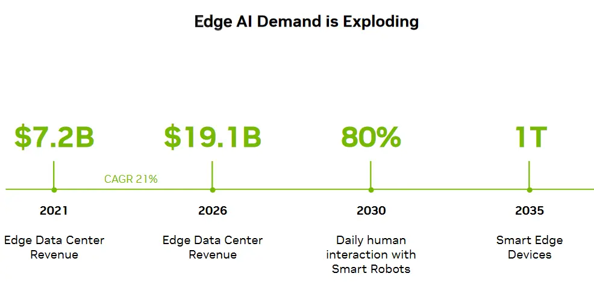

## 邊緣運算概述

邊緣運算，簡而言之，是在數據產生的源頭或附近進行數據處理的技術。其核心優勢在於實現數據的在地化處理，從而顯著降低延遲並減少頻寬需求。相較於雲端運算，邊緣運算能提供更即時的數據處理能力，避免了將大量原始數據遠距離傳輸至雲端資料中心的過程，極大節省了資源和時間。

## 邊緣運算的主要優勢：

- **低延遲**： 通過直接在數據源頭處理信息，邊緣運算能夠迅速響應需求，實現毫秒級的處理速度。
- **頻寬優化**： 減少數據傳輸量，有效緩解網路壅塞，提升整體效率。
- **數據安全與隱私保護**： 在地化數據處理減少了數據洩露的風險，增強了數據安全性。

## 應用案例：自動駕駛汽車中的邊緣運算優勢

在自動駕駛汽車的研發與應用中，邊緣運算展現了其顯著的優勢，特別是在低延遲、頻寬優化以及數據安全與隱私保護方面。

### 低延遲

自動駕駛汽車需要即時感知周圍環境，包括行人、其他車輛、交通信號以及道路條件等，以便迅速做出決策。傳統上，這些感知數據可能需要傳輸到遠程伺服器進行處理，但這種方式存在延遲風險，可能影響到緊急情況下的快速響應。通過採用邊緣運算技術，自動駕駛汽車上的感測器和攝像頭收集的數據可以立即在車輛本地進行處理。邊緣運算設備，如高性能的嵌入式運算單元，能夠直接在車輛內部實現毫秒級的影像處理和目標識別，從而大大減少了響應時間，確保了自動駕駛汽車在複雜交通環境中的安全行駛。

### 頻寬優化

自動駕駛汽車在運行過程中會產生大量的感知數據，如高畫質視頻流、雷達信號和光達（LiDAR）點雲等。如果這些數據全部傳輸到遠程伺服器進行處理，不僅會佔用大量的網路資源，還可能導致網路壅塞和延遲增加。通過邊緣運算，大部分數據處理工作都在車輛本地完成，只有必要的結果或異常情況才需要上傳到雲端進行進一步分析或備份。這種方式顯著減少了數據傳輸量，優化了頻寬使用，同時也提高了系統的整體效率和穩定性。

### 數據安全與隱私保護

自動駕駛汽車收集的個人隱私和敏感信息（如駕駛者身份、行車軌跡等）需要得到嚴格保護。如果這些數據被傳輸到遠程伺服器進行處理，就可能面臨被竊取或濫用的風險。採用邊緣運算技術，大部分數據處理都在車輛本地進行，減少了數據在傳輸過程中的暴露風險。此外，邊緣運算設備還可以整合加密技術，確保敏感數據在儲存和傳輸過程中的安全性。這樣，自動駕駛汽車就能在保障用戶隱私的同時，提供高效、安全的自動駕駛服務。

綜上所述，邊緣運算在自動駕駛汽車中的應用充分發揮了其低延遲、頻寬優化和數據安全與隱私保護的優勢，為自動駕駛技術的快速發展提供了有力支持。

## 邊緣運算與人工智慧的融合

隨著人工智慧技術的發展，邊緣人工智慧（Edge AI）應運而生，它將AI推理能力與邊緣運算相結合，實現了即時的數據分析和決策制定。這一融合不僅加速了數據處理速度，還拓寬了應用場景，如安全監控、缺陷檢測、交通流量管理等，通過攝像頭等感測器直接獲取並處理數據，生成有價值的即時洞察。

### 邊緣運算的多樣類型

邊緣運算涵蓋了多種類型，以滿足不同行業的需求：

1. **提供者邊緣**： 主要涉及網際網路服務提供商和內容分發網路，用於高速傳輸內容。
2. **企業邊緣**： 作為企業內部資料中心的延伸，保護數據隱私並促進現場數據處理
3. **工業邊緣**： 針對工業環境設計，具備高耐受性和穩定性，適用於惡劣條件下的自動化生產。
4. **嵌入式邊緣**： 集成於各類物聯網設備中，如機器人、無人機等，提供強大的運算能力以完成任務。

## 邊緣運算面臨的挑戰與解決方案

市場正在恢復增長。到了2021年，我們有72億美元的邊緣伺服器市場，我們正在朝著到2026年19.1億美元的目標邁進。據估計，到2030年，我們將有80%的機器人能夠與我們日常互動。到2035年，到處都將是一萬億智慧設備。\

首先，不同環境的具體要求是首要考慮因素。它們還需要更小的占地面積和低功耗，因為許多邊緣設備都是由電池供電的。

此外，您需要特定的邊緣軟體，因為邊緣運算是一個不同的領域，通常您不希望有太多的重型工作負載。因此，您必須優化您的軟體層，確保其有效運行。這是第二個挑戰。

第三，安全性。通常，設備被放置在公共空間，人們可以盜取它，並且對於網路安全非常脆弱，需要在這些設備上添加特殊的物理和網路安全措施。

## 臺灣IT產業在邊緣AI晶片領域的崛起之路

NVIDIA以其強大的GPU技術和廣泛的生態支持，在邊緣AI晶片市場佔據重要地位。Intel則通過其CPU和AI晶片產品的組合，為不同場景提供高效、穩定的解決方案。AMD Xilinx則憑藉其FPGA技術的靈活性和可配置性，為客戶提供客製化的邊緣AI解決方案。這些企業在市場中展現出強大的競爭力和影響力，為整個行業的發展注入了強大的動力。

隨著邊緣運算與人工智慧技術的深度融合，邊緣AI晶片作為新興技術的核心載體，正引領著一場運算邊界的重塑革命。在這場技術變革中，臺灣IT產業憑藉其深厚的半導體產業基礎、技術創新能力以及對市場趨勢的敏銳洞察，正逐步在邊緣AI晶片領域崭露頭角，展現出強勁的崛起勢頭。

### 半導體產業的深厚積淀

臺灣作為全球半導體產業鏈的重要一環，擁有從設計、製造到封裝測試的全鏈條能力。這種全面的技術積累為臺灣IT企業在邊緣AI晶片的研發與生產上提供了得天獨厚的優勢。企業能夠迅速響應市場需求，推出高性能、低功耗的邊緣AI晶片產品，滿足智慧家居、自動駕駛、安防監控等多元化應用場景的需求。

### 敏銳的市場洞察與快速響應

臺灣IT企業緊跟全球技術發展趨勢，對邊緣AI晶片市場的潛力有著深刻的認識。他們通過持續的市場調研與數據分析，準確把握市場熱點與未來趨勢，及時調整產品策略，推出符合市場需求的產品。同時，臺灣企業還注重與全球科技巨頭的合作，共同推動邊緣AI晶片技術的創新與應用，進一步拓展市場空間。

### 技術創新與客製化解決方案

技術創新是臺灣IT產業在邊緣AI晶片領域崛起的關鍵。臺灣企業不斷投入研發資源，致力於提升晶片性能、降低功耗、提高集成度，以滿足邊緣運算對高效能、低延遲的需求。同時，他們還注重提供客製化的解決方案，根據不同行業和應用場景的特點，量身訂製邊緣AI晶片產品，幫助客戶實現智慧化升級。

### 政府支持與產業協同

臺灣政府在推動邊緣AI晶片產業發展方面發揮了積極作用。通過出台一系列鼓勵政策、提供研發資金補助和稅收優惠等措施，政府為企業提供了良好的發展環境。此外，臺灣還建立了完善的產學研合作機制，促進學術界與產業界的緊密合作，加速技術成果的轉化與應用。這種產業協同的模式不僅提升了臺灣IT企業的競爭力，還推動了整個產業鏈的健康發展。

### 未來展望與持續挑戰

展望未來，隨著5G、物聯網等技術的普及和應用場景的不斷拓展，邊緣AI晶片市場將迎來更加廣闊的發展空間。臺灣IT產業將繼續發揮自身優勢，加大研發投入和技術創新力度，不斷提升產品的技術含量和附加值。同時，他們還將積極開拓國際市場，與全球科技巨頭展開合作與競爭，共同推動邊緣AI晶片技術的進步與發展。當然，面對日益激烈的市場競爭和技術迭代的加速，臺灣IT企業也需要保持高度的警覺性和創新能力，以應對未來的挑戰與機遇。
