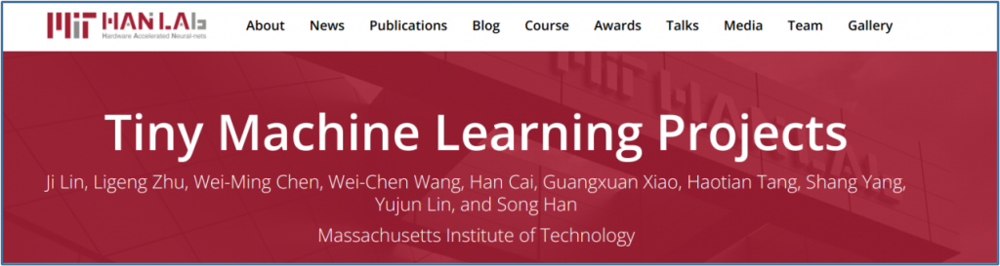
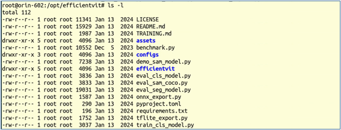
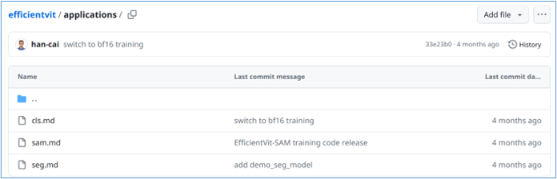
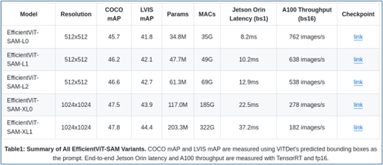

雖然DCNN深度卷積神經網路在2010年代為視覺AI技術開創新格局，但實用性受到很大的限制。後來受到NLP在Transformer技術的突破，對視覺技術產生非常大的衝擊，於是Google在2021年提出的ViT（Vision Transform）技術，對機器視覺上的圖片分類、物體檢測、語義分割等應用，產生非常大的變化，不僅在效能上有所突破，並且為視覺與大語言模型相結合的多模態技術，開創新的格局。

網路上已經有很多關於ViT算法的專業內容，有興趣的讀者請自行搜索閱讀。本文章的重點，在於為大家提供一個快速搭建測試不同ViT模型的實驗環境，因此需要尋找合適的模型來進行示範，為此我們找到非常適合在邊緣AI設備上部署的EfficientViT模型。

這個模型是ViT模型家族中非常突出的成員，由MIT的HanLab所創作，用於高效的高分辨率密集預測視覺任務，其核心構建塊是一個輕量級的多尺度線性注意力模組，僅需硬體高效操作即可實現全局感受野和多尺度學習，非常適合於GPU部署。

這個實驗室專注在發展“微型機器學習工程（Tiny Machine Learning Projects）”，成員名單從姓名上分析，應該是以華人為主力（<https://hanlab.mit.edu/team>），而大部分的項目名稱使用“Efficient”作為開頭，例如Efficient LLM quantization、Efficient ML systems、Efficient CNN algorithm-system co-designs等等。



實驗室在<https://github.com/mit-han-lab/efficientvit>開源了調用這個模型的源碼，雖然在“Getting Started”所列的安裝步驟只有以下4步：

```bash
$ conda create -n efficientvit python=3.10
$ conda activate efficientvit
$ conda install -c conda-forge mpi4py openmpi
$ pip install -r requirements.txt
```

看起來似乎很簡單，但實際執行過程中卻是難度很大，特別是這個以Python為主的各種依賴庫的版本變動太過頻繁，而requirements.txt所包含的依賴庫超過20個，如下所列：

```text
torch==2.0.1
torchvision==0.15.2
einops
opencv-python
timm==0.6.13
tqdm
torchprofile
matplotlib
git+https://github.com/zhijian-liu/torchpack.git@3a5a9f7ac665444e1eb45942ee3f8fc7ffbd84e5
transformers
onnx
onnxsim
onnxruntime
git+https://github.com/alibaba/TinyNeuralNetwork.git
git+https://github.com/facebookresearch/segment-anything.git
pycocotools
lvis
# demo-specific packages
gradio
gradio-clickable-arrow-dropdown
gradio-box-promptable-image
gradio-point-promptable-image
gradio-sbmp-promptable-image
```

一開始的torch就牽涉到是否支持CUDA的問題，對應執行效率有很大影響。其次，20多個Python依賴庫之間的版本依存關係，會隨著版本變動頻率與時間的延伸，降低安裝成功的機率。第三，裡面還有三個依賴於其他Github repo代碼的安裝，同樣會增強整個安裝過程的不確定性。

事實上，根據我們實際的操作，很難一次就完成EfficientViT模型的執行環境，這並不是如項目所指示地那麼容易。

好在Jetson AI Lab同樣為我們打包好一組專門執行EfficientViT模型的映像檔，我們依舊只要執行以下非常簡單的指令，就能進行操作：

```bash
$ jetson-containers run $(autotag efficientvit)
```

現在我們進入的項目裡面的/opt/efficentvit目錄中，但是用ls -l 指令檢查一下裡面的檔案版本，發現全部都是2024年1月份的版本，應該是比較老舊的內容，當然也都是可以執行應用。



如果我們想要執行EfficoentViT最新版本的應用時，只需要將最新的項目內容下載到本機裡面，然後在docker執行時用-v去映射路徑，這樣就可以使用最新版本的代碼去測試EfficientViT的各項應用。參考的指令如下：

```bash
$ git clone https://github.com/mit-han-lab/efficientvit
$ jetson-containers run -v ~/efficientvit:/opt/efficientvit $(autotag efficientvit)
```

現在就可以使用最新版本的代碼內容，對不同版本EfficientViT模型進行各種不同的測試，甚至訓練自己的ViT模型。目前項目提供三大類應用，我們可以到<https://github.com/mit-han-lab/efficientvit/tree/master/applications> 看到cls.md、sam.md與seg.md 三個基礎AI視覺應用說明：



每個應用說明中，對進行實驗都提供非常完整的相關內容，包括：

- 參考數據集，含下載鏈接；
- 預訓練模型，含參數與下載鏈接的列表（如下圖）；



- 執行調用的範例代碼；
- 各種評估性能的範例指令；
- 視覺化處理的示範指令；
- 部署指令：包括使用ONNX與TensorRT的示範指令；
- 訓練模型的示範指令；
- 其他；

所有執行內容請詳細參考applications裡 \*.md 的操作說明，對於實驗用途的人來說，這些操作內容是非常豐富並且足夠的。
