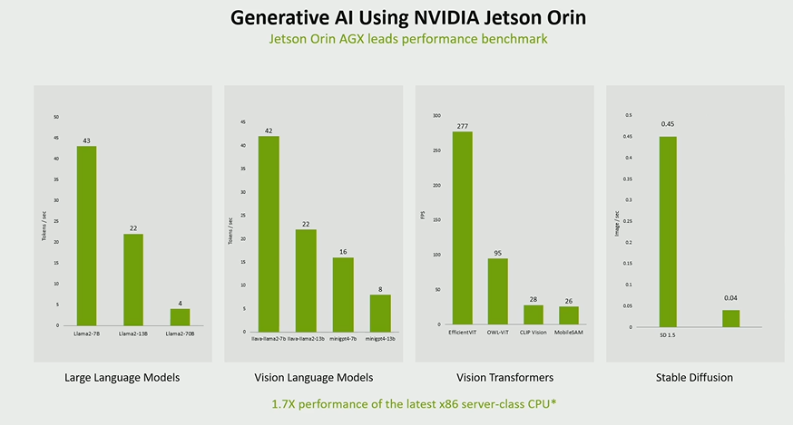
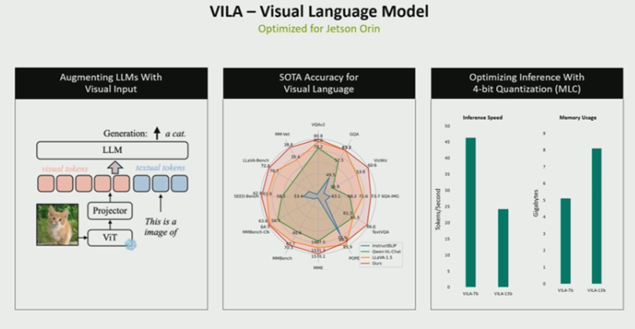
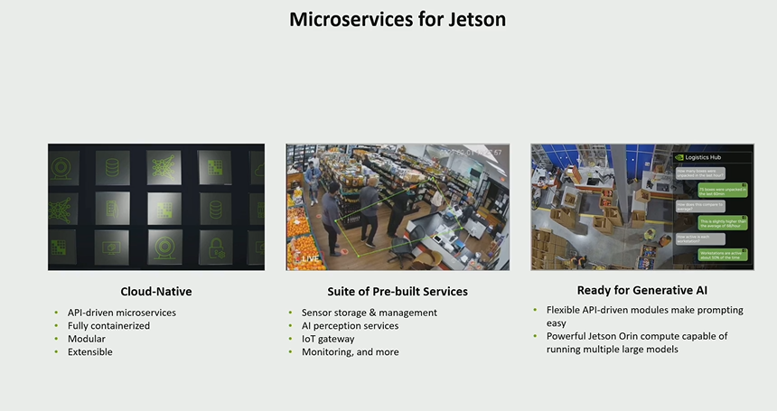

在智慧監控領域，NVIDIA Jetson Orin結合生成式AI正在開闢新的可能性。這篇文章將深入探討如何利用NVIDIA Metropolis微服務套件，通過雲原生的方法構建強大的邊緣AI應用程式，以及如何使用生成式AI實現更智慧的監控系統，特別是在火災檢測和應急響應方面。

## 傳統AI的局限與生成式AI的突破

傳統的電腦視覺和AI方法，如卷積神經網路（CNN），儘管在某些任務上表現出色，但在處理複雜的情境理解和多樣化的應用場景時存在明顯局限。這些方法通常需要固定的規則和模型，缺乏對上下文的理解，導致在複雜場景中的應用變得困難和繁瑣。然而，生成式AI通過其上下文理解和推理能力，可以有效克服這些挑戰。

## 生成式AI在火災檢測中的應用

以火災檢測為例，生成式AI不僅能夠檢測火災，還可以通過其豐富的上下文理解能力識別消防員、平民等關鍵要素，並在此基礎上推斷出現場情況。這種能力得益於生成式AI模型經過大量互聯網級別的數據訓練，使其能夠在沒有明確訓練數據的情況下，通過零樣本學習來識別各種物體和場景。

## Jetson Orin與VILa模型的整合

NVIDIA Jetson Orin平台已經優化了一個名為VILa（視覺語言模型）的生成式AI模型，該模型能夠接收視頻、圖像或文本作為輸入，並生成文本輸出。這一模型在Jetson Orin上以高效的方式運行，確保實時處理能力，從而為構建智慧監控系統提供了強大的技術支撐。

## 微服務架構簡化邊緣AI應用開發

NVIDIA Metropolis微服務套件為開發者提供了一套雲原生微服務，包括視頻存儲、感知服務和監控功能等。這些微服務使得構建、擴展和部署邊緣AI應用變得更加便捷。開發者可以使用這些預構建的服務，也可以根據需要引入自訂服務，通過API閘道進行整合。

## 生成式AI與微服務的協同作用

通過生成式AI與微服務的結合，開發者可以構建更為智慧和動態的監控應用。例如，通過自然語言提示，系統可以自動檢測並生成警報，極大地簡化了複雜場景下的監控任務。同時，生成的元數據可以用於後續分析，進一步提升系統的智慧化水平。

## 實時監控與數據交互的新可能

在實時監控場景中，生成式AI不僅能夠實時分析視頻流，還可以通過自然語言與系統交互，生成詳細的場景描述和數據總結。這種能力使得使用者可以輕鬆獲取複雜數據的關鍵資訊，顯著提升監控效率。

## 總結

Jetson Orin與生成式AI的結合，借助NVIDIA Metropolis微服務，正在改變智慧監控的面貌。通過這套強大的技術組合，開發者可以更快速地構建複雜的邊緣AI應用，實現從火災檢測到全面智慧監控的轉變。這種雲原生、基於微服務的架構為開發者提供了無限的可能性，使其能夠應對各種複雜的監控需求。
