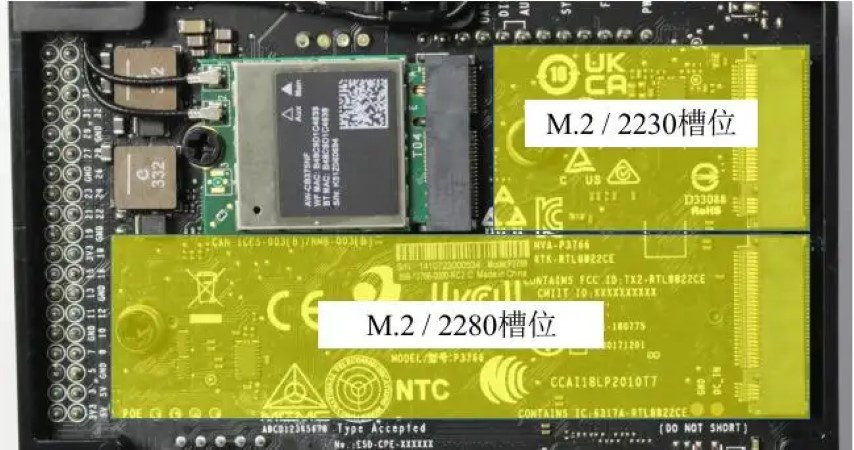
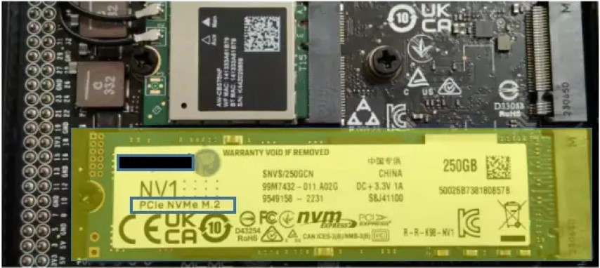
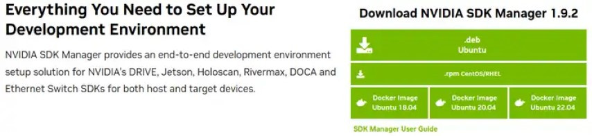
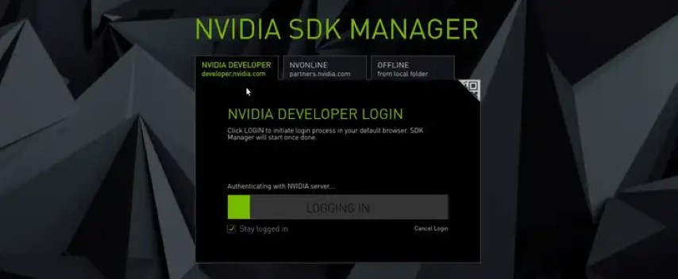
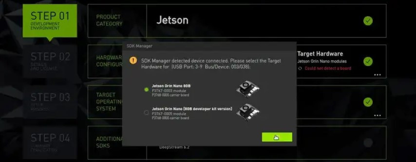
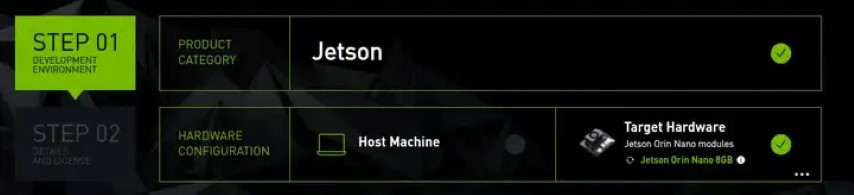
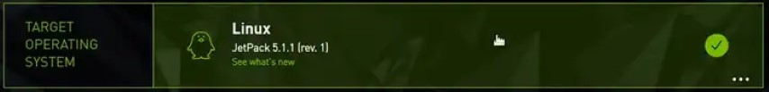
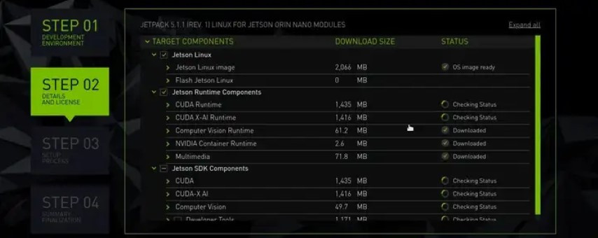
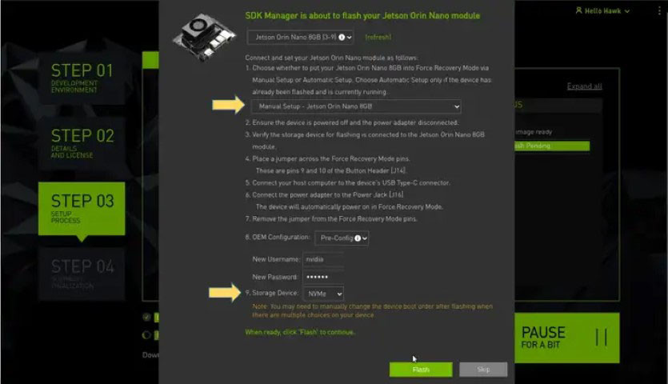
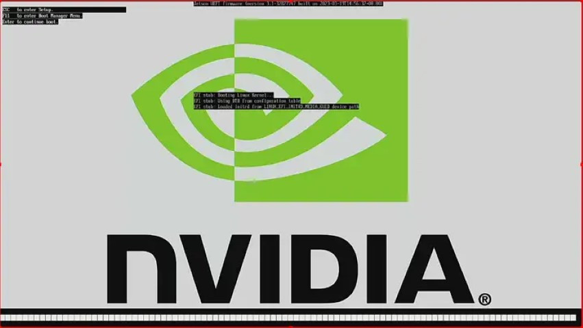

對於AI計算性能高達40TOPS的Jetson Orin Nano開發套件來說，如果缺少性能良好的存儲相匹配，會讓整體執行效益大打折扣。為此，NVIDIA在Jetson Orin Nano開發套件上配置2個M.2介面（如下圖），最高能安裝2片高速PCIe匯流排的NVMe高速存儲設備，這樣大大提升了這個產品的實用性。



由於M.2設備有較繁瑣的規格，包括介面匯流排以及SSD卡的長度。目前Orin Nano開發套件所支持的介面都是PCIe匯流排的NVMe種類，長度規格分別為2280（80毫米長）與2230（30毫米長）兩種，支持的匯流排規格分別為PCIe 3.0x4與PCIe 3.0x2，因此在選擇規格時千萬不能弄錯，否則就無法使用。

安裝NVMe SSD存儲卡非常簡單，只要卡插入M.2介面（注意方向性）後用開發套件上所配置的螺絲將SSD固定好就行。本文使用PCIe NVMe M.2/2280規格的SSD存儲設備（如下圖）來安裝Jetpack系統，讀者請自行配置所需要的規格與容量。



我們可以將這些NVMe SSD設備作為單純數據存儲用途，也可以將Jetson啟動系統安裝到NVMe SSD上以提高系統穩定性與執行性能，畢竟這種使用方法會比microSD（或稱TF）卡啟動方式更有優勢。

過去要將完整的Jetpack系統安裝在Jetson的NVMe SSD存儲上是極為繁瑣的，現在使用NVIDIA的SDK Manager 1.9.2以上的版本，就能非常輕鬆地執行這項任務。

目前SDK Manager只支持Ubuntu操作系統，因此首要工作便是需要一台安裝Ubuntu操作系統的x86電腦或者VMWare虛擬機，選擇18.04、20.04或22.04等LTS版本都可以。本文直接使用x86電腦來操作，關於虛擬機的使用方式，主要是注意“Removable Devices”的連接，其他環節都是一樣的。

現在就開始以下的步驟：

1. **下載並安裝SDK Mananger**

我們可以從 <https://developer.nvidia.com/sdk-manager> 下載SDK Manager安裝包（如下圖），這裡推薦下載第一種“.deb”會比較簡單，下面的“SDK Mananger User Guide”連結是這個軟體的使用手冊。



下載好安裝包之後，在Ubuntu系統裡執行以下指令：

```bash
$ sudo apt install ./sdkmanager_[version]-[build]_amd64.deb
```

例如：

```bash
$ sudo apt install ./sdkmanager_1.9.2-10889_amd64.deb
```

可以使用 `tab` 快速補全文件名。安裝好之後直接在命令終端執行 `sdkmanager` 就會啟動以下的啟動畫面：



NVIDIA要求使用者必須先擁有開發者帳戶，如果還沒有的話就需要先申請一個。網上許多關於這個帳號的申請教程，因此在這裡就不多贅述。

2. **讓開發套件進入刷機（Flash）模式**

這是使用SDK Mananger執行刷機時，所必須執行的步驟。在Jetson Nano（含2GB）、NX與Orin Nano等系列開發套件中，在“背部風扇下方”都有一組針腳（如下圖左），其中右數第3/4針腳分別為“FC REC”與“GND”功能（如下圖右上方），在關閉電源的狀態下，使用一般條線將這兩個腳位進行“短接”（如下圖右下方）。

接下來用一根支持數據傳輸功能的USB/Type-C線，將Ubuntu主機上與Orin Nano開發套件進行連接。一切就緒之後，再為開發套件接上電源，確認電源燈是亮著。\
如果上述步驟都正常執行的話，就會在SDK Mananger畫面上彈出下圖中間的選項，表示系統已經偵測到Orin Nano設備。



注意：這裡顯示檢測到的是"Jetson Orin Nano 8GB"，而不是"Jetson Orin Nano \[8GB developer kit version\]"，**我們必須選擇這裡所檢測到的型號，直接點擊“OK”鍵**，而不要去更改型號選項，否則後面會導致失敗！

3. **用SDK Mananger執行系統安裝**

現在就能開始進行刷機任務，進入“STEP 1”之後，建議將“Host Machine”的安裝選項取消掉（如下圖），因為這部分會在Ubuntu主機上安裝CUDA開發環境，除非您的系統上有裝上NVIIDA的GPU卡，否則這些安裝是沒有任何作用，還會浪費很多時間去下載安裝包與安裝環境。



至於第三行“TARGET OPERATING SYSTEM”部分，就選擇您想安裝的版本，這裡會以“最新版本”作為預設值，如果想要安裝其他版本，就點擊右下角“...”按鈕，會出現下拉選項提供選擇。



選擇完畢之後，點擊右下角“CONTINUE”黃色塊按鈕，進入下一级選項（如下圖），



這個步驟只要點選最下方“I accept the terms .....”前面方框，然後右下角“CONTINUE”按鈕就會變成黃色可點擊的選項，點擊之後就會開始下載所需要的安裝包，並且在Ubuntu主機上創建刷機所需要的系統目錄，這部分會花比較多的時間，初學者可以不需要了解這邊步驟所生成的內容。

繼續往下執行，直到出現下面畫面：



這部分是需要細心處理的步驟，只要是以下幾點：

1. 圖上第一個箭頭處，必須選擇“Manual Setup - Jetson Orin Nano 8GB”；
2. 圖下第二個箭頭處，選擇“NVMe”選項；
3. 在“New Username”框中，輸入您要設定用戶名；
4. 在“New Password”框中，輸入您要設定的密碼。

全部配置完後，就能點擊右下角“Flash”按鍵，開始為Jetson Orin Nano安裝操作系統與基礎環境，全部大約10分鐘時間，這樣就完成第一階段的操作。

4. **開發套件自動重啟，並執行系統配置**

完成第一階段的操作之後，Orin Nano開發套件會自動重啟，此時如果您為開發套件接上顯示器的話，就能看到以下的開機畫面。



**這個開機畫面會持續靜止大約6分鐘左右的時間**，因為系統還要寫入以下開機的設定，因此不要誤以為系統出現死機狀況。


等到正常開機之後，接下去系統會自動執行系統配置的步驟，這裡會將“全部空間”都配置給系統，並將前面輸入的“New Username”與“New Password”配置給系統，然後在SDK Manager端就會開始繼續安裝其他的開發環境，包括CUDA、cuDNN、TensorRT、OpenCV等等，這部分需要大約30分鐘時間。

整個安裝完畢之後，**請記得將最開始用來短接“FC REC”與“GND”的跳線取下**，否則可能會影響後續的正常運行。
