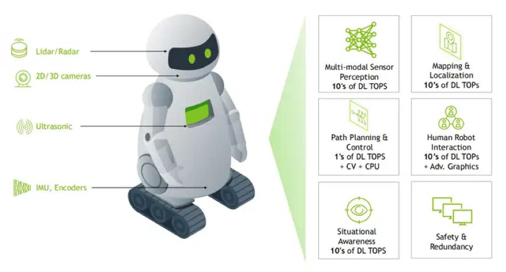
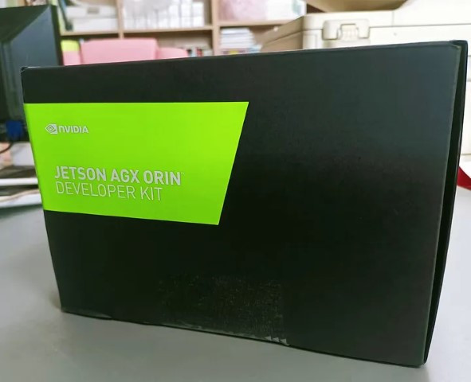
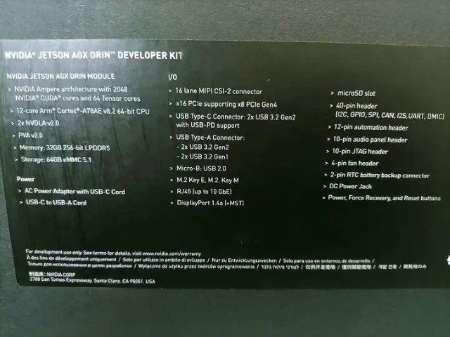
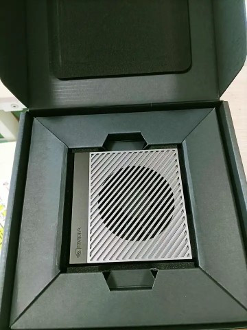
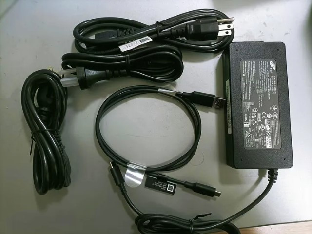
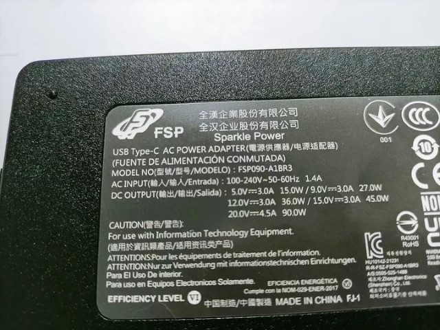
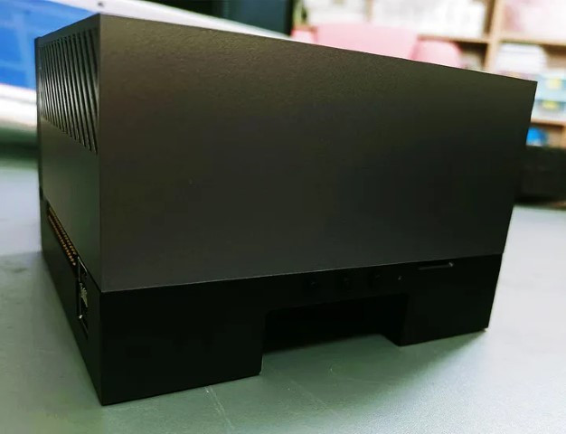
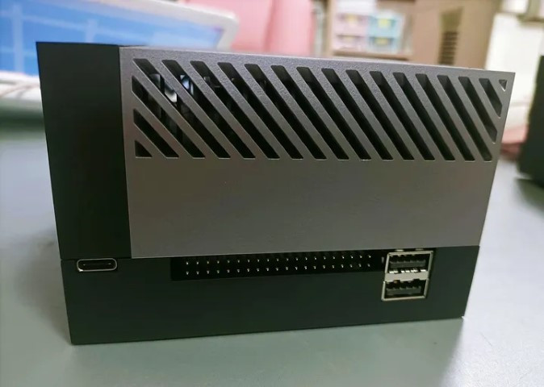
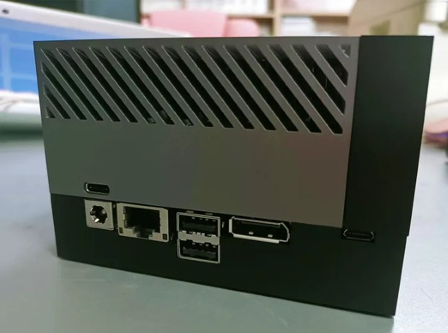
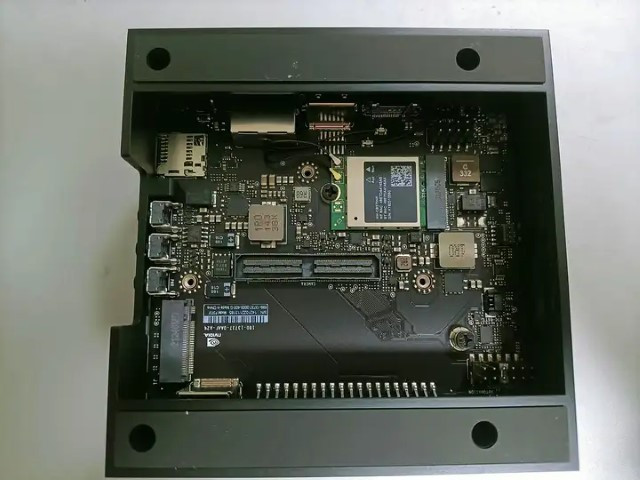

## 為什麼需要Jetson AGX Orin?

機器人技術的新時代正在出現，需要數量級的更高計算機器人現在正在進入人類世界，而不是孤立地工作，這需要多感測器感知、映射和定位、路徑規劃和控制、態勢感知和安全，這些不斷增加的任務正在推動對更多計算的需求。

Jetson AGX Orin 每秒可提供 275 萬億次操作，為客戶提供比其前身 Jetson AGX Xavier 高出 8 倍以上的處理能力，同時保持相同的手掌大小的外形尺寸和引腳相容性。AGX Orin具有 NVIDIA Ampere 架構 GPU、Arm Cortex-A78AE CPU、下一代深度學習和視覺加速器、高速介面、更快的記憶體頻寬和多模式感測器支持，以支持多個並發的 AI 應用程式管道。

## 規格比較

讓我們對比一下Jetson AGX Orin開發套件和Jetson AGX Xavier 開發套件的規格。

|  | Jetson AGX Xavier開發套件 | Jetson AGX Orin開發套件 |
| --- | --- | --- |
| AI性能 | 32TOPS | 200TOPS |
| GPU | 512-CoreNVIDIA Volta GPU | 1792-CoreNVIDIA Ampere GPU |
|  | 64TensorCores | 56Tensor Cores |
| CPU | 8-coreARM® v8.2 64-bit CPU, 8MB L2 + 4MB L3 | 12-coreArm Cortex-A78AE v8.2 64-bit CPU 3MB L2 + 6MB L3 |
| DLA | 2xNVDLA | 2xNVDLA v2.0 |
| VisionAccelerator | 2xPVA | PVA v2.0 |
| Memory | 32GB256-bit LPDDR4x | 137GB/s |
| 存储 | 32GBeMMC 5.1 | 64GBeMMC 5.1 |
| CSI Camera | 16lane MIPI CSI-2 | 16lanes MIPI CSI-2 |
| PCIe | x16 connector with x8 PCIe Gen4 or x8SLVS-EC | x16 PCIe slot:Lower x8 PCIe Gen4 |
| 网络 | Gigabit Ethernet | Upto 10 GbE |
| Display | HDMI2.0 Type A2x DisplayPort via USB-C | DisplayPort 1.4a (+MST) |
| USB Type-C | 2x USB-C 3.1 (supporting DIspalyPort and USBPD) | 2xUSB 3.2 Gen3 with USB-PD support |
| USB Type-A | 2xUSB 3.2 Gen2, 2x USB 3.2 Gen2 | 2xUSB 3.2 Gen2, 2x USB 3.2 Gen2 |
| USB Micro-B | USB2.0 | USB2.0 |
| M.2 Key M | NVME | x4PCIe Gen 4 |
| M.2 Key E | PCIex1 + USB 2.0 + UART (for Wi-Fi/LTE) / I2S + DIMIC + GPIOs | x1PCIe Gen 4, USB 2.0, UART, I2S |
| Other | 40-pin header (UART, SPI, CAN, I2C, I2S,DIMIC, GPIOs)MicroSD / UFS card slot eSATAp (eSATA | USB 3.0 Type-A1)10-pin audio header8-pin automation header (system power and related signals)4-pin fan header DCpower jackPower, Force Recovery, and Reset buttons |
| 尺寸 | 105mm x 105mm x 65mm | 110mm x 110mm x 71.65mm |

## 開箱

NVIDIA Jetson AGX Orin開發套件的外箱為黑色。

側面列出了開發套件的規格。注意我使用的是早期32G版本的AGX Orin，這個版本目前已經退市了，NVIDIA加量不加價，現在出的都是64G記憶體版本，我只能說有時候早起的鳥兒不一定能吃到好食......

請注意，購買Jetson AGX Orin開發套件後，需要將原包裝和配件保留至少一年。一年內如果有品質問題需要保固，必須是原包裝和配件返回給供應商——不要問我為啥一直強調這個。

打開外箱後，可以看到開發套件躺在裡面，顏值很高啊！

我們會看到附送的3根電源線和1根USB-Type C線，以及一個變壓器，這些都必須要保留好，不能弄丟喔。

注意AGX Orin附贈的電源變壓器規格：

再看看介面：

這裡有三個按鈕，分別是Power鍵、Force Recovery鍵和Reset鍵，同時有一個micro SD插槽。

這一面分別是USB Type-C介面，以及40-pin Expansion Header，還有2個USB3.2介面。

這一面有電源插口，插口的上面是一個USB Type C介面，接著是一個網路介面，然後又是兩個USB 3.2的介面（大家可以注意到AGX Orin總共有4個USB 3.2介面）。

關鍵來了，AGX Orin配備了一個DP介面，跟AGX Xavier的HDMI介面不同，是要接DP顯示器作為輸出。DP介面旁邊是一個Micro USB2.0介面。

將AGX Orin開發套件的底部朝上，我們看到這裡可以外接一個M.2的SSD卡。與AGX Xavier不同，AGX Orin有自帶無線網卡，而前者出廠是沒有，需要自己安裝，這樣可以節省很多事情了。

同時我們也可以看到這裡有2個MIPI CSI介面。

好了，我的兩款設備介紹完了，後面會陸續開始上乾貨了。
