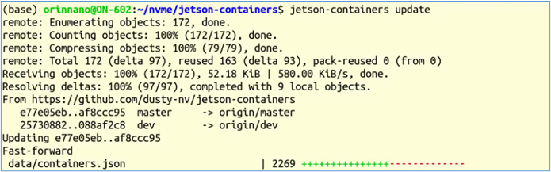
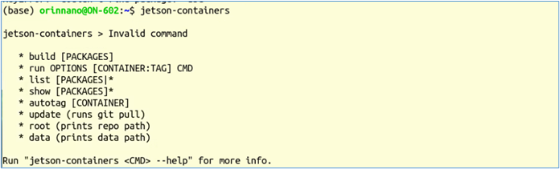
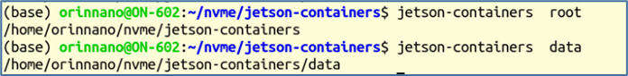
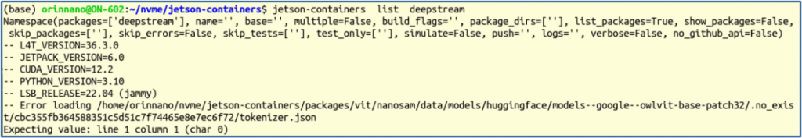
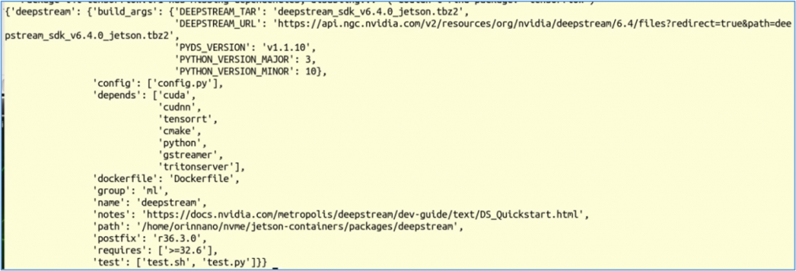

由NVIDIA資深工程師Dustin Franklin為Jetson設備所搭建的jetson-container開發環境，以Docker容器為基礎去提供各種所需的應用環境，這還需要nvidia-docker的配合，所幸Jetpack安裝工具已經都配置完成了。

不過Jetpack疏漏一個對runtime的設定，因此要在Jetson讓容器調用NVIDIA GPU的話，還需要先執行下面指令：

```bash
sudo nvidia-ctk runtime configure --runtime=docker
```

這個指令會在 `/etc/docker/daemon.json` 裡添加以下代碼：

```json
"runtimes": {
    "nvidia": {
        "args": [],
        "path": "nvidia-container-runtime"
    }
}
```

因此我們可以執行上面指令，或者直接在daemon.json裡添加上面的代碼塊，效果是一樣的。添加這個內容之後，記得執行以下指令讓其生效：

```bash
sudo systemctl deamon-reload  &&  sudo systemctl restart docker.service
```

完成上述工作之後，就可以開始安裝jetson-container開發環境，整個過程很簡單，只要按照以下步驟即可：

```bash
git clone https://github.com/dusty-nv/jetson-containers
bash jetson-containers/install.sh
```

安裝完之後，會在 `/usr/local/bin` 目錄下創建`jetson-containers`腳本文件，有興趣的朋友可以自行今天了解腳本內容。

由於 Jetson-container項目更新十分頻繁，因此每次要創建項目時，建議先執行以下指令進行更新：

```bash
jetson-container update
```

如果項目有所更新的話，就會看到類似下面畫面的信息：



現在我們就可以用 `jetson-containers` 指令，來創建我們所需要的docker容器環境，包括下載已經創建好的映像文件，或者從頭創建新的映像文件。

接下來就進一步挖掘`jetson-containers`的用法，當我們輸入以下指令時，會看到如下圖的信息：



表示在 `jetson-containers` 指令後面，總共有8個指令選項，其中 `update` 在前面已經使用過了，另外的 `list`、`show`、`root`、`data` 都是比較基礎的信息用途，現在就做個簡單的說明：

- `root` 與 `data`：分別顯示jetson-containers項目的根路徑與data路徑：

顯示的信息如下：



- `list [PACKAGES]*`：顯示個別package的基本信息

`jetson-containers  list` 命令会显示完整的 packages 列表。目前這個項目的總package數量已經超過230個，這裡就不展現列表信息。

```bash
jetson-containers  list  deepstream	# [PACKAGES]=deepstream
```

顯示的信息如下:



- `show [PACKAGES]*`：顯示個別package的完整信息，包括依賴的容器

顯示的信息，包括上來 list 的內容之外，再加上下圖所顯示的信息，包括這個項目所依賴的軟件、路徑、編譯版本等等，相對更加清楚些。



上面4個指令主要是信息用途，與實際的執行並沒有太大關係，因此使用頻率並不高。下面三個指令的組合是jetson-containers的靈魂，並且在`jetson-containers`目錄下有個別對應的腳步，來配合其工作。

- `autotag [CONTAINER]`：自動適配版本，並作進一步處理

由於容器映像與設備環境版本存在緊密對應的關係，每個package會針對各種Jetpack版本去創建對應版本的映像文件，例如deepstream package就有如下圖5種版本映像文件，前面提到目前已經有超過230個packages，那所需要管理的映像文件就大概有近千個，在管理上就會造成很大的負擔，大部分的新手通常不知道該使用哪個版本？


為了解決這個比較頭痛的問題，項目作者提供 `autotag` 自動判斷腳本，幫開發者直接確認該使用的映像版本。請執行以下指令：

```bash
echo  $(autotag deepstream)		# [CONTAINER]=deepstream
```

執行信息中的“Found compatible container dustynv/deepstream:r36.2.0”，就是告訴我們已經發現到“r36.2.0這個兼容版本”，雖然與前面 ”list” 指令所找到的“L4T\_VERSION=36.3.0”不完全一致，但系統告訴我們這裡有個可用的兼容版本，如果發現系統裡沒有對應的映像文件，還會詢問“是否下載（pull）？”、“是否創建（build）？”之類的問題，非常貼心。

`autotag` 這個指令通常不會獨立使用，而是與下面的 `run` 或 `build` 組合使用，不過 `build` 對新手來說使用的機會並不高，接下去就是說明以下 `run` 的使用。

- `run` 執行容器指令：標準格式如下

```bash
jetson-containers  run  OPTIONS  [CONTAINER:TAG]  CMD
```

如果按照指令的要求，我們需要自行提供\[CONTAINER:TAG\]的完整內容，例如“dustynv/deepstream:r36.2.0”。但如同前面所提到的，初學者經常搞不清楚能搭配的版本，因此我們可以使用 `$(autotag deepstream)` 來協作，如下指令：

```bash
jetson-containers  run  OPTIONS  $(autotag deepstream)  CMD
```

至於命令中間的 `OPTIONS`，就是與 `docker run` 後面所接的選項一樣，通常是添加容器內外路徑映射用途的，例如添加 `-v ${HOME}:/home` 這樣的映射關係。

在Docker應用中，周邊設備的映射通常是最令人頭痛且容易出錯的環節，因此作者在 `run.sh` 腳本中，為大家提供非常好的防護措施。主要部分如下：

1. 檢查可能連接的USB攝像頭（check for V4L2 devices）\
   在 `run.sh` 第6-14行中，檢查設備上已經連接的USB攝像頭，只要能發現到的都添加到列表中，最多數量為10個（編號0-9），應該不會再多了。
2. 檢查I2C設備（check for I2C devices）\
   同樣的原理，第17-25行檢查設備上已經接上的I2C設備，並添加到設備列表中。
3. 檢查顯示（check for display）\
   第27-41行為容器配置顯示能力，這段牽涉到幾個指令，是大部分初學者容易忽略的部分。作者將這部分添加到 `run.sh` 裡面，為大家做好預防措施，降低出錯的機率。
4. 指令匯總\
   從第75-86行的內容，就是將執行容器所需要的完整指令進行匯總，裡面會看到許多我們所不熟悉的映射，例如 `--volume /etc/enctune.conf:/etc/enctune.conf` 是什麼用途？這裡不多做探索。

如此一來，我們只要使用 `jetson-containers run OPTIONS [CONTAINER:TAG]` 指令，就能替代十多行繁瑣的指令，我們只需要專注在 "deepstream", "agent\_studio" 這些要使用的項目名稱，其他事情就交給jetson-containers指令去處理就行了。
