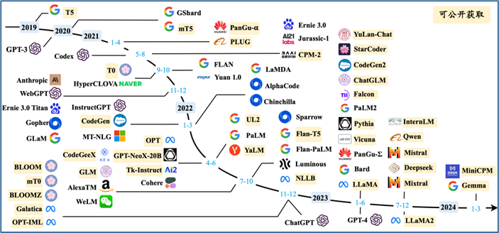
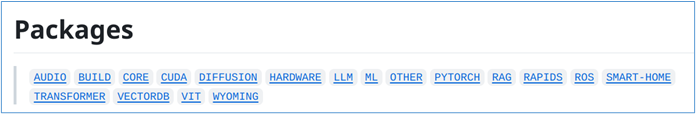

這兩年AI應用，已經從傳統機器視覺領域，擴展到大語言模型甚至多模態組合的智能應用，從原本單一智能模型的內容生成或推理，提升到多智能體（multi-agents）協作完成複雜任務的層次。

對大部分人來說，進入人工智能應用的最大門檻，首先是需要有一台能夠執行AI計算的設備，其次就是花時間去搭建複雜的運行環境，然後再根據前人提供的學習成果去按部就班地操作。

然而，昂貴的設備與快速迭代的技術與模型，讓很多人不知從何下手。下圖列出近五年較為主流的大模型種類，而HuggingFace所存放的開源模型總數超過80萬個，我們根本不可能逐一去嘗試與理解。

本系列文章的目的，就是為有志於AI應用開發的技術人員，提供一個最低成本、最豐富生態的開發平台，讓大家能在最短時間內掌握各種主流AI應用的基礎技能。選擇NVIDIA Jetson Orin Nano作為本系列的計算平台，主要原因如下：

1. 成本低廉：

這套不到500美元的掌上型嵌入設備，具有高達40TOPS的算力以及8GB顯存，能順暢地執行絕大部分精簡版的開源大語言模型，只要再搭配一片125GB以上NVME SSD儲存，就能輕鬆地嘗試大部分先進的AI應用技術。

2. 安裝輕鬆：

絕大部分AI技術開發人員，都經歷過配置環境的艱辛過程。從最基礎的安裝GPU驅動、CUDA、CUDNN、TensorRT等執行環境，以及Docker/nv-docker等虛擬運行環境的搭建，都是相當複雜而且繁瑣的過程。

NVIDIA為Jetson設備提供的Jetpack安裝包，一次性完成上述所有環境的安裝與版本匹配，十分輕鬆。

3. 生態豐富：

在Jetson AI Lab（jetson-ai-lab.com）裡所提供的各項應用資源，包括以下18個主要分類，在深度與廣度都非常完整：

本系列文章就是為大家從LLM（大語言模型）、RAG（檢索增強生成）、ViT（視覺轉換器）等時下最熱門的領域中，挑選大約10個項目的內容為大家深入說明，所有項目都使用容器技術調用，減少安裝調試的繁瑣過程。

以下是本系列內容的簡單介紹：

- 安裝AI Lab的jetson-cotainer實驗環境
- 生成式AI：
  - 基於text-generation-webui搭建Web界面智能助手；
  - 基於stable-diffusion-webui搭建Web界面的文生圖；
  - 使用Ollama模型管理器快速體驗百種大模型；
- RAG增強式生成
  - 用Jetson Copilot根據自己的數據需求快速建立私有問答系統；
  - 用NanoDB運行互動式演示，以見證處理多模態數據的向量資料庫的影響；
- ViT視覺轉換：
  - 建立EffectiveViT測試環境與OWL應用；
  - 創建TAM（Track Anythin Model）應用；
  - 創建SAM（Segment Anythin Model）應用；
- 互動式多模態整合應用：
  - NanoLLM綜合開發接口
  - Llamaspeak語音對話助手
  - Llava優化的多模態互動
  - Agent Studio多智能體開發

以上這十多個項目的內容，已經囊括時下基於大模型的大部分主流AI應用，只要能按部就班學習就能有所收穫，並且可以基於這些技巧去完成自己創意的AI應用項目，這會是非常有趣的過程。
