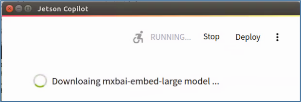
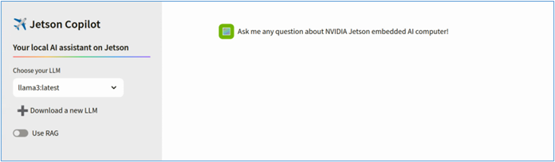
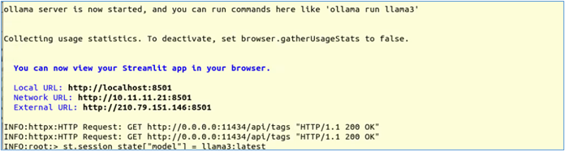
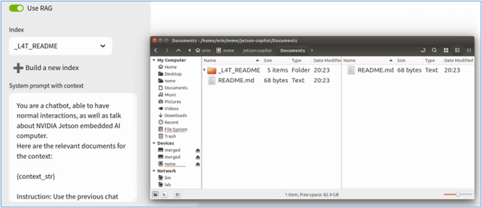
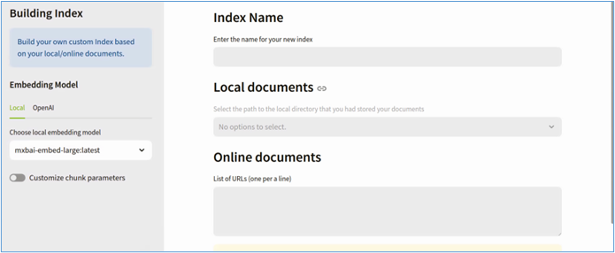
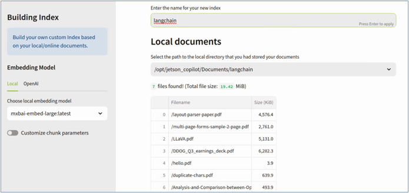
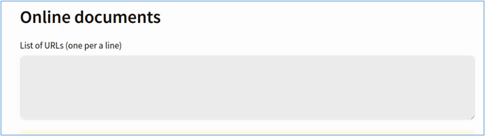
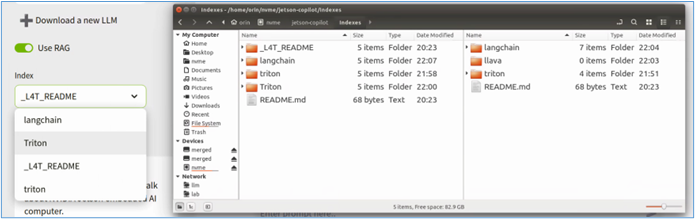

在前面的大語言模型測試過程，一定會發現這些智能助手都存在一些「胡言亂語」、「答非所問」之類的狀況，其實可以將它視為「不瞭解邊界」的小孩童一樣，因為所有人工智能模型，都是在它的知識庫中，尋找「機率最高」的答案。很有可能這個答案的正確率還不到 5%，但它不能回答「不知道」，必須找到一組以上的回覆（response），即便其正確率並不高。

為了要協助處理這種現象，目前最流行的方法就是使用俗稱「檢索增強生成」的 RAG（Retrieval-Augmented Generation）技術，為手上的大語言模型助手提供補強或微調的功能。

NVIDIA 在 <https://github.com/NVIDIA-AI-IOT/jetson-copilot/> 開源一個 Jetson Copilot 項目，還是在 Ollama 大模型管理器之上，結合以下兩個應用功能所組成：

- **LlamaIndex**：是一個用於快速搭建大型語言模型項目的 CLI 工具，旨在為 LlamaIndex 項目提供腳手架支持，支持多種後端存儲解決方案，包括本地文件系統、AWS S3。在這個項目中是用來實現 RAG 流水線。
- **Streamlit**：是一個基於 Python 的開源框架，用於快速構建和共享漂亮的機器學習和數據科學 Web 應用程序。在這個項目中用來搭建交互式的 Web 應用。

Jetson Copilot 項目的安裝十分容易，只要執行以下代碼即可：

```bash
$ git clone https://github.com/NVIDIA-AI-IOT/jetson-copilot/
$ cd jetson-copilot && ./setup_environment.sh
```

這裏的 `setup_environment.sh` 主要調試 Docker 的一些環境，我們在前面的項目中已經執行過，其實可以忽略不執行。

如果想使用先前已經透過 Ollama 管理器下載的模型資源，那麼在執行 `./launch_jetson_copilot.sh` 腳本啟動整個 Jetson Copilot 項目之前，最好先執行前面教過的啟動 Ollama 容器的指令，如下：

```bash
$ jetson-containers run $(autotag ollama)
```

等到 Ollama 管理器啟動之後，再開啟新的命令終端，執行以下指令：

```bash
$ cd jetson-copilot && ./launch_jetson_copilot.sh
```

這個腳本會為我們配置相關的環境變量，並且下載我們所需要的 `dustynv/jetson-copilot:<版本>` 鏡像文件。現在我們在 JetPack 6.0 版本的 Jetson Orin 上執行時，這個 `<版本>` 就應該是 `r36.3.0`。

腳本中要求 jetson-copilot 所創建的容器中，首先就是檢查 Ollama 服務是否存在？如果不存在，就會下載獨立的 `dustynv/ollama` 容器，並且重新創建一個 Ollama 服務，如此一來，前面透過 `ollama pull` 所下載過的模型，就全部都用不上了，需要重新再下載一次，非常耗時費力。因此我們在前面提過，最好先啟動 Ollama 服務器，這樣就能節省很多不必要的浪費，並且體現出兩種功能的結合。

這個腳本的最後會啟動 `streamlit_app/app.py` 程序，裏面預設使用 `llama3` 大語言模型與 `mxbai-embed-large` 嵌入模型，啟動過程中如果發現缺少這些模型，就會直接啟動模型下載程序（如下圖）去下載缺少的元件，自動化程度相當高。



一切就緒之後，就會自動啟動瀏覽器，並跳出下面的操作畫面：



這時在命令框中會看到以下的信息：



表示我們在其他機器上，也能輸入 `<IP_OF_JETSON_COPILOT>:8501` 來使用這項應用。這裏可以非常輕易地切換 Ollama 已下載的模型，也可以點擊「Download a new LLM」選項去下載新的模型，請大家自行嘗試。

這裏的重點在於創建 RAG 應用，因此基礎的大模型對話就不多做嘗試。我們打開左邊「Use RAG」選項，就會看到其下方出現如下圖左邊的內容：



右圖是在 jetson-copilot 下的兩個對應文件目錄位置：

- <strong>Documents（右邊）</strong>：需要添加原始文件的地方；
- <strong>Index（左邊）</strong>：生成 RAG Index 的地方。

當我們點選「+Build a new index」時，就會進入下面畫面：



此時我們在「Local documents」那邊怎麼點擊也都沒有反應，因為我們還沒有在 Documents 裏添加新的文件。現在我們在 Documents 裏新建 `langchain` 目錄，並且在下面添加 7 個 pdf 文件，然後按 F5 刷新頁面，就會看到如下內容：



這時再點擊「Local Documents」就有反應了。在這下面還有個可以輸入 URL 的框，每個 URL 用一行：



然後選擇左邊要使用的模型，這裏預設用 `mxbai-embed-large`，在最上面給一個 Index 名稱，最後點擊最下面的「Build Index」，系統就會為 `langchain` 建立 RAG Index 文件。

現在回到主畫面中，現在看看 Index 下面所出現的選項，與 jetson-copilot 下面的 Index 與 Documents 目錄中的內容比對一下，這樣就能掌握添加 Index 的方法。



選擇一個 Index 之後，再與智能助手進行互動，相信會有所不同的。至於使用 RAG 功能前後的差異，在這裏就不多贅述，由自己親手去體驗會更加有感覺。
