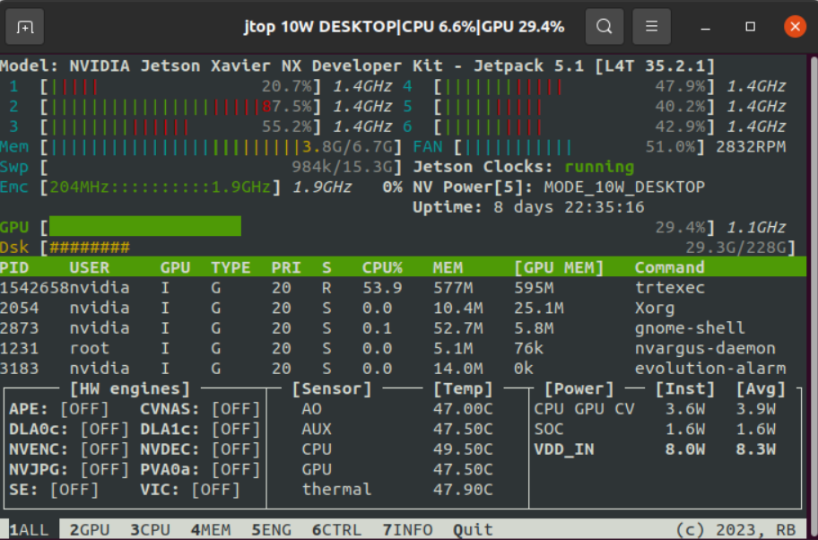

當你在Jetson邊緣設備上開發，想知道CPU和GPU的使用率，想知道現在功耗是多少，或者想知道運行溫度是多少，那麼這個工具就非常重要了！



`jetson_stats`是一個強大的工具包，用於監控和控制NVIDIA Jetson系列（包括Orin, Xavier, Nano, TX等）開發板。JTOP是該工具包中的一個核心組件，提供了一個直觀的終端介面來顯示和分析Jetson開發板的硬體狀態，如CPU、GPU、記憶體等。以下是一個基於`jetson_stats`庫安裝JTOP的詳細教程：

## 前提條件

- 確保你的Jetson開發板已經安裝了NVIDIA JetPack，並且網路連接正常。
- 確保你的Python環境已經設定好，並且`pip`工具可用。

## 安裝步驟

1. 打開終端：\
   首先，在你的Jetson開發板上打開終端。
2. 安裝pip（如果尚未安裝）：\
   通常，JetPack安裝中會包含pip。但如果沒有，你可以通過以下命令安裝pip（以Ubuntu為例）：

```bash
sudo apt update  
sudo apt install python3-pip
```

3. 安裝jetson-stats：

正常情況下，你應該可以直接使用 `pip` 直接安裝 `jetson-stats`

```bash
pip3 install jetson-stats
```

但如果以上命令沒有成功安裝，那麼你需要從源碼編譯

```bash
git clone https://github.com/rbonghi/jetson_stats.git  
cd jetson_stats  
python3 setup.py install
```

4. 驗證安裝：

安裝完成後，你可以通過運行 `jtop` 命令來驗證JTOP是否已正確安裝。如果一切正常，你將看到一個終端介面，展示了Jetson開發板的硬體狀態。

```bash
jtop
```

1. 使用JTOP：\
   一旦JTOP啟動，你可以通過介面上的信息來監控你的Jetson開發板。JTOP提供了豐富的信息，包括CPU、GPU的使用率、記憶體使用情況、風扇速度等。
2. 退出JTOP：\
   要退出JTOP，你可以簡單地按 `Ctrl+C`，或者你可以根據工具下方的指導按 `q` 鍵。

## 注意事項

- 確保你的使用者具有運行jtop所需的權限。通常，jetson-stats不需要超級使用者權限，但如果你遇到權限問題，請檢查你的使用者權限或嘗試使用sudo（儘管通常不推薦這樣做）。
- 如果你在Docker容器中運行Jetson開發板，請確保按照jetson\_stats的Docker文件進行配置。\
  以上就是基於jetson\_stats庫安裝JTOP的詳細教程。希望這能幫助你成功安裝並開始使用JTOP來監控你的Jetson開發板。
