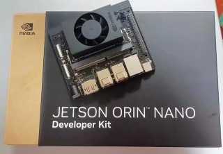
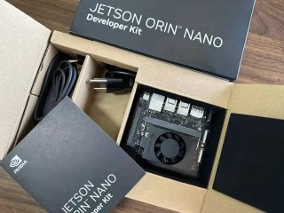
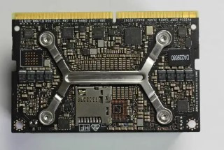
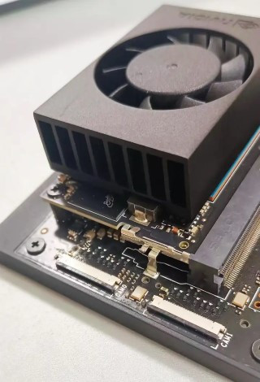
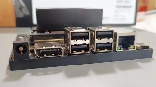
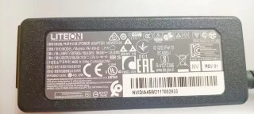
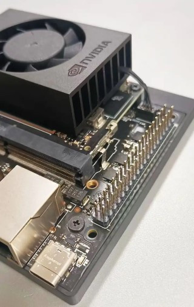
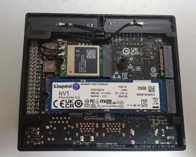

由於接下來的文章，我們都會以Jetson Orin NANO開發套件或者Jetson AGX Orin開發套件作為邊緣運算設備，所以我會介紹一下使用的設備情況。

讓我們一起來開箱一下吧。

請注意保留所有配件和外包裝盒至少一年，因為NVIDIA提供為期一年的保固。如果在保固期內遇到質量問題，您需要將產品原包裝返回。這對於開發者來說非常重要，請務必記住這一點。

不同於NVIDIA Maxwell架構的Jetson NANO，NVIDIA的Jetson Orin NANO開發套件是一款基於Ampere架構的GPU開發板，具有1024個NVIDIA CUDA核心和32個Tensor核心。同時，該開發板還配備了一顆6核心的Arm Cortex-A78AE v8.2 64位CPU，記憶體為8GB 128-bit LPDDR5，具有68GB/s的頻寬，可以提供出色的運算性能。

相較於Jetson NANO只有472 GFLOPS AI性能，Jetson Orin NANO開發套件達到了40TOPS，甚至比Jetson Xavier NX的20TOPS AI性能還高出了許多！

同之前NVIDIA推出的Jetson Xavier NX開發套件（現在已經停產）一樣，Jetson Orin NANO開發套件支援多種存儲方式，可以通過microSD卡槽和外部NVMe M.2 Key M存儲器進行擴展。

您可以清楚地看到在開發套件中，模組是帶有一個microSD卡槽。這與NVIDIA單獨銷售的生產用Orin NANO模組是不同的，後者是沒有microSD卡槽。

開發套件支援兩個MIPI CSI-2 22針攝像頭連接器，大家可以看到這個連接器跟Jetson NANO開發套件的MIPI CSI接口不一樣，所以Jetson NANO能用的CSI攝像頭不能直接用在這個開發套件上。後面我們會單獨有文章來介紹。

再來看一下前端接口，有一個DP接口接顯示屏，四個USB 3.1 Type A接口，一個千兆乙太網端口，以及一個USB-C接口（注意這個接口是用來傳輸數據的，不是用來供電的）

最左邊是DC供電，套件附贈一個19V的電源和電源線。

與Jetson NANO開發套件一樣，這款開發板也有一個40針擴展頭（UART、SPI、I2S、I2C、GPIO），是將Jetson Orin Nano開發套件連接到各種周邊設備的重要接口，可以擴展設備的功能和應用範圍，比如外接感測器、致動器等等。

最後看一下載板底部，一個M.2 Key E接口，出廠就已經接了無線網卡，所以這個板子可以直接無線上網。兩個M.2 Key M接口，可以擴展存儲，我已經自己接了一個SSD在上面，出廠是不帶SSD的哦！

總的來說，Jetson Orin NANO開發套件是一款功能強大的開發板，可以提供出色的運算和存儲性能，同時支援多種接口和擴展方式，非常適合進行嵌入式系統和物聯網應用的開發。
