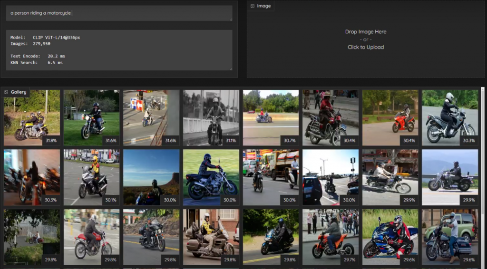
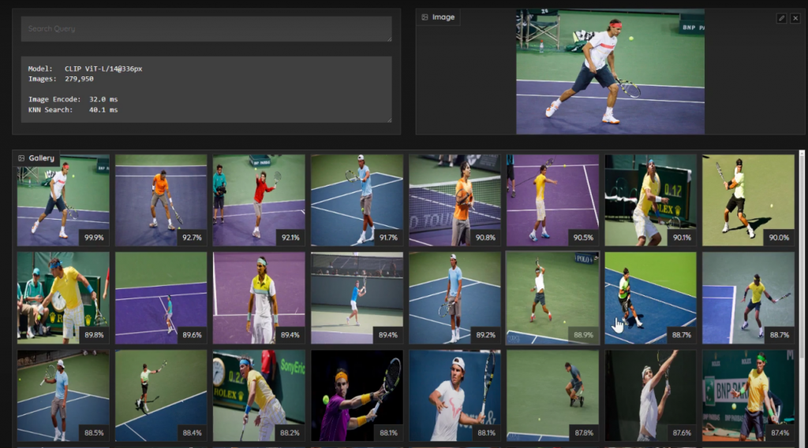
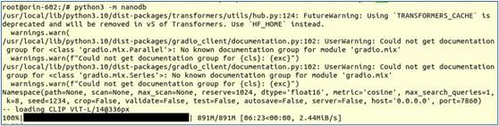
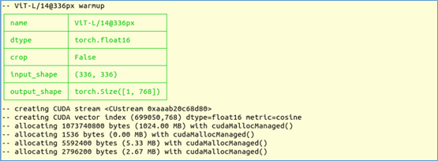
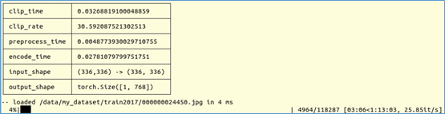
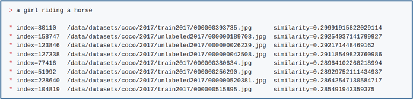
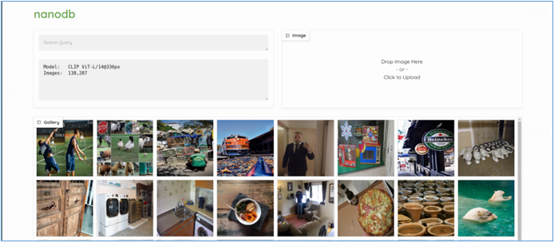
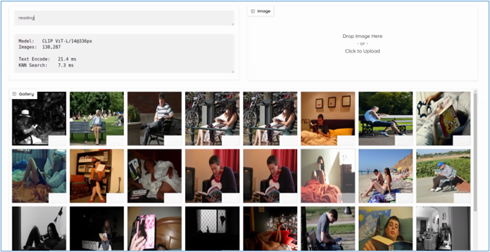

這個項目是一個CUDA優化的多模態向量資料庫，使用CLIP vision Transformer中的嵌入模型進行txt2img和img2img相似性搜索，實現下面的“以文找圖”與“以圖找圖”的功能，這對現代人來說是一項福音，因為大部分人總是困擾著，得在一堆圖片中找到所需要的目標，但是檔案名稱能表達的意義太有限。





這個項目支援'.png', '.jpg', '.jpeg', '.tiff', '.bmp', '.gif'等格式圖片，除了在邊緣有效地索引和搜索資料之外，這些向量資料庫還經常與LLM結合使用，用於檢索增強生成(RAG)，以完成超出其內建上下文長度（Llama-2模型為4096個token）的長期記憶，並且視覺語言模型也使用相同的嵌入作為輸入。

項目最耗時費力的環節，就是啟動多模態大模型對所需要的圖像檔案進行全盤的掃描（scan），並建立龐大的向量資料庫（vector DB），在最終執行圖片搜索的功能方面，除了CLI終端指令之外，還提供Web交互模式，便於未來可以開發成工程化的應用。

為了提高項目的通用性，我們使用COCO圖像字幕資料集中的12萬張圖像進行示範，包括建立向量資料庫的過程。因此我們使用32GB記憶體的Jetson AGX Orin設備來進行這個示範，讀者可以使用自己的圖片集來進行實驗。

雖然這個應用整合了多項先進的技術，還好在 Jetson AI Lab裡面已經為我們先弄好一個docker映像檔，我們只要執行下面指令就可以開始安裝並啟動：

```bash
$ jetson-containers run $(autotag nanodb)
```

下載完需要的映像檔之後，就會進入容器執行環境。第一次執行“python -m nanodb”時，因為系統找不到預設所需要的CLIP的ViT-L/14@336px模型，於是調用模型下載功能，自動下載到系統中。



執行到最後的地方，會出現以下資訊：



現在就可以開始對我們準備好的圖像集進行掃描工作。在容器內的/data目錄直接映射到容器外jetson-containers/data目錄，因此我們可以在這裡創建一個 my\_dataset，然後將資料集內容全部複製進去。\
注：由於這裡牽涉到容器內外的映射，因此 ln -s 這種軟連結的方式是會造成錯誤的。\
現在將COCO資料集的train2017.zip複製到my\_dataset下，解壓縮到這裡就可以，然後在容器內執行以下指令：

```bash
$ time python3 -m nanodb \
    --scan /data/my_dataset/train2017 \
    --path /data/my_dataset/nanodb \
    --autosave --validate
```

現在系統就開始掃描我們資料集裡的 118,287 張圖片，如下圖所示：



這裡要簡單說明一下nanodb應用的一些重要參數，主要有下面幾個：

- `--scan`：可選地指定一個目錄來遞歸掃描圖像，支援'.png', '.jpg', '.jpeg', '.tiff', '.bmp', '.gif'等格式。可以同時使用多個 `--scan`導入不同的目錄。
- `--path`：指定 NanoDB 配置/資料庫將保存到或加載的目錄，
  1. 如果該目錄不存在，則會為新資料庫創建該目錄。
  2. 如果那裡已經存在 NanoDB，它將首先被加載，並且任何執行的掃描都會添加到該資料庫中。
  3. 添加圖像後，您只需啟動 NanoDB 即可`--path`加載已準備好的資料庫。
- `--autosave`：每次掃描後以及每掃描1000張圖像後，自動保存NanoDB嵌入向量。
- `--validate`：將根據資料庫對每幅圖像進行交叉檢查，以確認其返回自身（或找到已包含的重複項）

NanoDB可以遞歸掃描圖像目錄，計算其CLIP嵌入並以float16格式保存到磁碟。要將內容提取到資料庫中，請啟動已掛載資料集路徑的容器。實際上，只有嵌入向量才保存在NanoDB資料庫中。如果您仍想查看圖像，則應將圖像本身保留在其他地方。索引過程後，原始圖像不需要用於搜索/檢索，它們僅供人類查看。

建立好向量資料庫之後，就會出現“>”的執行提示符號，我們可以在這裡輸入我們所要問的提示詞，例如“a girl riding a horse”，下面就會列出符合條件的圖片路徑，後面還會顯示相似度（similarity）數字，如下圖。預設會顯示top 8結果，可以使用“`--k`”參數改變這個設定值。



我們在文章一開頭的地方，看到的是Web界面。現在只要執行以下指令，就能啟動Web交互界面：

```bash
$ time python3 -m nanodb \
    --path /data/my_dataset/nanodb \
    --server --port=8760 （端口號可以自己隨便給）
```

然後在瀏覽器中輸入`http://HOSTNAME:7860?__theme=dark`，就能出現以下界面：



在左上角輸入提示詞，例如“reading”，就幫我們找出與讀書有關的圖片。



當我從這些圖片將左上角第二張圖片（坐在公園讀書的人）拉到右上角框內，nanodb會從資料庫中找出與這個張圖片相類似的圖片。


是不是很有趣？這就是nanodb結合多模態大數據模型所實現的功能，可以作為很多應用的基礎模組。
