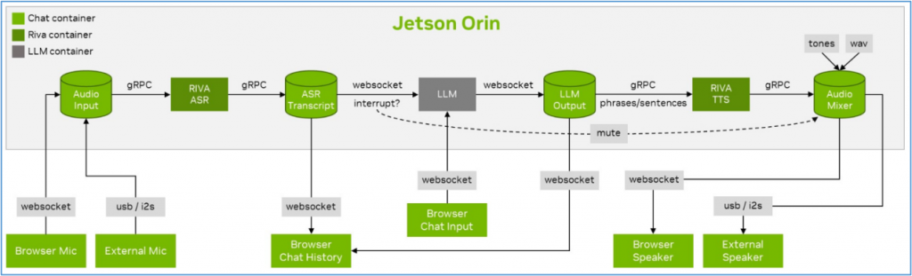
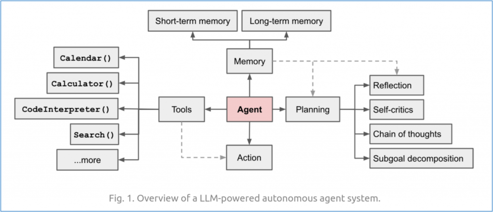
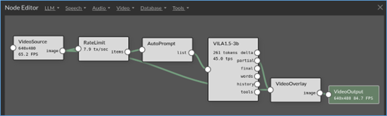
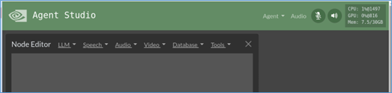
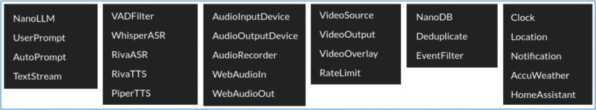
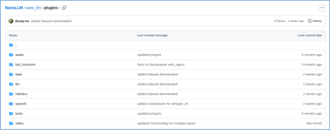
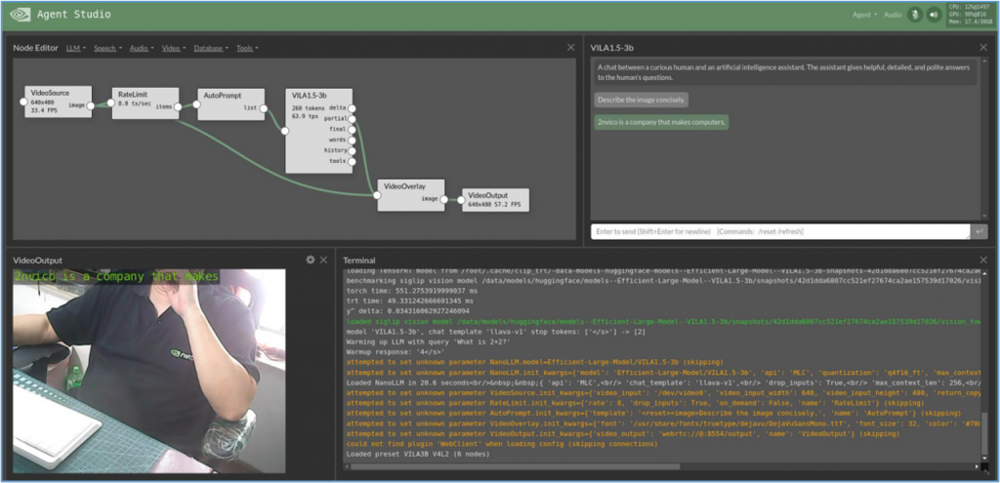
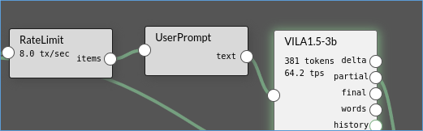
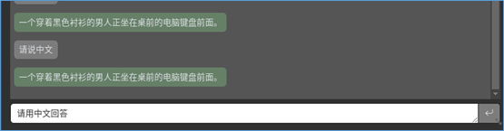

雖然大語言模型為AI開啟新的紀元，但是我們只能將這些模型視為AI能量的供應源，與我們所需要的流程類應用還有段差距，因為再厲害的大語言模型也都有各自擅長的部分，要搭建一個完整的應用，需要更多配套的組件共同完成任務。

例如我們前面搭建的Llamaspeak語音智能助手專案中，並非單純地選擇不同大語言模型來作為智能核心就完成了，我們還需要結合很多其他配套技術，包括音頻輸入/輸出的websocket或usb/i2s技術、數據傳輸技術（gRPC）、語音識別技術（RIVA ASR）、語音合成技術（Piper TTS）等等。

下圖就是技術Llamaspeak專案的簡單示意圖：



實際上，在這裡的流程中有很多環節是固定的，主要會有所不同的部分是在於以下部分：

1. 模型選型：按照前面專案的案例，如果我們選擇能支持多模態的模型，那麼這個應用就具備多模態識別的能力，否則就只能提供單純的對話功能；
2. ASR/TTS語音種類；
3. 視頻採樣的相關參數；
4. 基於Web應用所需的傳輸協議。

於是我們就可以將這裡所需要的技術，打包成一個可執行單元，利用參數傳遞的方式賦予其不同的能力，這就是個agent的雛形。

前面提過NanoLLM目前已經提供ChatAgent、VoiceChat、WebChat、VideoStream與VideoQuery這5種基本agents。雖然我們在Llamaspeak專案中只調用nano\_llm.agents.web\_chat這個agent，但裡面直接包含VoiceChat agent的功能，因此就能直接使用瀏覽器指定的麥克風與音箱進行對話。

一個基於大語言模型的agent基礎結構如下：



可以看得出要建構一個agent也不是一件簡單的事情，這也不是本文所要傳遞的重點。關於AI agent的知識與技術，網上有非常豐富的內容，請大家自行搜索與學習。

本文的重點，是要教大家使用NanoLLM所提供的AgentStudio工具（如下圖所示），能夠非常輕鬆快速地用系統所創建好的agents與plugins，透過對agent的位置拖拉、創建交互關係、調整參數等動作，就能非常有彈性地搭建出符合自己需求的AI應用。



現在我們先開始啟動這個AgentStudio介面，然後再介紹這個應用內置的相關資源。請執行以下指令進入NanoLLM容器：

```bash
$ jetson-containers run --env HUGGINGFACE_TOKEN=$HUGGINGFACE_TOKEN \ $(autotag nano_llm)
```

因為後續的應用還需要從HuggingFace下載相關模型與資源，因此這裡還是得將您從HuggingFace所獲取的密鑰填進去，否則會出現錯誤。

接著執行以下指令啟動AgentStudio：

```bash
$ python3 -m nano_llm.studio
```

啟動服務之後，可以在自己電腦中的瀏覽器，輸入`https://<IP_OF_ORIN>:8050`，就會看到以下介面：



我們可以看到右上方還會顯示運行設備（這裡使用Jetson Orin）的計算資源使用狀況。在“NodeEditor”旁邊出現的“LLM”、“Speech”、“Audio”、“Video”、“Database”“Tools”等選項，分別提供以下所列的功能插件：



由於內容相當繁多，這裡沒有足夠篇幅進行詳細說明，有興趣的朋友可以自行到<https://github.com/dusty-nv/NanoLLM/tree/main/nano_llm/plugins>，裡面列出所有插件的源碼，請自行參閱：



現在我們先載入一個本應用已經預先建立好的“VILA3B V4L2”專案，以VIAL 3B多模態大語言模型為基礎、描述攝像頭所看到景象的應用。請點擊右上角“Agent”->“Load”->“VILA3B V4L2”之後，介面不會馬上做出反應，因為後台還在做相應的處理或下載。此時可以看到右上角計算資源的使用狀況正在跳動。

載入後的執行畫面如下（已經過人為調整）：



左上角是對agents的流程安排，從VideoSource -> RateLimit -> AutoPrompt -> VILA1.5-3b -> VideoOverlay -> VideoOutput。右上方顯示的是VILA1.5-3b對攝像頭的描述，左下方是攝像頭的輸出，右下方顯示執行終端的信息。

現在試試看將流程中的“AutoPrompt”刪除（點擊Agent框，左上角會出現“X”符號），再從“LLM”下拉選項中選擇“User Prompt”，替代原本的位置與連接關係。



現在到右邊對話框裡輸入“請用中文回答”，就會看到上面的回應也變成中文信息了，但是左下方的視頻輸出部分會出現亂碼。



如何？這個AgentStudio工具很好用吧！對於絕大部分不知道該怎麼創建Agent的人來說，真的非常方便，目前NanoLLM已經提供非常充足的Agent插件，當然也允許開發人員自行創建有針對性的插件，去完成特定的工作。
