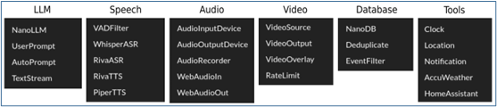
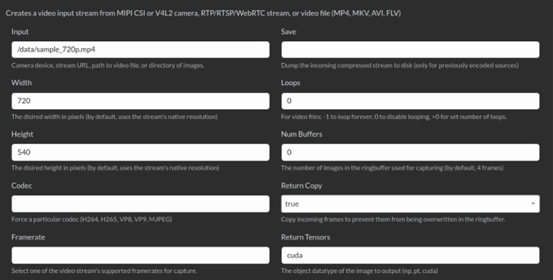
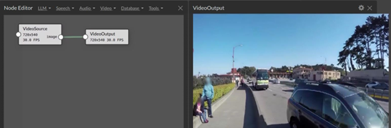
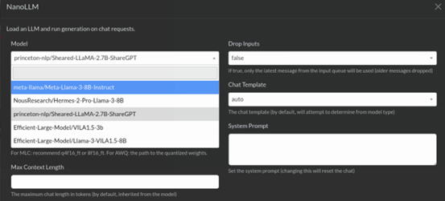
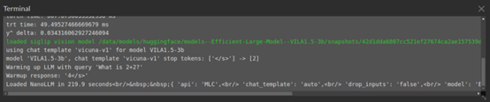
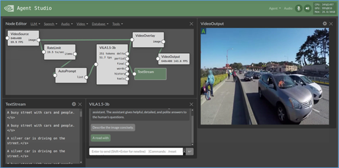

Agents只是創建或連接其他嵌套插件管道的plugins，以透過更高級的控制流實現更高級的行為，它們被設計為可以相互疊加，這樣就可以將不同agent功能組合在一起。

在NanoLLM開發平台裡，為互動式沙盒(sandbox)中，提供快速設計和實驗創建自己的自動化agent、個人助理和邊緣AI系統的能力，用來連接多模式LLM、語音和視覺轉換器、向量資料庫、提示模板和函數調用到即時感測器和I/O。並且針對Jetson上的部署進行了優化，結合設備內計算、低延遲流和統一記憶體等特性。

在專案NanoLLM下的nano\_llm/agents目錄中，目前已提供dynamic\_agent.py、chat.py、video\_query.py、video\_stream.py、voice\_chat.py與web\_chat.py等六個agents，我們還可以繼續為這個系統添加自己開發的agents。

在前面的文章中介紹過AgentStudio這個互動式開發工具，就是用來開發新agent用途的。目前AgentStudio已經提供如下所列的6大類plugins，我們可以很輕鬆地用這些插件來組件自己的agent。

現在我們以視頻分析的對話應用為例，為大家做個簡單的示範。

首先，我們需要有個視頻的輸入源，於是從Video類點擊VideoSource後，會跳出下面的對話框：

這裡可以設定視頻類的輸入源，種類列在最上方。Input欄位填上輸入源的內容，如果要使用USB攝像頭的話，就填入「/dev/video0」，現在會看到Node Editor裡出現一個「VideoSource」的框。

接著先看看這個輸入是否正確，最簡單的方式就是添加一個「VideoOutput」插件，然後將VideoSource右方的image（輸出）與VideoOutput左方入口相連接，就能看到視頻輸出的畫面，如下圖。

現在我們要用LLM來對視頻資料進行分析，我們可以從LLM類別中選擇NanoLLM，然後出現如下圖的選項框，其中「Model」部分提供下拉選項去點選就可以，不用自行輸入。現在因為要處理視頻資料，因此挑選支持多模態的VILA1.5-3b模型。

這裡面的任何動作，都不會立即在Node Editor上反應，因為都是當下去生成這些元件，如果選擇的模型還未下載到本機的話，就需要更多時間從Huggingface下載，不過執行資料只要下載一次之後就能重複使用。我們可以在Terminal裡看到相關信息：

現在我們要搭建一個用LLM去分析VideoSource內容、並輸出到VideoOutput的任務，光靠這三個plugins還是不夠的，因為我們需要為LLM提供prompts，還得將LLM回應的內容疊加到原視頻之上，因此我們需要AutoPrompt或UserPrompt作為VideoSource與LLM插件直接的連接處，輸出部分則需要VideoOverlay插件將VideoSource與LLM輸出內容進行疊加，然後輸出到VideoOutput之上。

如此搭建的工作流，就如下圖左上角所示的安排。

有時為了讓顯示結果能看到清楚些，通常會在VideoSource後面添加一個RateLimit插件，用來限制給LLM的幀率，一方面可以讓LLM的回答不會快速閃過，另一方面也能有效控制計算資源的消耗。

當一切調試到符合我們期望的，就能在右上方「Agent」按鈕中選擇「Save」功能，保存好我們所開發的agent，並且後面還能使用「Load」或「Insert」功能載入進來重複使用。

怎樣？用AgentStudio來創建應用LLM agent是不是很方便？還可以多多嘗試跟語音識別/合成的功能一起結合，為自己打造一個真正AI的智慧助手。
