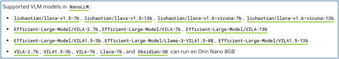
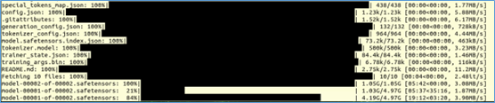
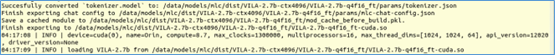
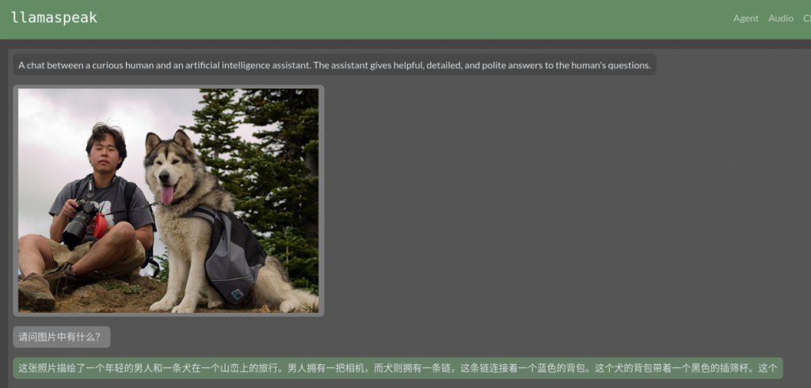
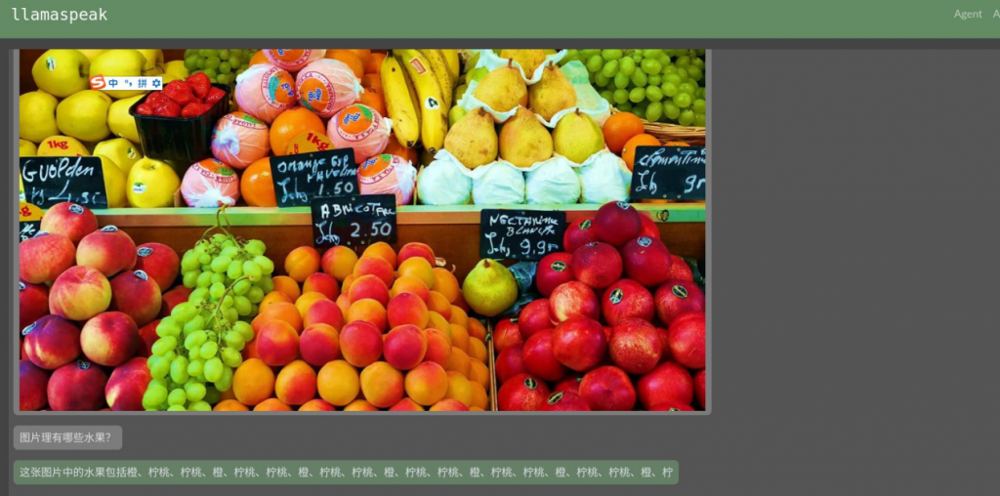
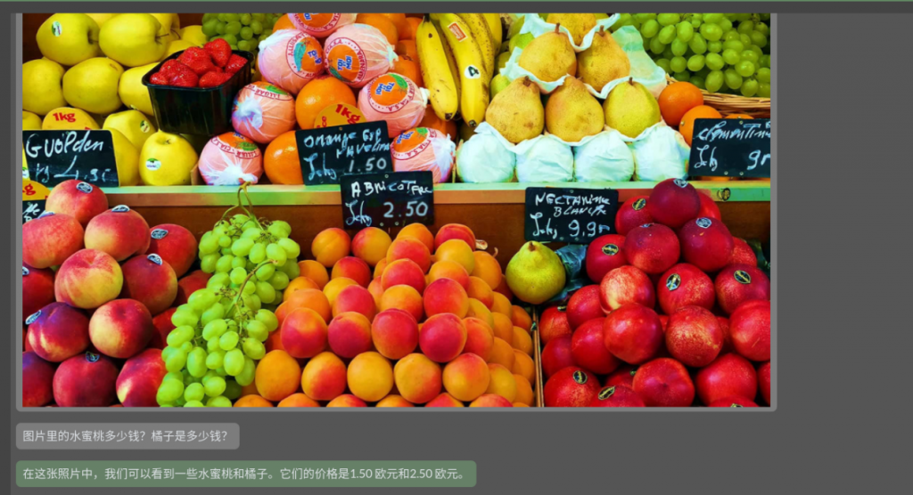
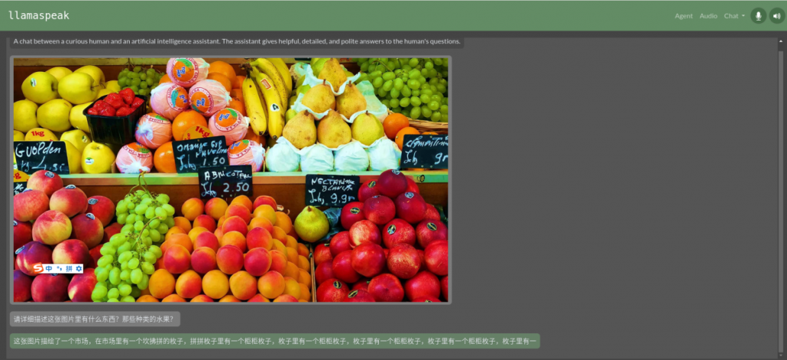

上一篇文章裡，我們使用NanoLLM所提供的nano\_llm.agents.web\_chat代理，調用Llama-3-8B-Instruct模型，並修改ASR與TTS調用的檔案來支援中文的輸入與輸出，非常輕鬆地搭建Llamaspeak語音助理。\
本文將進一步在前面的基礎上，將Llama-3-8B-Instruct模型換成支援VLM的大語言模型，就能立即將原本純語音的Llamaspeak變身成為多模態的語音助理。目前NanoLLM所支援的VLM非常多，如下圖所列的內容：



現在我們試試把前面llamaspeak的執行指令中的 `--model` 所指定的模型，改成Efficient-Large-Model/VILA-7b試試看，完整指令如下：

```bash
$ python3 -m nano_llm.agents.web_chat --api=mlc \
    --model Efficient-Large-Model/VILA-7b  --asr=riva  --tts=piper
```

由於系統裡沒有Efficient-Large-Model/VILA-7b模型，因此會直接調用下載程式，從HuggingFace去下載。



還有將模型轉換成支援CUDA GPU的格式：



甚至還要再將格式轉換成適合本設備的TensorRT格式：


要知道，以前這些過程，都需要我們一步一步地按照要求規範去給與特定參數然後執行，過程十分繁瑣並且出錯率很高。如今NanoLLM系統都已經為我們將大部分複雜的任務進行簡化，可以為我們減輕至少80%以上工作量與時間。\
當一切就緒之後，同樣在瀏覽器中輸入“`https://127.0.0.1:8050`”，就能啟動Llamaspeak的語音交互介面。現在我們要嘗試的已經不單單是對話的部分了，我們可以從其他地方“拉入”圖片，然後問語音助理“圖片裡面有什麼？”



下面的回答是 <em>“這張照片描繪了一個年輕的男人和一條狗在一個山巒上的旅行。男人擁有一把相機，而狗則擁有一條鏈，這條鏈連接著一個藍色的背包。這個狗的背包帶著一個黑色的插篩杯。”</em>

現在我們換一張如下圖的水果照片來提出問題，不過這裡記得得先清除前面的聊天，否則會產生幻覺現象。我們提出問題“照片裡有哪些水果？”



回應的答覆就有點混亂了，畢竟照片裡面的水果還挺多的。

後面我們繼續詢問“圖片裡的水蜜桃多少錢？橘子是多少錢？”

助理回答\*“在這張照片中，我們可以看到一些水蜜桃和橘子。它們的價格是1.50 歐元和2.50 歐元。”\*



又問“照片裡有多少個蘋果？多少個葡萄？”\
回答\*“這張照片中的蘋果和葡萄很多。我無法確定具體數量，但它們的整個攝影中都有很多。”\*



大致的效果是這樣的，就一個大語言模型來說，這已經算是相當厲害了，而且回答過程幾乎沒有任何延遲。\
這裡可能會出現一個問題，當我們離開容器之後，先前修改的內容並不會保存下來，因此重新進入容器之後，前面調整過的中文ASR與TTS配置，就得重新再來一次，這是一個比較麻煩的事情。\
解決這個問題的辦法有兩種：

1. 將修改過的容器，使用docker commit 存成另一個映像檔案名，例如llamaspeak\_cn:r36.2.0等等，然後啟動時將指令修改成下面的方式：

```bash
$ jetson-containers run --env HUGGINGFACE_TOKEN=<自己的HUGGINGFACE_TOKEN> \
  --workdir /opt/NanoLLM  llamaspeak_cn:r36.2.0 
```

但這種方式如果還需要修改其他代碼的時候，就得不斷儲存映像檔，對空間會有不小的影響，並且在版本的管理上也是一大考驗。\
2\. 另一種方式，就是在本機上複製一份NanoLLM源代碼，並映射到容器內的/opt/NanoLLM，這樣不僅可以確保使用的NanoLLM版本是最新的，並且我們在這裡的任何修改，都有容器內無關。執行的步驟如下：

```bash
$ git  clone  https://github.com/dusty-nv/NanoLLM 
$ jetson-containers run  -v  ~/NanoLLM:/opt/NanoLLM  --workdir /opt/NanoLLM \
--env HUGGINGFACE_TOKEN=<自己的HUGGINGFACE_TOKEN>  $(autotag nano_llm) 
```

進入容器之後，重新執行一次下面指令，更新容器內配套庫的版本

```bash
$ pip  install  -r  requirements.txt
```

現在對/opt/NanoLLM/nano\_llm/nano\_llm/plugins/speech裡面的riva\_asr.py與piper\_tts.py配置檔，按照上一篇文章的方式去修改成支援中文的能力，這個方式的實用性就高很多。\
大家可以從支援大模型列表中，嘗試更多其他的模型來看看效果，因為NanoLLM已經讓我們不需要寫代碼，就能跑出這麼厲害的應用，多試幾種模型所消耗的也就是下載模型的時間與帶寬而已。
