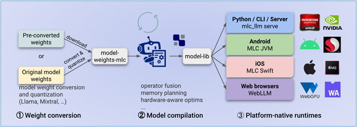

我們在前面所介紹的各項應用，包括SAM、OWL-Vit、Text-Generation-Webui、stable-diffusion-webui等等，都是基於個別專案環境去搭建，目的是讓讀者比較輕鬆地掌握不同技能的知識。但是這種方式對於要開發一個實用的應用系統來說，就顯得過於零碎，並且難以整合，這又不符合我們一開始所設定的目標，因此提供一套更有系統的開發環境，就變得非常重要。

在Jetson AI Lab專案中的Nano\_LLM專案，就為我們提供很完整的開發環境，專案作者為我們提供非常豐富的Python API，這樣讓我們就能很有彈性地去建構實用的AI應用，例如結合語音、對話、圖像、視頻等多模態的應用，甚至是結合多智能體（agents）形成完整工作流的智能應用等等。

這些Python API開發接口主要有如下所列的七大類：

- <strong>Models（模型相關）</strong>：提供模型加載、量化、嵌入和推理相關的接口。
  - 支持的API類型：MLC（Machine Learning Compilation）、HF(HuggingFace)與AWQ（Activation-aware Weight QuantizationMLC）三種。



- 支持的架構：Llama、Llava、StableLM、Phi-2、Gemma、Mistral、GPT-Neox

- 已測試的模型：

  - 大模型（LLM）：
    - meta-llama/Meta-Llama-3-8B
    - meta-llama/Llama-2-7b-chat-hf
    - meta-llama/Llama-2-13b-chat-hf
    - meta-llama/Llama-2-70b-chat-hf
  - 小模型（SLM）：
    - stabilityai/stablelm-2-zephyr-1\_6b
    - stabilityai/stablelm-zephyr-3b
    - NousResearch/Nous-Capybara-3B-V1.9
    - TinyLlama/TinyLlama-1.1B-Chat-v1.0
    - princeton-nlp/Sheared-LLaMA-2.7B-ShareGPT
    - google/gemma-2b-it
    - microsoft/phi-2
  - 視覺大模型（VLM）：
    - liuhaotian/llava-v1.5-7b
    - liuhaotian/llava-v1.5-13b
    - liuhaotian/llava-v1.6-vicuna-7b
    - liuhaotian/llava-v1.6-vicuna-13b
    - NousResearch/Obsidian-3B-V0.5
    - Efficient-Large-Model/VILA-2.7b
    - Efficient-Large-Model/VILA-7b
    - Efficient-Large-Model/VILA-13b
    - Efficient-Large-Model/VILA1.5-3b
    - Efficient-Large-Model/Llama-3-VILA1.5-8B
    - Efficient-Large-Model/VILA1.5-13b

- 模型相關操作的API：目前已經提供14種以“NanoLLM.”帶頭的API接口，例如NanoLLM.from\_pretrained()、NanoLLM.generate()等等。

- Streaming與KV Cache

- <strong>Chat（對話相關）</strong>：關管理多回合聊天會話、模板和維護嵌入歷史記錄的信息，包括chatHistory、chatMessage等等。

- <strong>Multimodal（多模態）</strong>：提供優化的多模式管道，包括視覺/語言模型（VLM）、矢量資料庫（NanoDB）和可以整合到互動式代理中的語音服務。

- <strong>Plugins（擴充插件）</strong>：插件是模型（如LLM、ASR、TTS）、後處理器和I/O（如視頻和音頻流）的包裝器，它們可以連接在一起，與其他插件節點串聯形成管道，其目的是要減少樣板代碼並快速構建更複雜的代理。插件將輸入接收到處理隊列中，對其進行處理，然後通過其輸出通道輸出結果。每個輸出通道表示模型具有的一種輸出類型（例如，ChatQuery插件在令牌、單詞和句子級別公開輸出），每個輸出通道可以連接到任意數量的其他插件節點。預設情況下，插件是線程化的，並在自己的隊列中運行，但可以通過將threaded=False傳遞給插件的初始化器來配置為內聯（無線程）運行。它們也可以用interrupt()函數中斷，以放棄當前請求和輸入隊列中的任何剩餘數據，例如，當你想提前停止LLM生成，或靜音TTS輸出。創建新插件類型時，實現process()函數來處理傳入數據，然後返回傳出數據。您還可以使用簡單的回調函數來接收數據，而不需要定義自己的插件類（如chat\_Plugin.add(my\_function)來接收聊天輸出）

- <strong>Agents（智能體）</strong>：只是創建或連接其他嵌套插件管道的插件，用於通過更高級的控制流實現更高級的行為。它們被設計為相互疊加，這樣你就可以將不同代理的功能組合在一起。目前已經提供的智能體有ChatAgent、VoiceChat、WebChat、VideoStream與VideoQuery等五大類。

- <strong>Webserver（網頁控制）</strong>：這是一個使用Flask和websockets實現的可擴展Web伺服器，允許代理提供前端HTML頁面，以及使用websockets的雙向消息傳遞，包括特定於每個應用程序的自定義消息類型

- <strong>Utilities（工具）</strong>：系統目前提供了Tensor Conversion（張量格式轉換）、Audio（音頻處理）、Images（圖像處理）、ArgumentParsing（參數解析）等四大類實用的工具。

除了上述的Python API之外，專案還提供一些基本指令，讓我們不需要寫代碼就能直接調用指令來實現某些基本功能，例如下面指令：

```bash
$ python3 -m nano_llm.completion --api=mlc \
  --model meta-llama/Llama-3-8b-chat-hf \
  --quantization q4f16_ft \
  --prompt 'Once upon a time,'
```

與下面的 Python 代碼是等效的：

```python
from nano_llm import NanoLLM
model = NanoLLM.from_pretrained(
   "meta-llama/Llama-3-8b-hf",  
   api='mlc',                   
   api_token=($HUGGINGFACE_TOKEN)  # 自己的HUGGINGFACE_TOKEN
   quantization='q4f16_ft'
)
response = model.generate("Once upon a time,", max_new_tokens=128)
for token in response:
   print(token, end='', flush=True)
```

後面我們就會帶著大家開始安裝Nano\_LLM開發環境，並且演示一些比較實用的互動式範例，讓大家更容易上手。
