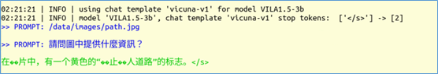
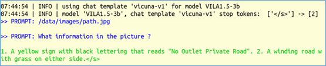
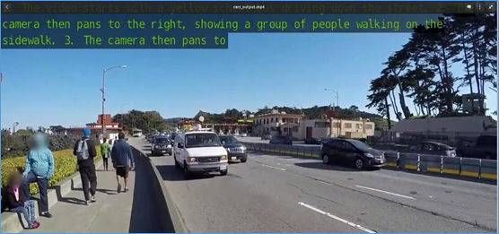
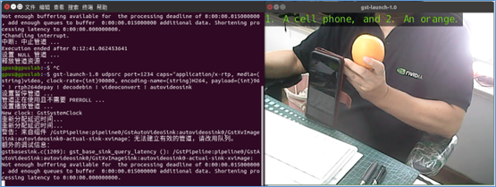

我們前面應用NanoLLM開發平台，已經很輕鬆地創造出語音對話助手、多模態識別等應用，本篇文章要更進一步調用NanoLLM的影片相關API，搭配合適的大語言模型，來對影片檔或攝影機獲取的內容進行動態分析功能。\
這裡我們將模型換成同樣支持多模態的Efficient-Large-Model/VILA1.5-3b，並且前後使用3個API來進行測試，大家可以相互比較一下，並且後續自行調整出最適合應用場景的內容。\
如果想用自己的USB攝影機進行測試，請在進入容器之前就先將攝影機插到設備上，然後再執行以下指令進入NanoLLM容器：

```bash
$ jetson-containers run $(autotag nano_llm) 
進入容器之後，可以先執行以下指令檢查是否檢測到攝影機：
$ ls /dev/video* 
```

如果有看到反應，就表示在容器內已經找到攝影機了。\
現在我們還是先從簡單的nano\_llm.chat聊天功能以及圖片/影片內容識別開始。這些需要提供兩個prompt給nano\_llm.chat，系統會從第一個prompt去分析所需要識別的檔案路徑，第二個提示詞才是我們所要問的問題。現在我們先嘗試用中文提示詞：

```bash
$ python3 -m nano_llm.chat  --api=mlc \
  --model Efficient-Large-Model/VILA1.5-3b \
  --prompt '/data/images/path.jpg' \
  --prompt '請問圖中提供什麼資訊？'
```

下面是 /data/images/path.jpg 的內容：


系統最終所提供的回應（不一定完全一樣）：



這裡可以看出，在終端模式下顯示中文的能力不完整，因此會出現亂碼。其次系統會識別我們prompt的語種，並用相同語種來做回應，還挺智能的。\
現在我們將第二個promt改成“What information in the picture ?”，跑出來的結果如下截屏，回答的非常正確：“1.黃色標誌，黑色字體，寫著“禁止出口私家路”。圖2：一條兩邊都是草的彎彎曲曲的路。”



如果我們要對影片進行分析的話，這裡的底層會用到專案作者早期的jetson-utils裡的videoSource與videoOutput兩組庫，輸入影片支持H264/H265編碼的MP4/MKV/AVI/FLV等格式，輸出部分還支持RTP/RTSP/WebRTC等網路影片協定，分別透過 `--video-input` 與 `--video-output` 兩個參數進行傳遞。

在nano\_llm.vision.video、nano\_llm.agents.video\_query這些工具裡面，都調用了這些庫。

現在使用nano\_llm.vision.video這個工具，簡單讀入影片並根據提示詞進行分析，再將分析結果嵌入影片中，然後輸出到指定影片中，我們就可以在輸出結果中查看結果。

請輸入以下指令試試看：

```bash
$ python3 -m nano_llm.vision.video \
    --model Efficient-Large-Model/VILA1.5-3b \
    --max-images 8 \
    --max-new-tokens 48 \
    --video-input /data/sample_720p.mp4 \
    --video-output /data/sample_output.mp4 \
    --prompt 'What changes occurred in the video?'
```

輸入的 `/data/sample_720p.mp4` 是一段在公路上拍攝的車流與行人影片，識別後的影片存放在 `/data/sample_output.mp4`。下圖是截取其中一張在影片上嵌入“提示詞回應”的截圖：



現在我們可以將 `--video-input` 參數指向 `/dev/video0` 去調用攝影機，但是輸出指向一個檔案時，由於應用的結束得用“Ctrl-C”去中斷，導致影片儲存不完整而無法打開，那我們就沒辦法去檢查執行的結果了。

推薦的辦法，就是查看攝影機結果時，將結果透過RTP協定輸出到指定電腦中，然後在電腦裡用 `gst-launch` 來接收結果。

現在我們在Jetson Orin的容器裡面執行以下指令：

```bash
$ python3 -m nano_llm.vision.video \
--model Efficient-Large-Model/VILA1.5-3b \
--max-images 8 \
--max-new-tokens 48 \
--video-input /dev/video0 \
--video-output rtp://<IP_OF_TARGET>:1234  \
--prompt 'What are in his hand?' 
```

開始執行之後，在目標的Linux電腦上執行以下指令：

```bash
$ gst-launch-1.0 udpsrc port=1234 \
caps="application/x-rtp, media=(string)video, \
clock-rate=(int)90000, encoding-name=(string)H264, payload=(int)96" \
! rtph264depay ! decodebin ! videoconvert ! autovideosink
```

然後就會在Linux電腦上看到以下的顯示：



這樣就能解決在攝影機裡進行即時識別的問題。
