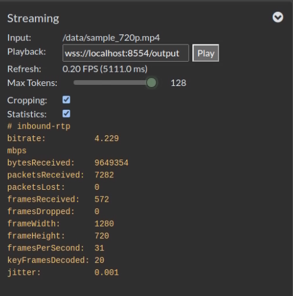
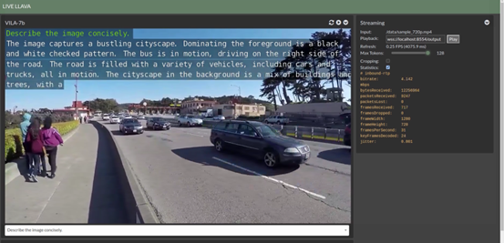
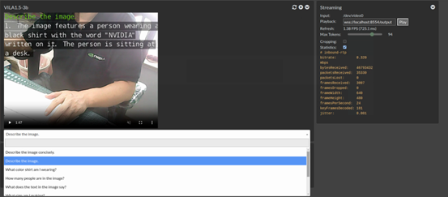
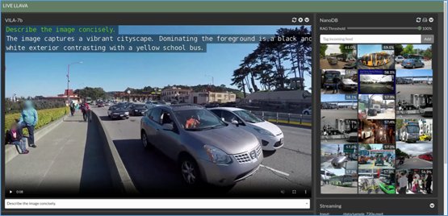
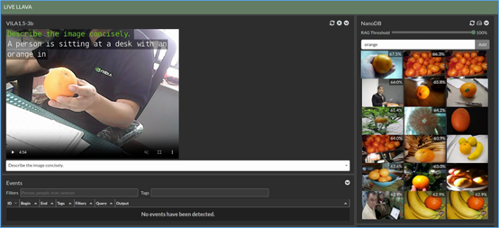

前面使用NanoLLM的vision.video功能來分析影片或攝影機畫面，是一種非常輕便的方法，但是互動性不足，主要是演示影片處理的能力。

為了讓大家更進一步感受到NanoLLM庫的強大，本文要使用一個集成多模態大模型並加上瀏覽器互動介面的nano\_llm.agents.video\_query智能體，不僅可以顯示輸入源的相關資訊，還能動態調整輸出token的數量，如下截圖的Max Tokens所示：



輸入源可以是以H264/H265編碼的多種格式檔，也支援攝影機輸入。輸出部分就直接將識別的內容在瀏覽器中的畫面上顯示，最後還能結合前面的nanodb資料庫專案，提供RAG檢索的功能，適用性非常之高。

目前nano\_llm.agents.video\_query智能體有兩個比較明顯不足的地方：

1. 不支援英文以外的文字顯示；
2. 未將語音識別與輸出的部分集成進去。

不過瑕不掩瑜，這個智能體還是能讓我們非常輕鬆地執行強大的功能。現在我們依舊使用Efficient-Large-Model/VILA1.5-3b多模態大模型來進行演示。首先還是要先執行以下指令，進入Nano\_LLM的容器中：

```bash
$ jetson-containers run $(autotag nano_llm)
```

然後在容器中執行以下命令，就能運行這項功能：

```bash
$ python3 -m nano_llm.agents.video_query --api=mlc \
    --model Efficient-Large-Model/VILA1.5-3b \
    --max-context-len 256 \
    --max-new-tokens 32 \
    --video-input /data/sample_720p.mp4 \
    --video-output webrtc://@:8554/output
```

前端推薦使用Google的Chrome瀏覽器，因為使用了WebRTC功能，開啟之前請關閉chrome://flags/#enable-webrtc-hide-local-ips-with-mdns選項，然後開啟瀏覽器輸入`https://127.0.0.1:8050`，就能看到下面的畫面：



除了右邊“Streaming”設定中可以調整“MaxTokens”值之外，在下方也有個下拉式的對話框，裡面提供9條預設的prompts可以直接選擇，當然我們也可以直接在框框裡面輸入自己的prompt進行互動。

如果我們將“`--video-input`”後面改成“/dev/video0”的話，就能將輸入源直接換成接在設備上的USB攝影機。完整指令如下：

```bash
$ python3 -m nano_llm.agents.video_query --api=mlc \
    --model Efficient-Large-Model/VILA1.5-3b \
    --max-context-len 256 \
    --max-new-tokens 32 \
    --video-input /dev/video0 \
    --video-output webrtc://@:8554/output
```

現在畫面就變成攝影機所抓取的內容。



但這樣就已經滿足了嗎？還不夠的，nano\_llm.agents.video\_query智能體還能集成前面nanodb的數據查找的功能，讓我們將能力擴展到與現有圖片進行比對，快速找出符合度高於要求的圖片。

例如，我們在前面的nanodb專案中，使用/data/my\_dataset/training2017數據集創建向量資料庫，存放在/data/my\_dataset/nanodb下的config.json、vectors.bin與metadata.json三個檔中，如果需要結合，只要在前面指令中添加最後一行即可，下面列出完整指令：

```bash
$ python3 -m nano_llm.agents.video_query --api=mlc \
    --model Efficient-Large-Model/VILA1.5-3b \
    --max-context-len 256 \
    --max-new-tokens 32 \
    --video-input /data/sample_720p.mp4 \
    --video-output webrtc://@:8554/output \
    --nanodb /data/my_dataset/nanodb 
```

專案執行之後，刷新瀏覽器，就能看到如下圖的內容：



現在右邊會根據我們提供的prompt，結合多模態大語言模型去識別出對應的描述，然後從nanodb中找出符合度夠高的圖片，顯示在右方欄位上，原本的“Streaming”功能就被擠到下面去了。

同樣的，如果我們將輸入源改成USB攝影機的話，完整指令如下：

```bash
$ python3 -m nano_llm.agents.video_query --api=mlc \
    --model Efficient-Large-Model/VILA1.5-3b \
    --max-context-len 256 \
    --max-new-tokens 32 \
    --video-input /dev/video0 \
    --video-output webrtc://@:8554/output \
    --nanodb /data/my_dataset/nanodb 
```

就能看到如下方截圖的內容：



如果在手上拿起一個橘子時，右邊跳動顯示的內容中也會出現水果類的圖片，不過這個顯示的跳動很快，也會出現其他描述內容相關的圖片。

如何，這個nano\_llm.agents.video\_query智能體很有意思吧！
