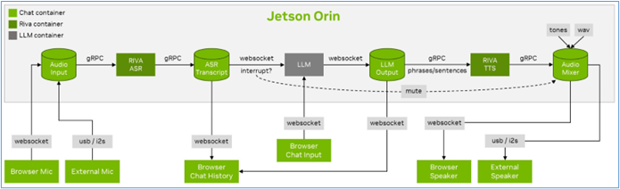
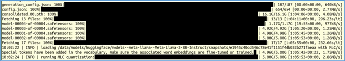
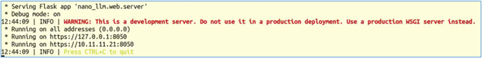
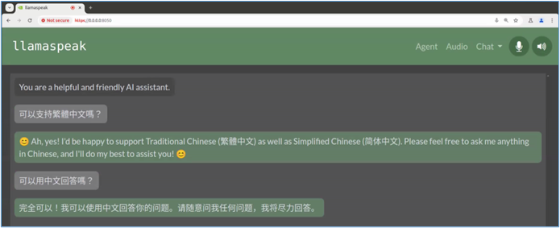

前面已經簡單介紹過在Jetson AI Lab所提供的NanoLLM開發平台上的API基本內容，使用這些API可以非常輕鬆地開發並整合比較複雜的應用，現在就用一個比較具有代表性的Llamaspeak對話機器人項目，做個簡單的比較。

這個項目的工作原理如下圖：



這個Llamaspeak項目在2023年提出第一個版本時，是以NVIDIA的RIVA語音技術結合Text-Generation-Webui界面與LLM大語言模型而成，整個安裝的過程是相當複雜的，主要包括以下步驟：

1. 安裝與啟動RIVA Client服務：完整的安裝與啟動教程在<https://github.com/dusty-nv/jetson-containers/tree/master/packages/audio/riva-client>裡面，包括需要在NVIDIA的NGC上進行註冊、下載執行腳本、修改配置文件、下載ASR與TTS所需要的模型，最後再進行啟動對應版本的容器；

2. 載入配套的Text-Generation-Webui所需要的LLM模型：參考的安裝程序在<https://github.com/dusty-nv/jetson-containers/tree/master/packages/llm/text-generation-webui>。

3. 啟動HTTPS/SSL：瀏覽器需要使用HTTPS才能訪問客戶端的麥克風，因此需要創建一個自簽名的SSL證書和密鑰，如下指令：

   ```bash
   $ cd /path/to/your/jetson-containers/data
   $ openssl req -x509 -newkey rsa:4096 -keyout key.pem -out cert.pem -sha256 -days 365 -nodes -subj '/CN=localhost'
   ```

4. 執行Llamaspeak容器：

   ```bash
   $ jetson-containers run --workdir=/opt/llamaspeak \
     --env SSL_CERT=/data/cert.pem \
     --env SSL_KEY=/data/key.pem \
     $(./autotag llamaspeak) \
     python3 chat.py --verbose
   ```

現在就可以打開瀏覽器，輸入指定位置與端口號，開始以用戶端（如筆記型電腦）的麥克風與這個應用開始交流。

事實上有經驗的工程師，可能都要花一整天時間，才有機會完成整個Llamaspeak系統的搭建，因為過程中需要獨立安裝的東西太多，並且模型之間的交互關係較為複雜，一般初學者要安裝成功的機會並不高。

現在使用NanoLLM開發環境重新搭建Llamaspeak應用，就變得非常簡單，而且在舊版只支持語言對話的功能之上，還增加了對多模態大語言模型的支持，這樣的使用性就變得非常高了。現在只要執行以下指令，就能實現Llamaspeak的功能，不過在執行之前，請記得先到huggingface.co去申請一個TOKEN：

```bash
$ jetson-containers run --env HUGGINGFACE_TOKEN=$HUGGINGFACE_TOKEN \
  --name llamaspeak --workdir /opt/NanoLLM $(autotag nano_llm)
$ python3 -m nano_llm.agents.web_chat --api=mlc \
    --model meta-llama/Meta-Llama-3-8B-Instruct --asr=riva --tts=piper
```

這裡使用Meta-Llama-3-8B-Instruct模型，執行純語言的對話。如果系統裡面沒有這個模型，就會從HuggingFace去下載，如下圖所示：



最後停留在下面畫面：



現在我們在瀏覽器裡輸入`https://127.0.0.1:8050`，就會進入操作界面：



這裡我們嘗試用文字輸入問題，雖然llama-3-8b-instruct模型能支持中文，但是在ASR與TTS兩端均未提供中文支持的能力，因此文字部分雖然可以用中文回答，但是語音輸出部分就沒辦法了。

如果想要支持中文的語音輸入識別與輸出的話，就需要修改以下兩個地方：

- 輸入的中文識別：修改`/opt/NanoLLM/nano_llm/plugins/speech/riva_asr.py`，將裡面的`language_code=`從`en-US`改成`zh-CN`
- 輸出的中文語音：修改`/opt/NanoLLM/nano_llm/plugins/speech/piper_tts.py`，將裡面的`en_US-libritts-high`模型（有兩處）改成`zh_CN-huayan-medium`模型。這裡可以選擇的中文模型，可以在`/data/models/piper/voices.json`裡找到，請用關鍵字`zh-CN`搜索，會找到`zh_CN-huayan-medium`與`zh_CN-huayan-x_low`兩組可用的中文語言

修改完這兩處之後，重新執行以下指令：

```bash
$ python3 -m nano_llm.agents.web_chat --api=mlc \
    --model meta-llama/Meta-Llama-3-8B-Instruct --asr=riva --tts=piper
```

現在試試從麥克風用中文與Llamaspeak交談，是否能如預期地識別出我們所說的話，並且以用中文語音回答呢？如果一切順利，你現在就能開始有一個博學多聞的對手，可以跟你天南地北聊天了。
