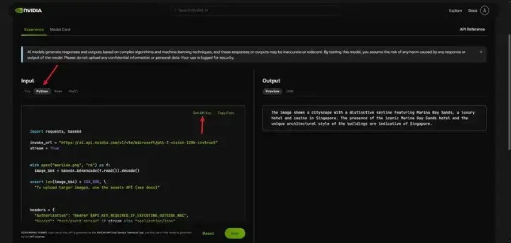
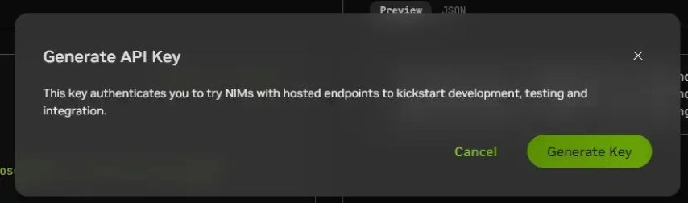
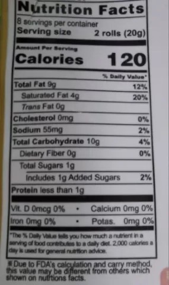

Phi-3-Vision-128K-Instruct 是一種輕量級、最先進的開放式多模態模型，它基於包括合成數據和經過篩選的公開網站在內的數據集構建，重點關注文本和視覺方面的高品質、推理密集型數據。模型屬於 Phi-3 模型系列，多模態版本可支援 128K 上下文長度（以 token 為單位）。該模型經過了嚴格的增強過程，結合了監督微調和直接偏好優化，以確保精確遵循指令和採取強大的安全措施。

對於那些需要同時處理圖像和文字的任務，Phi-3-vision則展現出其獨特的優勢。它特別適合光學字符辨識（OCR）任務，不僅能對提取的文本進行推理和問答，還能有效理解圖表、圖形和表格等內容。這種多模態的處理能力使得Phi-3-vision在多媒體內容分析領域具有廣泛的應用前景。

NVIDIA NIM API 是一種用於建置和部署自訂 AI 模型的 API,它旨在簡化模型訓練和部署的複雜性，使開發人員能夠專注於模型的設計和效能最佳化。 NIM 提供了一種簡單的方式來訓練和部署模型，以便在邊緣設備上進行推理。例如本教學的撰寫，是在 Nvidia Jetson NX 上進行的。

1. 前往 NVIDIA NIM Phi-3-vision 頁面。
2. 頁面右上角點選 "Login" 登入。
3. 點選 "Python" 選項卡，並點選 "Get API Key" 按鈕。



點擊 "Generate Key"，複製並儲存你的 API Key。



今天我們來做一個OCR辨識的小專案。我現在手上有一張圖片，上面是某食品包裝的營養成分錶。



我希望讓 Phi-3-vision 模型識別這張圖片，並將圖片上的表格轉換成 Markdown 格式的表格。

```python
import base64 # 用于编码图片import jsonimport os
import requestsfrom dotenv import load_dotenv
load_dotenv()TOKEN = os.getenv("TOKEN")
```

複製 NIM 頁面中的 Python 程式碼，並將其包裝成函數

```python
def invoke(prompt: str, image_b64: str, stream=True):
    invoke_url = "https://ai.api.nvidia.com/v1/vlm/microsoft/phi-3-vision-128k-instruct"
    
    # Ensure the size of the image is within the allowed limit
    assert len(image_b64) < 180_000, "To upload larger images, use the assets API (see docs)"
    
    headers = {
        "Authorization": f"Bearer {TOKEN}",
        "Accept": "text/event-stream" if stream else "application/json",
    }
    
    payload = {
        "messages": [
            {
                "role": "user",
                "content": f'{prompt} ',
            }
        ],
        "max_tokens": 512,
        "temperature": 1.00,
        "top_p": 0.70,
        "stream": stream,
    }
    
    response = requests.post(invoke_url, headers=headers, json=payload)
    
    if stream:
        for line in response.iter_lines():
            if line:
                data = json.loads(line.decode('utf-8')[6:])
                print(data["choices"][0]["delta"]["content"])
    else:
        print(response.json()["choices"][0]["message"]["content"])
```

我們需要將圖片讀進 Python，並轉換成 base64 編碼

```python
with open("nutrition_facts.jpg", "rb") as f:
    image_b64 = base64.b64encode(f.read()).decode()
```

呼叫 invoke 函數

```python
invoke("Help me organize the table in the picture into md format", image_b64, stream=False)
```

運行得到以下輸出：

```
| Nutrition Facts | |
|--------------------------------|---------------------|
| 8 servings per container | |
| Serving size | 2 rolls (20g) |
| **Amount Per Serving** | |
| Calories | 120 |
| **% Daily Value*** | |
| Total Fat | 9g |
| | 12% |
| Saturated Fat | 4g |
| | 20% |
| Trans Fat | 0g |
| Cholesterol | 0mg |
| | 0% |
| Sodium | 55mg |
| |
| Trans Fat | 0g |
| Cholesterol | 0mg |
| | 0% |
| Sodium | 55mg |
| | 2% |
| Total Carbohydrate | 10g |
| | 4% |
| Dietary Fiber | 0g |
| | 0% |
| Total Sugars | 1g |
| Includes 1g Added Sugars | |
| | 2% |
| Protein | less than 1g |
| Vit. D | 0mcg 0% |
| Calcium | 0mg 0% |
| Iron | 0mg 0% |
| Potas. | 0mg 0% |
*The % Daily Value tells you how much a nutrient in a serving of food > contributes to a daily diet. 2, 2,0 calories a day is used for general > nutration advice
```

使用英偉達 NIM 與微軟 Phi-3-vision 進行OCR識別的應用場景非常廣泛，它們可以大大提高自動化處理和資料提取的效率。以下是一些具體的應用情境：

- 文件自動化處理：在辦公室環境中，大量紙本文件需要轉換為數位格式以便進行儲存、搜尋和共享。使用NVIDIA NIM與Phi-3-vision進行OCR識別，可以快速且準確地將紙本文件（如合約、發票、報告等）轉換為可編輯的文字或Markdown格式，提高辦公室效率。
- 產品標籤識別：在零售和物流領域，產品標籤上通常包含重要的產品訊息，如名稱、生產日期、保質期、條碼等。透過OCR技術，這些標籤資訊可以快速且準確地提取出來，用於庫存管理、物流追蹤和產品追溯。- 財務資料處理：在處理財務報表、發票和收據等財務文件時，OCR技術可以自動識別和提取其中的關鍵信息，如金額、日期、客戶名稱等。這有助於加快數據處理速度，減少人為錯誤，並提高財務工作效率。
- 圖書資料數位化：圖書館和檔案館中儲存大量的紙本書和資料，這些資料需要數位化以便線上存取和保存。使用OCR技術可以自動辨識和轉換書籍和資料中的文字內容，實現圖書資料的快速數位化。
- 表單處理：在企業或政府部門中，經常需要處理各種表單（如申請表、問卷等）。使用OCR技術可以自動辨識表單中的文字和影像內容，轉換為可編輯的資料格式，方便後續的資料分析和處理。
- 自動化安全檢查：在安全檢查領域，如機場、車站等場所，需要識別旅客的身分證件、車票等資訊。透過OCR技術可以自動識別和提取這些信息，提高安全檢查的速度和準確性。
- 無障礙閱讀輔助：對於視力障礙人群，OCR技術可以將紙本書、雜誌等轉換為可聽的語音格式，幫助他們更方便地獲取資訊。同時，OCR技術也可用於製作電子書和網頁的無障礙版本，提高網站和應用程式的可用性。

這些只是使用英偉達 NIM 與微軟 Phi-3-vision 進行OCR識別的一些典型應用場景。隨著技術的不斷發展和應用場景的不斷拓展，OCR技術將在更多領域發揮重要作用。
