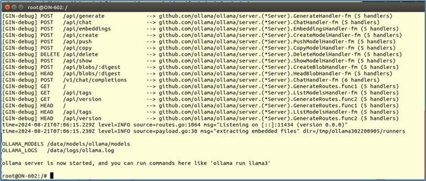
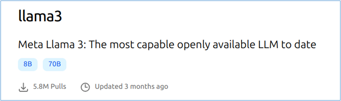
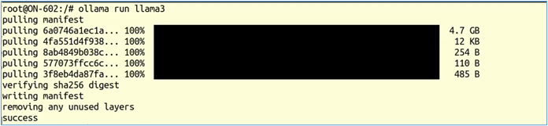
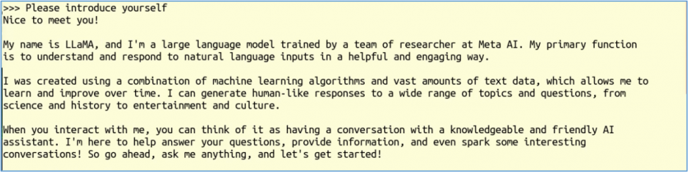
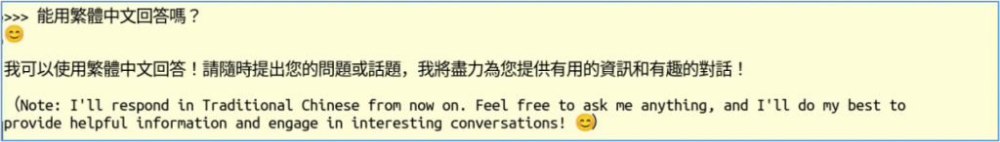
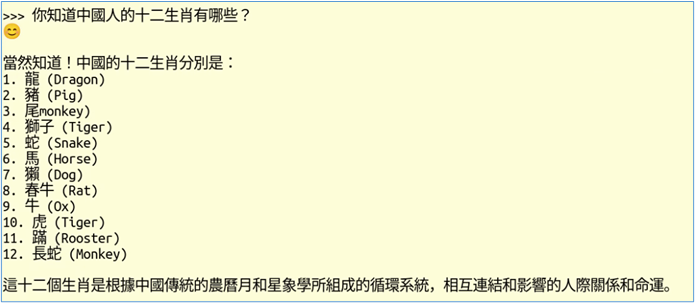
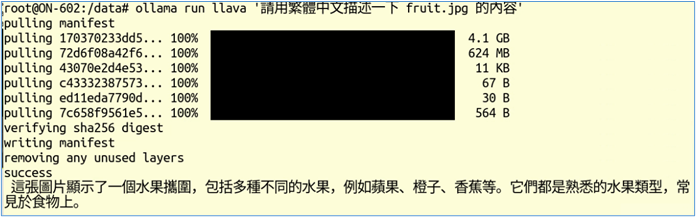
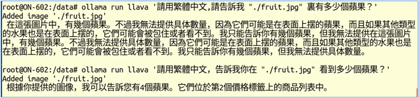

本系列第3期文章，在Jetson Orin Nano上使用text-generation-webui專案搭建智能助手，十分輕鬆。但是大部分入門者都會在「選擇模型」、「下載模型」以及選擇「加載器」這三部分，遭遇比較大的障礙，畢竟要在幾萬個開源模型中找到合適的，猶如大海撈針一般地困難，再加上Orin Nano只有8GB顯存的限制，能執行的大語言模型相當有限。

面對這樣的問題，使用Ollama這個模型管理器會是更有效率的方法，因為它單純使用llama.cpp這個效率較好的加載器，並且這個開發團隊為我們篩選了100個左右大語言模型，下載與執行模型的指令都非常簡單，將模型管理的問題交給Ollama處理，可以讓事情變得單純許多，對新手來說也是最容易上手的方法。

由於Ollama雖然提供支持ARM平臺的docker版本檔，但這個檔並不支持CUDA GPU，因此性能上會大打折扣，並且有出錯的現象。我們要在Jetson Orin Nano上執行的最好方法，就是用Jetson AI Lab為大家創建好的鏡像檔來執行，會非常順利並且高效。只要執行以下指令即可：

```bash
$ jetson-containers run $(autotag ollama)
```

下面是執行的結果。



現在已經進入Ollama容器內，接下去可以用「ollama run \<模型>」來執行。我們可以在<https://ollama.com/library>裏找到Ollama團隊挑選的大語言模型列表，我們可以根據「Featured（特色）」、「Most Popular（普及度）」、「Newest（最新的）」去進行排序。

每種模型可能還有不同的版本，例如Llama3是目前的主流版本，這裏收錄了8B、70B兩種參數規模的優化版本。



現在，請在容器內命令終端裏輸入以下指令：

```bash
$ ollama run llama3
```

模型後面沒有跟隨版本號（如「:70B」）的話，默認執行「latest」版本。如果在模型庫中沒有找到對應的版本時，就會從Ollama伺服器上下載到本地來執行。如下圖：



這對新手來說是最簡便的方法，完全不用去HuggingFace上面翻找，除非你清楚要用的模型在Ollama支持列表中找不到，那就得通過Ollama提供的方法將指定模型導入進來也可以，並不是太難。

現在已經進入「互動式指令」模式，我們可以開輸入提示詞，例如「Please introduce yourself」，與Llama3模型進行對話。



接著可以再試試用中文提示詞提問，如下圖：



這時Llama3用我們所要求的語言種類進行回應，下面還附帶著英語的原文，前後還各帶一個笑臉符號，可以感受到一點人性的氣息。

接著我再問一個所有華人都很清楚的「12生肖」問題，得到的答覆如下：



這裏的答案雖然並不完全正確，但是12個生肖裏面也中了11個（英文部分），除了重複兩次monkey與缺少rabbit之外，其餘10個都能完全對上，這對於一個國外訓練的大語言模型來說，還是很厲害的。

其餘語言類的模型，請參考<https://ollama.com/library/>裏所列的模型，自行進行體驗即可，沒有什麼難度。

在Ollama支持列表中，可以看到有5個支持「視覺（vision）」的模型，是否表示我們可以用Ollama來讀取圖片，並且分析圖片的內容呢？

答案是可以的！我們直接嘗試一個支持多模態的llava模型，並使用下面指令，用它來分析一張與水果相關的圖片，請llava用中文描述以下圖片的內容：

```bash
$ ollama run llava '請用繁體中文描述一下 fruit.jpg 的內容'
```



這裏的 fruit.jpg 是我們先複製到容器裏的一張圖片，其內容如下。我們看看llava模型的回答，雖然很簡單，但是也很正確，挑不出什麼毛病，因為我們給的提示詞也很簡單。

大語言模型所回覆的答案，與我們所提供的問題有很大關聯。例如我們想問大模型「在圖片中有多少個蘋果？」


下面是不同提示詞所得到不同答案的範例。



Ollama還提供Python、JavaScript等語言的介面，我們可以很輕鬆地使用這些語言撰寫調用Ollama執行的大語言模型，請參考<https://ollama.com/blog/vision-models>裏面所提供的一些範例代碼。
