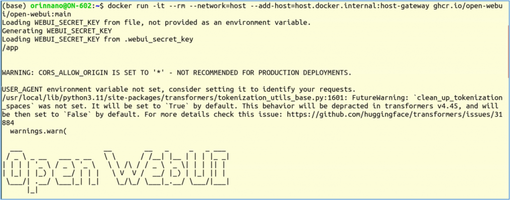
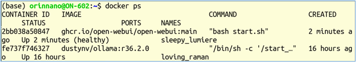
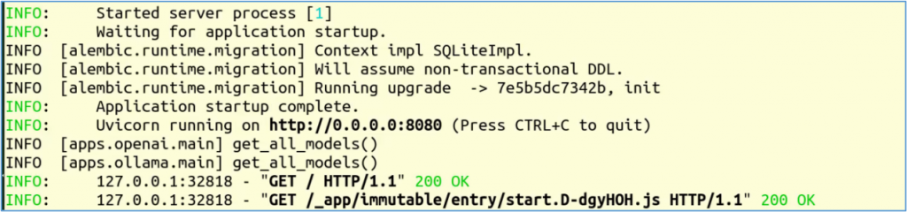
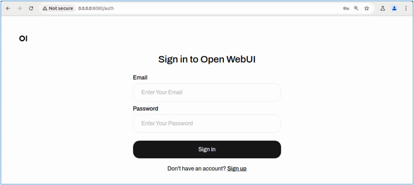
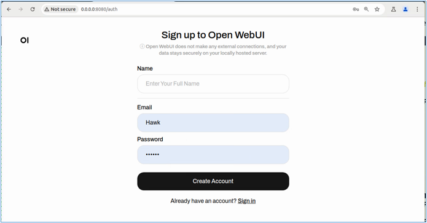
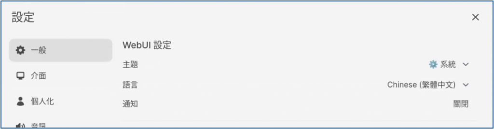
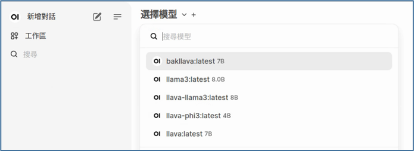
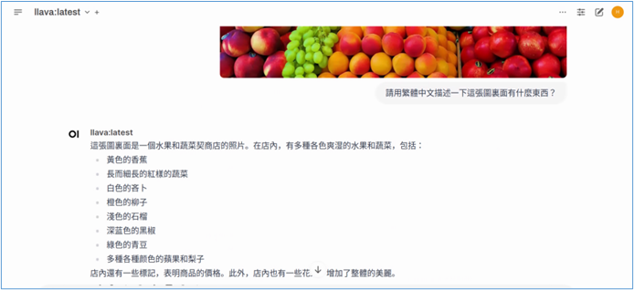

前面已經教會大家很輕鬆地使用 Ollama 搭建一個在指令終端的交互式智能助手，但這種操作模式畢竟比較粗糙，而且只能在一臺機器上使用，實用性並不高，如果能搭建一個Web界面的智能助手，並且可以讓局域網裏的其他人一起使用的話，就能大大提高這個項目的實用價值。

在<https://github.com/open-webui/open-webui> 這個項目與Ollama項目能搭配得天衣無縫，只要在前面ollama容器執行的狀況下（表示ollama server已啓動），然後執行以下指令，就能爲Ollama提供一個非常美觀的Web交互界面：

```bash
docker run -it --rm --network=host \
--add-host=host.docker.internal:host-gateway  ghcr.io/open-webui/open-webui:main
```

這裏要用到 ghcr.io/open-webui/open-webui:main 鏡像文件，如果系統裏面沒有這個鏡像文件，就會自動下載。開始執行的信息如下：



現在我們打開第3個終端，執行以下指令檢查目前啓動的容器：

```bash
docker ps 
```

應該要看到類型下面截屏的信息，目前已經有兩個正在執行的容器，分別由 ghcr.io/open-webui/open-webui 與 dustynv/ollama:r36.2.0 鏡像文件所生成，如果有缺少的話，後面的步驟就無法正常執行。



在open-webui容器執行的信息中，會看到一行“INFO: Uvicorn running on <http://0.0.0.0:8080> (Press CTRL+C to quit)”信息：



現在我們就以這個IP:\<端口號>格式，在瀏覽器中輸入”0.0.0.0:8080”後，就會出現以下畫面：



由於Open Webui具備管理功能，可以同時多人上線使用，因此用戶上線是需要第一次登錄時都需先註冊一個賬號，而系統第一個註冊的賬號就會設定爲管理員，因此我們需要先點擊下方“Sing up”去創建賬號，如下界面：



輸入完之後就會正式進入Open Webui操作界面，這時可以看到在右上方與賬號有關的圖標，點進去之後會有“Setting”選項，再進去之後就能看到如下圖的一些基本設定，這裏就能將界面改成中文顯示了，當然還有其他可以設定的地方。



回到主畫面之後，第一件事情就是在左上方選擇一個模型，然後才能正常使用以下的功能。這裏顯示的模型選項，就是 Ollama已經下載到本地的模型，可以非常輕鬆地在各種模型直接切換，這樣就很容易去測試各種不同模型的特色與效果。



Open Webui非常貼心地爲我們預設了七種類型的prompt，都是挺有代表性的，請自行多多嘗試與體驗。

另外，如果我們選擇llava這類的多模態模型時，還可以讓智能助手爲我們分析一下圖片裏面的信息。


例如我將上面這張fruit.jpg上傳給智能助手，然後詢問“請用繁體中文描述一下這張圖裏面有什麼東西？”



下面可以看到 llava 模型所回答的內容，雖然不一定完全正確，但是可以看得出這個多模態模型的能力，已經十分強大。

不過經過實際的實驗，在8GB的 Jetson Orin Nano上跑參數少的單純大語言模型還剩遊刃有餘的，但是要跑llava這類的多模態模型，就顯得非常吃力。因此在預算充裕的狀況下，選擇64GB的Jetson Orin能讓我們的體驗更加寬廣。

現在搭配Open Webui的Ollama智能助手已經建立好了，我們可以在另一臺機器上打開瀏覽器，然後輸入 \<IP\_OF\_OLLAMA>:8080 ，例如我們搭建Ollama + Open WebUI的Jetson Orin Nano機器的IP爲192.168.0.35，那麼我們可以在相同網段上的任何一臺有瀏覽器的機器上，輸入“192.168.0.35:8080”去登錄這個智能助手，這樣的實用價值是非常之高的！
