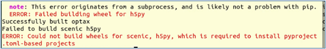
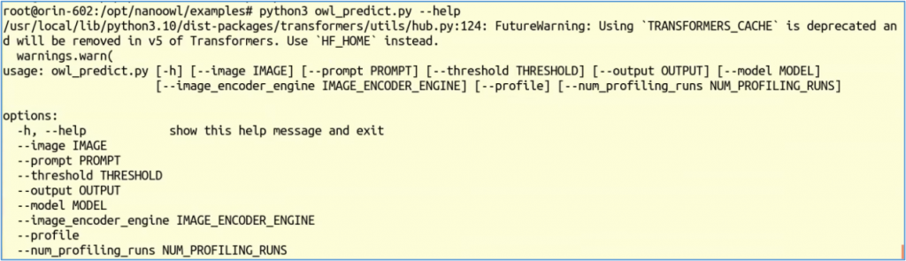
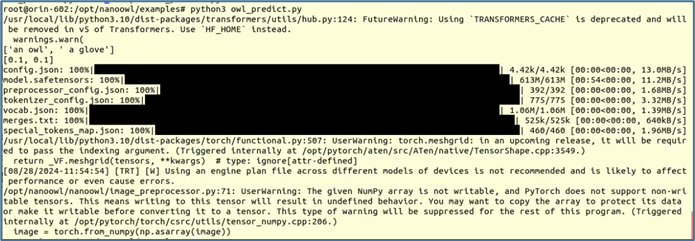
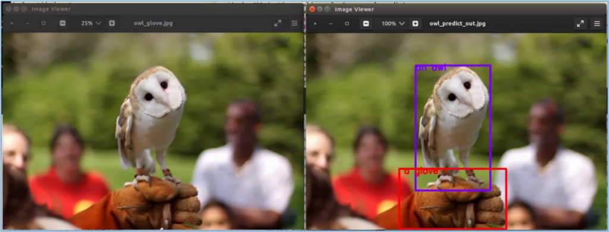
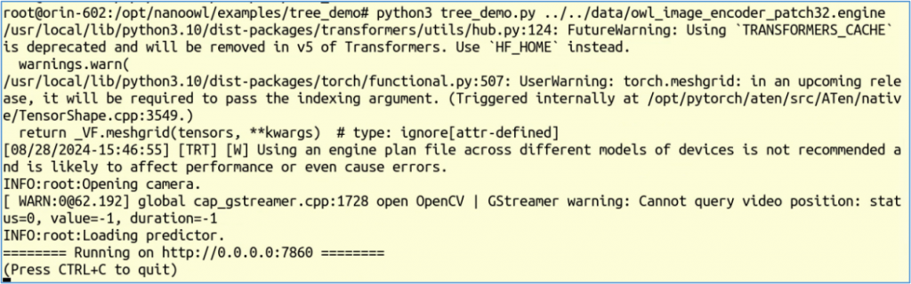
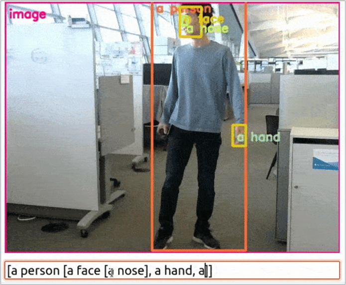

做過機器視覺模型訓練的人都知道，最耗時費力的階段，就是對圖片集進行標註的環節，這通常必須交由人力來進行，很難交給電腦去自動化標註，因此這個階段也是除了採購設備之外，成本最高的環節。

為了解決機器視覺領域的這個痛點，由Google實驗室的Matthias Minderer等人，提出了一種簡單而強大的OWL（Open-World Localization with Vision Transformers）方法，將影像級別的預訓練轉移到開放詞彙表目標偵測任務中。

使用標準的Vision Transformer架構，並對其進行了最小修改，透過對比影像-文本預訓練和端到端的目標偵測微調來實現，目標是為了實現“Zero Shot”的境界，其實就是要與YOLO的“One Shot”別苗頭。

不過總的來說，YOLO和OWL-ViT還是各有優勢的，適用於不同的應用場景。YOLO更側重於速度和即時性能，而OWL-ViT則在開放詞彙表和長尾分佈數據集上展現出更強的泛化能力，給定一個影像和一個自由文本查詢，它會在影像中找到與該查詢匹配的對象。它還可以進行一次性對象偵測，即基於單個示例影像偵測對象。

OWL-ViT是Google Research的Scenic專案之下的一個子專案，其開源倉位置在 <https://github.com/google-research/scenic/tree/main/scenic/projects/owl_vit> ，基於Python與JAX科學庫所搭建，開源倉所提供的安裝步驟依然很簡單，如下：

```bash
git clone https://github.com/google-research/scenic.git
cd ~/scenic
python -m pip install -vq .
python -m pip install -r scenic/projects/owl_vit/requirements.txt

# For GPU support:
pip install --upgrade "jax[cuda]" -f https://storage.googleapis.com/jax-releases/jax_cuda_releases.html
```

但實際的操作依舊是很難順利完成，總是出現如下圖的錯誤：



因此最簡單的方法，還是在Jetson Orin設備上使用Jetson AI Lab所提供的nanoowl映像檔來創建容器，這個容器不僅提供對CUDA的支持，並且也對TensorRT進行過優化。操作的指令如下：

```bash
$ jetson-container run --workdir /opt/nanoowl $(autotag nanoowl)
```

這裡使用“`--workdir` /opt/nanoowl”參數，就是將容器內的/opt/nanoowl設為指定的工作目錄，如果沒有添加這個參數，也可以進到容器之後再用“cd /opt/nanoowl”指令去切換。

現在我們先到examples裏，跑一跑最基本的`owl_predict.py`應用，先執行下面指令看一下所需要的參數：

```bash
$ cd examples 
$ python3 owl_predict.py --help
```

下圖是執行`--help`所顯示的輸出，裏面總共有8個可調用的參數。



上面每個參數都提供預設值，這也是一種很好的防呆措施。以下列出每個參數的用途與預設值：

- `--image`：圖片路徑，預設值 "../assets/owl\_glove\_small.jpg"
- `--prompt`：提示詞，預設值為 "\[an owl, a glove\]"
- `--threshold`：閾值，預設值為 "0.1,0.1"
- `--output`：輸出結果路徑，預設值 "../data/owl\_predict\_out.jpg"
- `--model`：使用的模型，預設值為 "google/owlvit-base-patch32"
- `--image_encoder_engine`：使用的圖片編碼引擎，預設值為"../data/owl\_image\_encoder\_patch32.engine"，這是用`build_image_encoder_engine.py`所訓練的模型。
- `--profile`：預設值為"store\_true"
- `--num_profiling_runs`：預設值為30

如果我們執行下面最簡單的指令，所有參數都用預設值：

```bash
$ python3 owl_predict.py
```

第一次執行時，會如下圖一樣先下載所需要的模型到本地使用。



一切就緒之後就會開始執行。下圖左原圖是"../assets/owl\_glove\_small.jpg"，根據提示詞"\[an owl, a glove\]"所執行的標識，圖右"../data/owl\_predict\_out.jpg"為輸出的結果。



如果覺得這種靜態圖片偵測不夠生動的話，我們可以執行`examples/tree_demo`下面的`tree_demo.py`程序，這是可以接上USB Camera直接對現場物體進行即時偵測的應用。如果先前啟動容器時還未連上USB Camera的話，請先跳出容器、連上USB Camera之後，再重新啟動容器，然後執行以下指令：

```bash
$ cd examples/tree_demo
$ python3 tree_demo.py ../../data/owl_image_encoder_patch32.engine
```

正確執行後會出現下面信息：



現在啟動瀏覽器，輸入“0.0.0.0:7860”後就會出現Camera畫面，下方出現可以互動的Prompt框，就可以在這里輸入多層提示語，然後看到畫面根據提示語找到目標。



如何？這個應用很酷吧，可以用在非常多實用的場景，動態地找出一些特定的物體，還可以根據需求隨時修改要定位的物種。
