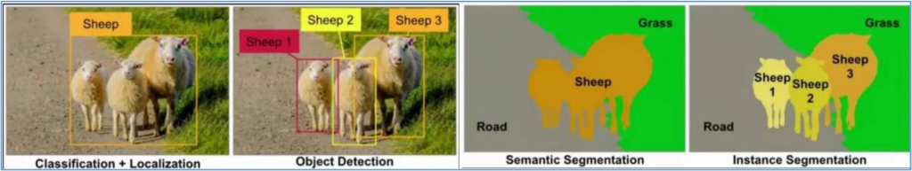
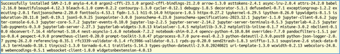
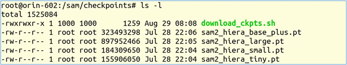
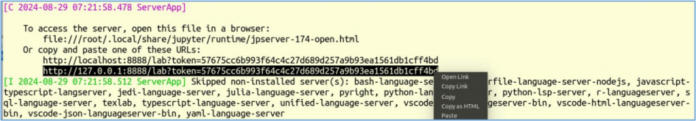
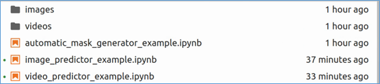

圖像分割（segmentation）是一項基礎的計算機視覺任務，通過將每個像素分配給一個類別或對象，將數字圖像分割成多個部分。傳統上，分割包括三個主要任務：

- 語義分割：將每個像素分配給預定義的語義類別標籤；
- 實例分割：進一步區分相同類別的實例；
- 全景分割：將語義分割和實例分割結合起來，全面理解場景。

下圖可以簡單說明機器視覺中四種常用識別的特性：



有經驗的人都很清楚這四種算法之間的差異與所需的對應算力之間的關係。事實上，在醫療、工程、航天、自動駕駛等很多使用價值高的應用場景中，對於分割技術的需求是非常明顯的。

例如人體器官從來都不是矩形，並且在人體中是相互疊加的，於是至少需要實例分割的技術才堪使用。同樣的，在航拍應用、無人駕駛、工程實施等應用，簡單的物體識別就顯得過於粗糙，實用價值非常有限。

見面文章中提到Google研究院所提出的ViT（Vision Transformers）技術，將機器視覺與大語言模型結合成多模態的應用，為機器視覺領域開創新的紀元，於是在這個基礎之上又發展出許多新的技術，其中Meta所開源的SAM（Segment Anything Model）模型，算得上是破局影響力的技術，目前已經發展到SAM2版本。

SAM 2可以識別視頻中的特定對象，並實時實現該對象的追蹤與提取，在視頻編輯與特效製作中，可以高效輔助工作。該模型也可以根據用戶具體訴求，選擇分割某個物體或某個區域，使控制更加精準。

與其他模型不同的是，SAM2擁有對不熟悉物體和圖像的零樣本泛化能力，無需額外訓練，只需單擊一幀視頻中的任何物體，即可實現對目標對象的實時追蹤，快速處理未來每一幀。除此以外，該模型還可以集成到更大的系統中，它善於從其他智能系統中獲取提示，使系統之間完成協作。例如，SAM2能夠在AR/VR穿戴式設備中選擇用戶注視對象，也可以讀取分割對象的邊界框提示，完成文本提示到視頻圖像分割的轉化。

現在我們就要在NVIDIA Jetson Orin上創建執行SAM2的應用環境。由於SAM2主要的依賴項為：

- python>=3.10
- torch>=2.3.1
- torchvision>=0.18.1

因此我們在Jetson Orin上選擇以dustynv/l4t-pytorch:r36.2.0版本的鏡像文件為基礎，來搭建SAM2的執行環境。由於項目還需要源代碼倉來協助環境安裝，因此我們還需要提前將代碼倉複製到本地來，並且使用“-v”參數來進行指定。第一階段的完整設定指令如下：

```bash
$ git clone https://github.com/facebookresearch/segment-anything-2.git
$ jetson-containers run -v ~/segment-anything-2:/sam2 $(autotag l4t-pytorch)
```

如果系統中還沒有dustynv/l4t-pytorch:r36.2.0鏡像的話，會自動下載。執行完進入容器之後再執行以下指令：

```bash
$ cd /sam2
$ pip install -e .
```

這個項目提供一套Jupyter Notebook的入門學習教程，推薦初學者可以先從這裡入手。要在容器裡創建這個學習環境，只要執行以下指令即可：

```bash
$ pip install -e “.[demo]”
```



為了要讓執行比較順暢，我們可以先執行以下指令，去下載所需要使用的模型：

```bash
$ cd checkpoints && ./download_ckpt.sh
```

如果不修改內容的話，會將SAM2所提供的4個不同規模的模型全部下載，最大的sam2\_hiera\_large.pt也不到900MB，全部下載完的內容如下：



現在我們就可以簡單執行下面指令，啟動Jupyter學習環境：

```bash
$ cd /sam2 && jupyter-lab --allow-root
```

啟動Jupyter服務器之後，最後面會出現如下圖的信息：



右鍵點擊上圖黑色標注的地方，選擇“Open Link”就會自動在瀏覽器中打開Jupyter環境，進入notebooks目錄之後，會看到如下圖裡的三個 .ipynb 文件：



現在就可以開始選擇從這裡體驗SAM2的操作，這三個ipynb的主要內容如下：

- `automatic_mask_generator_example.ipynb`：由於SAM 2可以有效地處理提示，因此可以通過在圖像上採樣大量提示來生成整個圖像的掩碼。這個範例展示了這項功能櫃，通過在圖像上的網格中採樣單點輸入提示來工作，SAM可以從每個提示中預測多個掩碼。然後，對掩模進行質量濾波，並使用非最大抑制進行重複數據消除。其他選項允許進一步提高掩模的質量和數量，例如對圖像的多個作物進行預測，或對掩模進行後處理以去除小的斷開區域和孔洞。
- `image_predictor_examples.ipynb`：根據指示所需對象的提示預測對象掩碼。該模型首先將圖像轉換為圖像嵌入，從而允許從提示中高效地生成高質量的掩模。為模型提供了一個簡單的接口用於提示模型，允許用戶首先使用set\_image方法設置圖像，該方法計算必要的圖像嵌入。然後，可以通過預測方法提供提示，以根據這些提示有效地預測掩碼。該模型可以將點和框提示以及之前預測迭代的掩碼作為輸入。
- `video_predictor_examples.ipynb`：本筆記本展示了如何使用SAM 2在視頻中進行交互式分割，涵蓋以下內容：
  - 在幀上添加點擊（或框）以獲取和細化掩碼（時空掩碼）
  - 在整個視頻中傳播點擊（或框）以獲取掩碼
  - 同時分割和跟蹤多個目標

現在就可以開始好好跟隨每個ipynb裡面所提供的指示，開始輕鬆學習SAM2有趣並且強大的功能。

由於SAM2的應用場景十分豐富，可以在官網<https://ai.meta.com/SAM2/>與開源倉<https://github.com/facebookresearch/segment-anything-2>找到更多應用項目以及配套資源。
