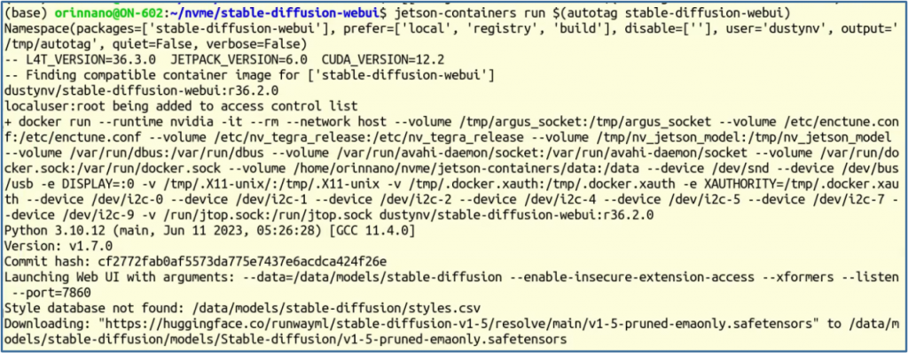
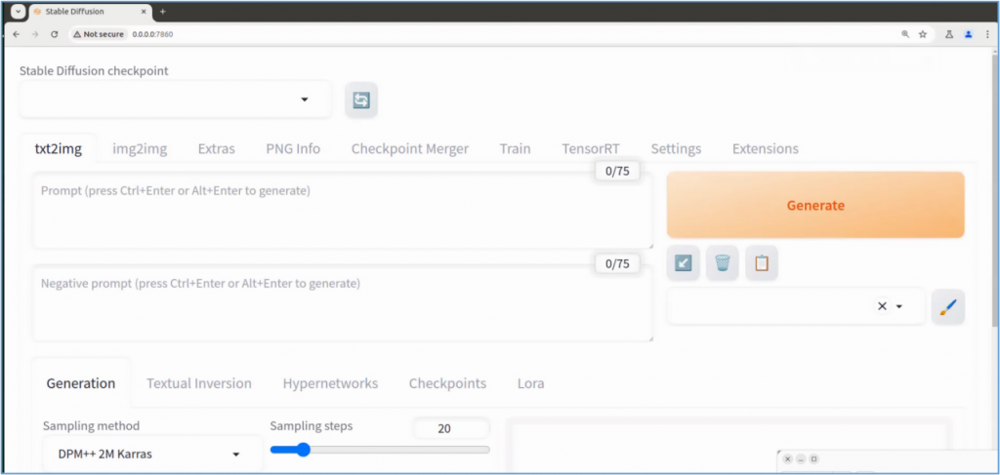
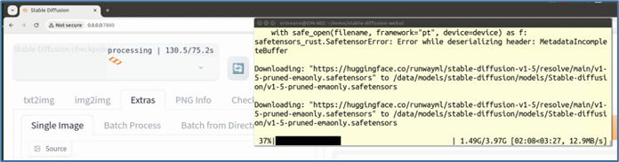
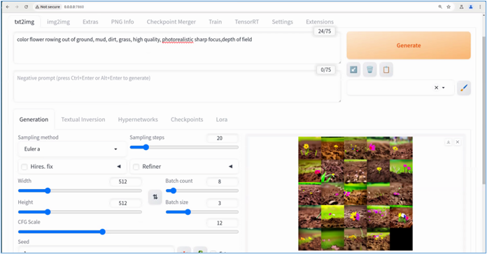

透過 prompt 提示詞來生成圖片，一直是生成式 AI 中最受歡迎的應用，而 Stable Diffusion 演算法應該是這方面開源專案中的翹楚。事實上這個 SDW 專案也是我們前一篇文字 TGW 的基石，目前在 GitHub 上已經獲得將近 14 萬個星以及超過 2.6 萬個 forks，受歡迎程度遠遠超過 TGW 專案。

本文主題的 SDW 則是 Stable-Diffusion-Webui 的縮寫，這個開源專案為 SD 演算法整合一個 web 界面，在 <https://github.com/AUTOMATIC1111/stable-diffusion-webui> 中發佈，讓我們可以在本地部署 Stable Diffusion 這項非常有趣的文生圖應用，只需要再搭配合適的模型即可。

在技術方面，SDW 專案是集成多項先進演算法於一身，主要包括（不限於）以下幾種：

- CompVis 的 stable-diffusion 專案；
- CompVis 的 taming-transformers 專案；
- sczhou 的 CodeFormer 專案；
- Salesforce 的 BLIP 專案；
- crowsonkb 的 k-diffusion 專案；
- TencentARC 的 GFPGAN 專案；
- 其他

安裝過程需要從 GitHub 上克隆上述幾個儲存庫到本地，以備後續啟動時進行調用。但是這些專案原本就處在高變動頻率階段，任何一個專案的修改都會影響 SDW 的安裝舒適度，難度是相當高的。

其次，這個專案是基於 PyTorch 框架進行計算與調用，對於 Python 版本以及依賴庫的版本都相當敏感，而在不同版本作業系統上，都需要有些細微處的調試，如果還混著使用 venv 或 conda 這類的虛擬環境的話，對電腦技能就有更大的挑戰。

原始的 SDW 專案並沒有提供 Docker 版本，只是對不同作業系統提供針對性的安裝腳本，在腳本中為我們去檢測不同環境所需要的不同配置，作者是煞費苦心地為我們提供貼心的設計，但是技術處於高速迭代的當下，這些腳本往往不能一路到底順利地安裝好 Stable Diffusion Webui 環境。

如今，在 Jetson-containers 開發環境中，我們已經有預處理好的 Docker 映像檔，只要簡單執行以下指令，就能輕鬆啟動 SDW 操作環境：

```bash
$ jetson-containers run $(autotag stable-diffusion-webui)
```



然後在瀏覽器中輸入「0.0.0.0:7860」後，就能看到以下操作畫面：



這樣是不是非常簡單？我們所需要耗費的時間，就是單純的下載映像檔的時間，如果帶寬好一些大概也就 10 分鐘就差不多了。

不過目前的狀態還不能真正執行，因為我們還沒有可以執行文生圖功能的模型，不過執行的程式碼中已經嵌入了下載。現在我們只要在 Web 界面左上角點擊「刷新」按鈕，就可以在命令終端裡看到開始下載指定的模型到指定路徑的工作，如下圖：



存放路徑為容器內的 `/data/models/stable-diffusion/models/Stable-diffusion/`，對應外部 `jetson-containers/data/models/stable-diffusion/models/stable-diffusion`，請自行到目錄下去看看，是否有個大小為 4.3GB 的 `v1-5-pruned-emaonly.safetensors` 模型檔案？如果有的話，我們就可以在 Jetson Orin Nano 上開始進行有趣的「AI 文生圖」應用了。

現在就可以在 Jetson 上開始使用 Stable-Diffusion-Webui 為我們生成想要的圖片，下圖是我們輸入提示詞「color follower rowing out of ground, mud, dirt, grass, high quality, photorealistic sharp focus, depth of field」的執行結果，讓它一次為我們生成 6 張圖片讓我們挑選，這是根據參數 Batch Count \* Batch Size 計算出來的。



剩下的工作，就需要讀者自行根據 SDW 專案所提供的使用手冊去進行體驗與測試，地址在 <https://github.com/AUTOMATIC1111/stable-diffusion-webui/wiki>，裡面的 Usage 與 Developers 兩部分，與大家的操作有比較直接的關係，從這裡開始進入應用會比較適合。

至於操作界面部分，可以根據 Usage -> User-Interface-Customizations 裡面的內容，調整 Web 操作界面的元素部署、顏色、預設值等等。
