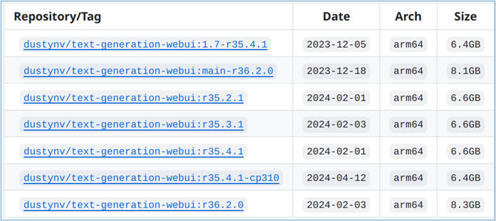
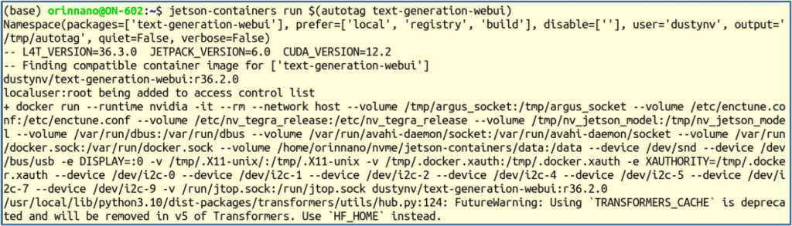
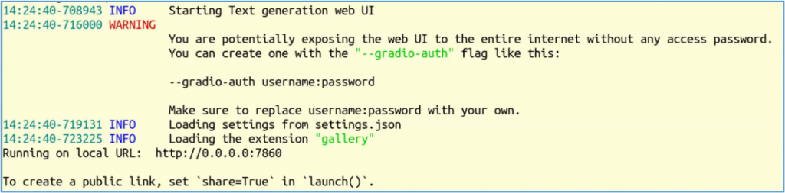
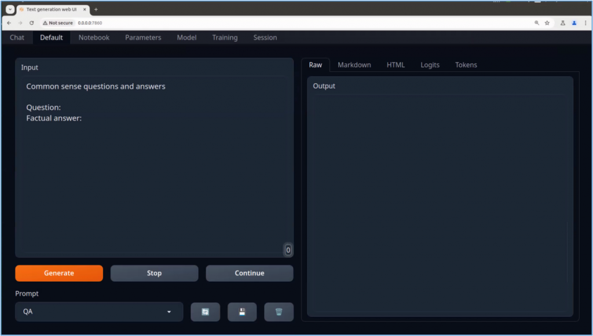
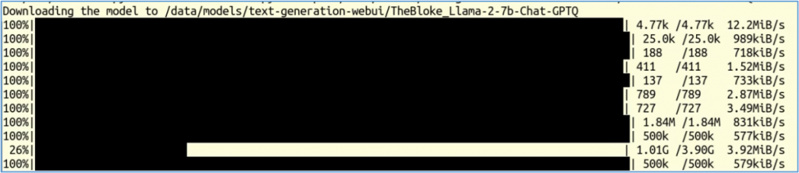
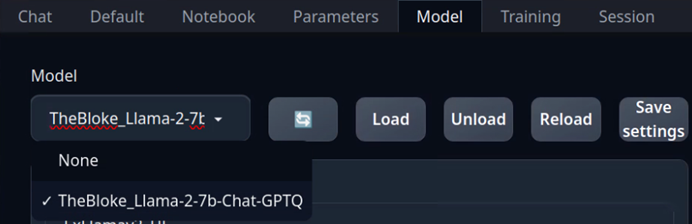

TGW是Text-Generation-Webui專案的縮寫，這是2023年隨著ChatGPT的火爆浪潮中，讓我們能搭配開源LLM模型，在本地建置可對話智能助手的專案，就不用整體擔心源頭單位的朝令夕改所產生的風險。

專案於2023年初在 <https://github.com/oobabooga/text-generation-webui> 開源之後，至今已有近4萬個星以及5000多個folks，是個十分非常熱門的專案，也被視為是學習自製本地化大模型對話智能助手類型專案的入門應用。

TGW專案的主要特性如下：

- 提供3種互動介面：兩列模式（預設）、筆記本模式和聊天模式。
- 多個模型後端：包括Transformers、llama.cpp（透過llama-cpp-python）、ExLlamaV2、AutoGPTQ、AutoAWQ、TensorRT LLM等。
- 下拉選單可以在不同模型之間快速切換。
- 大量擴充（內建和用戶貢獻），包括用於真實語音輸出的Coqui TTS、用於語音輸入、翻譯、多模式管道、向量資料庫、穩定擴散整合等的Whisper STT。
- 可以與自訂角色聊天。
- 精確的聊天模板，用於指令跟踪模型，包括Llama-2-chat、Alpaca、Vicuna、Mistral。
- LoRA：使用您自己的數據訓練新的LoRA，動態加載/卸載LoRA以進行生成。
- Transformers庫整合：透過bitsandbytes加載4位或8位精度的模型，使用llama.cpp和Transformers取樣器（llamacpp\_HF加載器），使用PyTorch進行32位精度的CPU推理。
- 與OpenAI相容的API伺服器，帶有聊天和完成端點。

事實上我們可以將TWG專案視為一套SDK開發包，因為專案還提供非常完整的使用說明，在<https://github.com/oobabooga/text-generation-webui/wiki/> ，包括非常豐富的參數列表（03‐Parameters Tab）、與模型相關的指令與參數列表（04-Model Tab）、與OpenAI對接的API接口與範例（12-OpenAI Tab），甚至還提供一套訓練LoRA模型的教程（05-Train Tab）。

更有甚者，TGW除了自己開發出一些強大的擴充（extensions）之外，還允許任何人根據他們所定義的規範，去開發自己的擴充件，然後還可以加入TGW的生態圈裡，這是相當有遠見與企圖心的做法，可以參考07-Extension這個章節的內容。只要能把TGW玩得熟練，就能在這個基礎上非常輕鬆地開發自己的有趣大模型應用。

由於TGW裡面包含太多內容，雖然在Github專案裡提供一些對應平台的安裝腳本，包括`start_linux.sh`，`start_macos.sh`，`start_windows.bat`，`start_wsl.bat` 等等，看起來是非常簡單，但實際執行時就會遇到非常多不可預期的坑，特別是受到網路約束或頻寬限制所帶來的困擾。

在我們前面建置的Jetson AI Lab的jetson-containers運行環境中，已經為我們創建好多個可以直接下載並執行的docker映像檔，如下圖所示：



現在執行以下最簡單的指令試試看：

```
$ jetson-containers run $(autotag text-generation-webui)
```

會看到以下一大串的訊息。如果您的設備還沒下載對應的映像檔，則會先行下載。



最後會停在下方畫面：



這裡看到出現 “`http://0.0.0.0:7860`” 就表示專案已經啟動，我們可以在本地瀏覽器中輸入 `http://0.0.0.0:7860`，就能進入TGW的操作畫面，如下圖：



這樣全部的操作時間就是映像檔下載時間，非常單純。

那現在已經可以開始讓TGW變成智能助手了嗎？還不行，因為我們尚未提供合適的大語言模型來預支匹配，這是下一步驟需要操作的部分。

現在我們再開啟一個命令視窗，執行以下指令去下載一個小一點的模型：

```
$ cd  <PATH>/jetson-containers
$ ./run.sh --workdir=/opt/text-generation-webui $(./autotag text-generation-webui) /bin/bash -c 'python3 download-model.py --output=/data/models/text-generation-webui TheBloke/Llama-2-7b-Chat-GPTQ'
```

這個指令會從 <https://huggingface.co> 裡找到 `TheBloke/Llama-2-7b-Chat-GPTQ` 模型，並且下載相關檔案，如下圖：



這些下載檔案會存放在與容器 `/data` 相映射的 `jetson-containers/data/` 下面，請再深入到 `models/text-generation-webui/TheBloke_Llama-2-7b-Chat-GPTQ` 裡面，然後與 <https://huggingface.co/TheBloke/Llama-2-7B-Chat-GPTQ/tree/main> 目錄下的內容進行比對，基本上是全部的都下載了。

當模型下載完成之後，回到瀏覽器介面中，在”Model”標籤裡的左上角選項中，點擊最左邊“刷新”功能，點擊下拉選單中就會看到我們剛剛下載的模型，如下圖所示：



選好模型之後，點擊旁邊的“Load”功能，中選擇“llama.cpp”，這是目前效能比較好的載入器即可，然後回到前面的 Chat、Default、Notebook等功能框裡，就能執行正常的TGW操作。

當然， Llama-2-7b-Chat-GPTQ 模型並沒有提供足夠的中文支持。如果需要進行非英文的對話，就請讀者自行到HuggingFace上，篩選並下載合適的模型，然後根據設備的計算資源去調配相關參數，然後找出最合適使用的模型。
