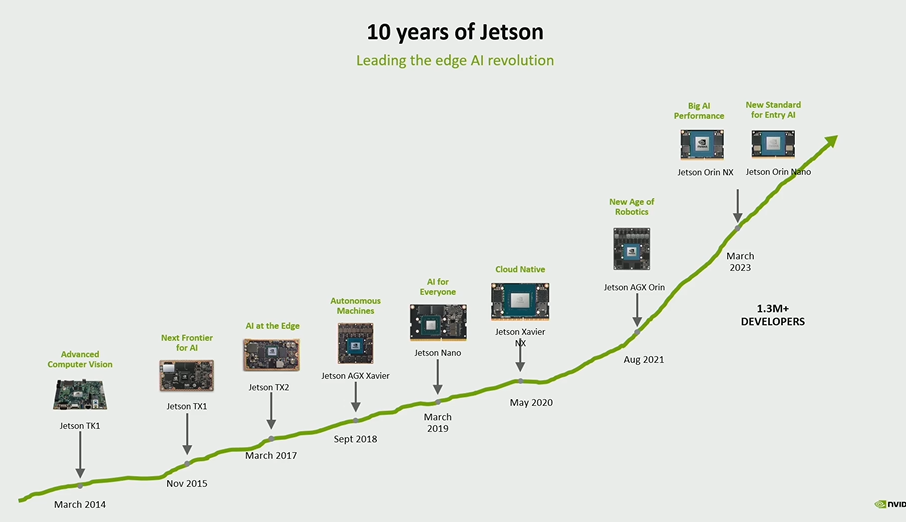
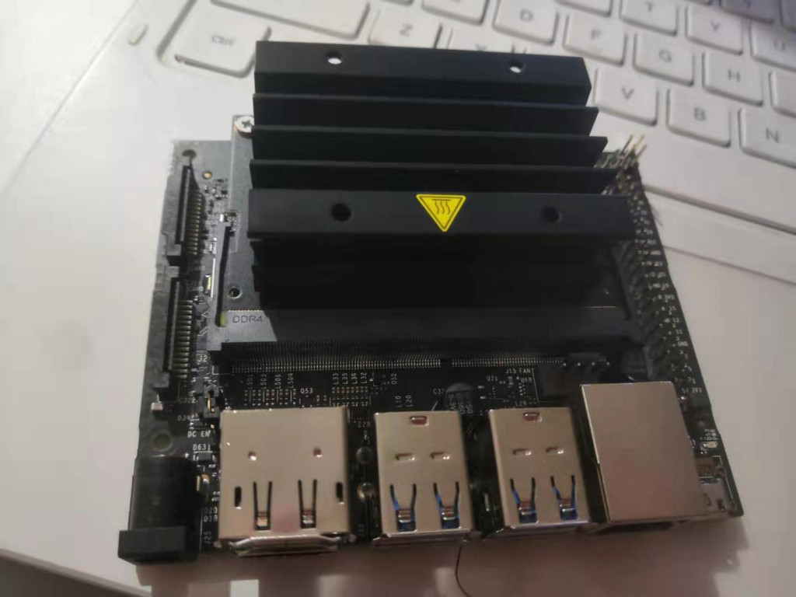
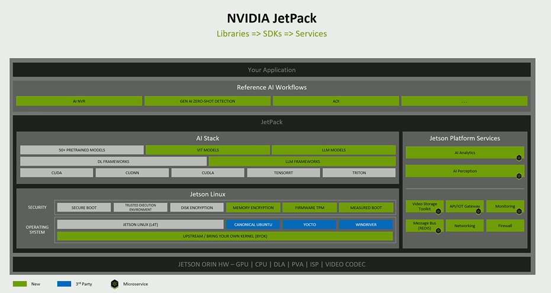
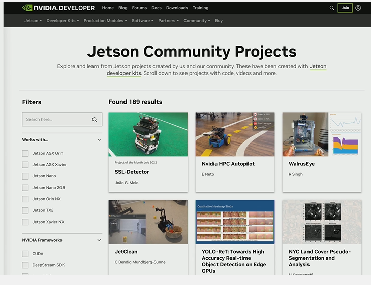

上一篇，我主要整理了邊緣計算以及人工智慧對未來科技發展的重要性。這一篇我要開始講述我個人在邊緣計算道路上的旅程，以及分享一些經驗，希望對有著與我同樣興趣的開發者提供一些參考，尤其是入門開發者。

在邊緣計算領域，選擇一款合適的開發設備是項目成功的關鍵。我第一次接觸邊緣計算是源自於我的爸爸有一塊NVIDIA Jetson NANO開發套件，他那個時候也正在入門人工智慧的開發，這無疑給我創造了先決條件，適逢當時就讀的學校說有一個青少年創客大賽，呼籲學生報名參加，於是我在爸爸的鼓勵下，與兩個同學一起報名了這次創客比賽。我跟我的同學商量用AI做垃圾分類——這在當時算是很熱門的一個應用。

那時我還剛剛開始自學Python程式設計，且我還只是一名國三學生。

我的邊緣人工智慧開發就此起步。

針對Jetson NANO開發套件的使用，NVIDIA官方提供了很多資料，尤其是NVIDIA DLI（深度學習培訓中心）有一個免費的線上課程是利用Jetson NANO開發套件入門深度學習。這個課程提供了詳細的實驗環境和程式碼，教大家識別手指方向。我們將這個程式碼修改，變成識別紙杯和易拉罐。也是透過這個課程，學習如何進行數據訓練。

所以我的AI開發之路也就此展開。從以後的幾年裡，NVIDIA的邊緣設備性能不斷升級，各種開發工具層出不窮，我對AI技術的了解也隨之不斷深入，一直伴隨我步入大學殿堂。\

以下是我選擇NVIDIA Jetson的幾大理由：

1. 高性能與低功耗的完美平衡

NVIDIA Jetson系列結合了高性能的GPU與高效的CPU，為邊緣計算應用提供了強大的計算能力。無論是進行複雜的圖像處理、視頻分析還是即時數據推理，Jetson都能輕鬆應對。更令人印象深刻的是，它在提供如此強大性能的同時，還能保持較低的功耗，這對於需要長時間運行且依賴電池供電的邊緣設備來說至關重要。

2. 強大的AI處理能力

作為NVIDIA的明星產品，Jetson自然繼承了NVIDIA在AI領域的深厚積累。它內建了TensorRT等優化工具，能夠顯著加速深度學習模型的推理速度，使得在邊緣設備上部署和運行AI應用變得更加高效。這意味著開發者可以快速地將AI演算法整合到產品中，實現智慧化升級。

我記得Jetson NANO開發套件剛出來的時候，大家最喜歡將樹莓派與它相比較。Jetson Nano最大的差異性是，它可以支持目前很流行的深度學習框架，在Jetson Nano上，使用者可以搭配NVIDIA TensorRT推理引擎、混合精度的優化，輕易地把推理性能再往上推升數倍。搭配NVIDIA其它工具，使用者可以非常輕鬆地將自己（或別人）訓練好的特定模型，輕鬆移植到Jetson Nano去執行專屬的應用，這有機會讓開發人員減少70%的研發時間。

不僅如此，Jetson NANO可以支持更多的攝影鏡頭，可以用於視頻智慧分析等場景，而利用NVIDIA Deepstream SDK可以很方便地實現這些應用，這些內容都會在本次系列裡提到。

3. 丰富的生态系统与开发工具

NVIDIA為Jetson提供了完善的生態系統支持，包括豐富的開發板、模組以及配套的軟體和工具。JetPack SDK是專為Jetson設計的一站式開發環境，它整合了CUDA、cuDNN、TensorRT等NVIDIA核心技術，並提供了易於使用的API和函式庫，極大地簡化了開發流程。此外，NVIDIA還與眾多合作夥伴建立了緊密的合作關係，共同推動邊緣計算應用的創新與發展。\

4. 广泛的应用场景

由於Jetson的高性能、低功耗以及強大的AI處理能力，它被廣泛應用於各種邊緣計算場景中。無論是智慧安防、智慧製造、智慧城市還是自動駕駛等領域，Jetson都能發揮出巨大的作用。例如，在智慧安防領域，Jetson可以即時分析監控視頻流，快速識別異常行為；在智慧製造領域，它可以用於生產線上的質量檢測與自動化控制等。

NVIDIA近幾年一直在大力發展Jetson社群，對於初學者來講，可以在Jetson社群裡獲得很多的幫助以及項目啟發，我覺得這是NVIDIA區別與其他大廠的一個很重要的地方——就是NVIDIA真的很重視生態的發展。

5. 靈活的配置與可擴展性

NVIDIA Jetson系列提供了多種型號供開發者選擇，從入門級的Nano到高端的Xavier NX和AGX Xavier等，覆蓋了不同的性能需求和預算範圍。這意味著開發者可以根據項目的實際需求選擇最適合的配置。同時，Jetson還支持通過模組化設計進行功能擴展，如增加攝影模組、通信模組等，以滿足更複雜的應用場景。

綜上所述，NVIDIA Jetson以其卓越的性能、強大的AI處理能力、豐富的生態系統支持以及廣泛的應用場景等優勢，成為了我選擇邊緣計算開發設備的首選。這也是本次活動，我選擇依托Jetson平台，來與大家一起探索更多創新應用的可能性，推動智慧化技術的普及與發展。
